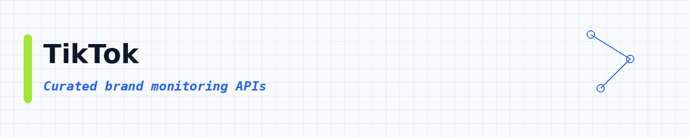
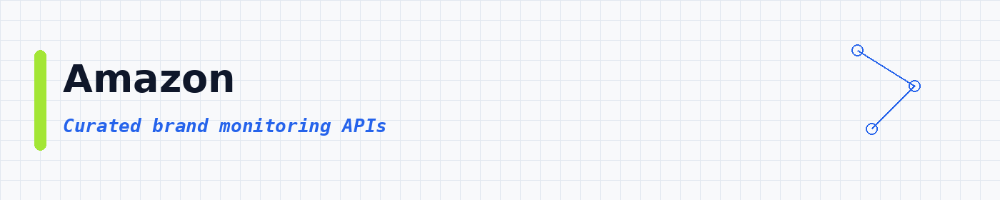
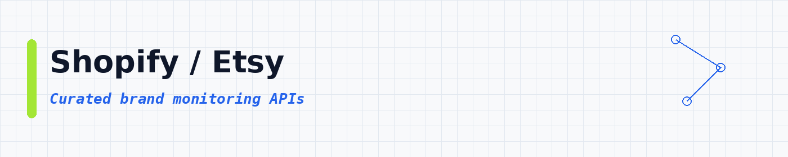
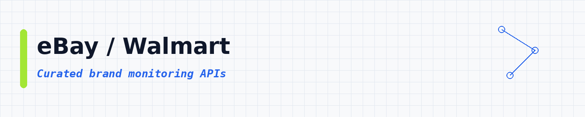
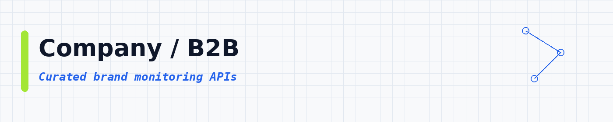

# Brand Monitoring APIs: Find Out What People Say About Any Brand

 

 
 
 

 <a href="#top-10-most-popular">Top 10</a> ·
 <a href="#table-of-contents">Categories</a>

Want to know what people say about a company online? These APIs do the looking for you. Give an API a brand name, and it brings back reviews, social posts, news and ads as a clean list. **8,052 ready-to-use APIs**, sorted by real users so the best ones come first.

These brand monitoring APIs help you track brand mentions, monitor online reviews, watch competitor ads and measure brand reputation. Use them for social listening, review scraping (Trustpilot, G2, Google Reviews, Yelp), Reddit and news monitoring, Facebook and Instagram ad library research, and AI search visibility tracking. Each API runs in the cloud, returns JSON, CSV or Excel, and works with Python, JavaScript, n8n, Zapier and Make.

---

## Collection statistics

| Metric | Count |
|--------|-------|
| **Brand Monitoring APIs** | **8,052** |
| **Categories** | **18** |
| **Last updated** | 2026-11-02 |

---

## What is a brand monitoring API?

A brand monitoring API is a tool you call to see what people say about a brand. Things like reviews, social mentions, ads and news. You give it a brand name, domain or page. It gives you clean rows you can save as CSV or JSON.

People also call this a reputation API, a mention scraper or a social listening API. Same idea: watch your brand without reading every site by hand.

---

## What can you build?

These **8,052 ready-to-use brand monitoring APIs** help you pull reputation data into your own apps. You can:

- Collect reviews from major review sites
- Watch social mentions and comments
- Pull ad creatives and public ad libraries
- Scan news for brand name hits
- Compare rival brands side by side
- Alert on sudden rating changes
- Export clean CSV or JSON for dashboards

Pick an API below, open it, try a small run, then export the results.

---

## ⭐ Star This Repository

If this API list helped you, please give it a star! ⭐

Your support helps other people discover this resource and keeps the list updated and growing.

---

## Table of contents

- [Reviews / Brand](#reviews-brand) : **2,935**
- [SEO / SERP](#seo-serp) : **1,379**
- [AI / Agents / MCP](#ai-agents-mcp) : **715**
- [Google / Maps](#google-maps) : **628**
- [Instagram](#instagram) : **388**
- [Facebook / Meta](#facebook-meta) : **331**
- [Email / Phone](#email-phone) : **322**
- [TikTok](#tiktok) : **239**
- [Amazon](#amazon) : **205**
- [LinkedIn](#linkedin) : **184**
- [News / Content](#news-content) : **161**
- [Other / General](#other-general) : **133**
- [X / Twitter](#x-twitter) : **105**
- [Jobs / Recruiting](#jobs-recruiting) : **104**
- [Shopify / Etsy](#shopify-etsy) : **72**
- [eBay / Walmart](#ebay-walmart) : **67**
- [Real Estate](#real-estate) : **62**
- [Company / B2B](#company-b2b) : **22**

---

## Top 10 most popular

| API | What it does | Users | Rating | Price |
|-----|-------------|-------|--------|-------|
| [Google Search Results Scraper](https://apify.com/apify/google-search-scraper?fpr=data) | Scrape Google Search Engine Results Pages (SERPs). Select the country or language and extract organic and paid results, AI Mode, AI overvie… | 224.8K | 4.65 | Pay per event |
| [Instagram Reel Scraper](https://apify.com/apify/instagram-reel-scraper?fpr=data) | Scrape or download Instagram reels. Just add Instagram profile or reel URL, and get caption, timestamp, transcript, hashtags, mentions, tag… | 182.6K | 4.39 | Pay per event |
| [Instagram Post Scraper](https://apify.com/apify/instagram-post-scraper?fpr=data) | Scrape Instagram posts. Just add one or more Instagram usernames and get your data in seconds including caption, metrics, images, mentions,… | 151.7K | 4.26 | Pay per event |
| [Reddit Scraper \| Enterprise Grade](https://apify.com/fatihtahta/reddit-scraper-search-fast?fpr=data) | Extract Reddit posts and full comment threads from searches, subreddits, user pages, and direct post URLs. Built for enterprise-grade speed… | 78.0K | 4.10 | Pay per event |
| [Facebook Ad Library Scraper](https://apify.com/curious_coder/facebook-ads-library-scraper?fpr=data) | Scrape ads from facebook ads library search results and facebook pages. Cost: $0.75 per 1K ads | 49.6K | 4.80 | Pay per event |
| [Facebook Ads Library Scraper](https://apify.com/apify/facebook-ads-scraper?fpr=data) | Extract advertising data from Facebook, Instagram, WhatsApp, Threads. Get ads, publishers, prices, reach estimates, impressions, links, ima… | 49.3K | 3.99 | Pay per event |
| [Traffic Generator (Youtube, Web, Etsy, Behance and many more!)](https://apify.com/epctex/traffic-generator?fpr=data) | Maximize your website's performance and visibility with our Traffic Generator. Drive targeted traffic, simulate page views, and stress-test… | 45.4K | 4.25 | Pay per event |
| [Facebook Posts Search](https://apify.com/scraper_one/facebook-posts-search?fpr=data) | ✨ Search for Facebook posts using keywords or hashtags. Retrieve post URLs, content, publication dates, author details, and engagement metr… | 25.3K | 4.22 | Pay per event |
| [Facebook Search Scraper](https://apify.com/silentflow/facebook-search-scraper?fpr=data) | Search Facebook by keyword and export posts, pages, places, events and people as clean structured data. Get text, author, reactions breakdo… | 23.7K | n/a | Pay per event |
| [Facebook Search Scraper](https://apify.com/igview-owner/facebook-old-posts-search?fpr=data) | Search Facebook posts in seconds. Find viral posts, photos and videos by keyword, date range and engagement: perfect for research, content… | 13.8K | 4.83 | Pay per event |

---

## Reviews / Brand

**2,935 APIs in this category** | [View all →](lists/reviews-brand.md)

| API | What it does | Users | Rating | Price |
|-----|-------------|-------|--------|-------|
| [Reddit Scraper \| Enterprise Grade](https://apify.com/fatihtahta/reddit-scraper-search-fast?fpr=data) | Extract Reddit posts and full comment threads from searches, subreddits, user pages, and direct post URLs. Built for enterprise-grade speed… | 78.0K | 4.10 | Pay per event |
| [Xiaohongshu Comments Scraper: Reply Threads (RedNote)](https://apify.com/zen-studio/rednote-comments-scraper?fpr=data) | Extract every Xiaohongshu (RedNote) comment with nested reply threads, author profile, avatar URL, IP city, like counts, attached pictures,… | 9.7K | n/a | Pay per event |
| [Trustpilot Reviews Scraper](https://apify.com/automation-lab/trustpilot?fpr=data) | Extract Trustpilot reviews with ratings, replies, reviewer info, and company data. Tiered per-review pricing applies, plus a $0.005 run sta… | 3.6K | 5.00 | Pay per event |
| [Trustpilot reviews scraper](https://apify.com/casper11515/trustpilot-reviews-scraper?fpr=data) | Easily filter and extract thousands of reviews with data such as title, description, score, reviewer, country, company response, and much m… | 3.1K | 4.06 | Pay per event |
| [Google Ads Transparency Center Scraper & API](https://apify.com/scrapesage/google-ads-transparency-scraper?fpr=data) | Scrape ads from the Google Ads Transparency Center by brand, domain or advertiser. Get creatives, dates, days active and per-country reach.… | 3.0K | 5.00 | Pay per event |
| [🔥 Trustpilot reviews scraper](https://apify.com/nikita-sviridenko/trustpilot-reviews-scraper?fpr=data) | ✅ FREE to use ✅ Easily filter and extract thousands of reviews with data such as title, description, score, reviewer, country, company resp… | 2.1K | 3.96 | Free |
| [G2 Reviews & Products Scraper](https://apify.com/automation-lab/g2-scraper?fpr=data) | Scrape G2.com reviews, ratings, and product data. Extract NPS scores, reviewer sentiment, ease-of-use ratings, switching data, and product… | 1.1K | 5.00 | Pay per event |
| [Shopee Product Detail Scraper: Full Data, Stock & Reviews](https://apify.com/zen-studio/shopee-product-detail-scraper?fpr=data) | Scrape full Shopee product detail by URL: live price, discount, per-variant stock, units sold, ratings, specifications, brand, and category… | 919 | 5.00 | Pay per event |
| [Sherlock Username Recon](https://apify.com/datacach/userrecon?fpr=data) | Scan 400+ social networks for any username in minutes. Returns confirmed profile URLs with platform categories and metadata. Built for OSIN… | 897 | 5.00 | Pay per event |
| [Trustpilot Review Scraper: Ratings, Replies & Filters](https://apify.com/zen-studio/trustpilot-review-scraper?fpr=data) | Scrape Trustpilot reviews for any business. Get ratings, review text, reviewer details, company replies, and verification status. Filter by… | 808 | 5.00 | Pay per event |
| [Trustpilot Reviews Scraper](https://apify.com/getwally.net/trustpilot-reviews-scraper?fpr=data) | Import customer reviews from Trustpilot. Get review headline, text, rating, avatar, name, date, and URL. Download the data in JSON, CSV, an… | 746 | n/a | Pay per event |
| [Trustpilot Reviews Scraper [💰$0.25]: All Reviews, No 200 Cap](https://apify.com/blackfalcondata/trustpilot-reviews-scraper?fpr=data) | 💰 $0.25 per 1,000 reviews. Scrape the full Trustpilot review history of any company, past the 200-review public limit: ratings & owner repl… | 686 | 5.00 | Pay per event |
| [Threads User Posts Scraper](https://apify.com/apibox/threads-user-posts-scraper?fpr=data) | Extract User Posts from Threads, including captions, media, tags, mentions, and metrics such as likes, comments, and quotes. Easily collect… | 671 | 2.35 | Free |
| [Fast Trustpilot Reviews Scraper API \| TrustScores & Reviews](https://apify.com/theagents/trustpilot-reviews?fpr=data) | Lightning-fast Trustpilot Reviews Scraper that extracts 100-200 reviews per second at just $0.50 per 1K reviews. Features custom mapping, s… | 656 | 5.00 | Pay per event |
| [All-in-One Review Scraper: G2, Capterra & Trustpilot](https://apify.com/zen-studio/software-review-scraper?fpr=data) | Scrape reviews from G2, Capterra, TrustRadius, Gartner, and Trustpilot in one run. Just type a product name or domain. Get unified ratings,… | 551 | 4.00 | Pay per event |
| [🔥Vinted Scraper](https://apify.com/bebity/vinted-premium-actor?fpr=data) | 🚀 Vinted Data Scraper: Fast & Robust! 🔥 🛒 Items and catalogs 👥 User profiles with stats and balances 🏷️ Brands 🌟 Seamlessly integrate with… | 535 | 2.92 | Pay per event |
| [Website Logo Finder: Extract Logos from Any URL](https://apify.com/coder_luffy/website-logo-finder?fpr=data) | Easily find and extract logos from any website URL. This tool helps you instantly get brand logos for websites: perfect for marketing, rese… | 530 | 4.70 | Pay per event |
| [Fragrantica.com Scraper](https://apify.com/lexis-solutions/fragrantica?fpr=data) | Scrape fragrance data from Fragrantica: including perfume names, brands, notes, ratings, reviews, and images. Ideal for market research, ca… | 457 | 5.00 | Pay per event |
| [Trustpilot](https://apify.com/canadesk/trustpilot?fpr=data) | Collect Trustpilot reviews, ratings, reviewer details and business replies across websites. | 452 | 3.31 | Pay per event |
| [🕰️ Chrono24 Listings Scraper [From 💰$0.80/1K]](https://apify.com/misterkhan/chrono24-search-scraper?fpr=data) | Export luxury watch listings from Chrono24: zero proxy config required. Auto-paginates brand, model, and filtered search URLs at 60 listing… | 449 | n/a | Pay per event |
| [Meesho Reviews Scraper 🛍️](https://apify.com/easyapi/meesho-reviews-scraper?fpr=data) | Extract detailed product reviews from Meesho.com, including ratings, comments, review images, and author information. Perfect for market re… | 433 | 5.00 | Pay per event |
| [Yandex Market Scraper (Парсер Яндекс Маркет) - Product Data](https://apify.com/zen-studio/yandex-market-scraper-parser?fpr=data) | Парсер Яндекс Маркет: extract product data from Russia's largest marketplace. Prices, ratings, reviews, specs, seller info, images, and sto… | 425 | 5.00 | Pay per event |
| [Pinterest Scraper: Pins, Boards, Profiles, Search & Comments](https://apify.com/memo23/pinterest-scraper?fpr=data) | Pinterest Scraper: pull pins, boards, profiles, search results and ideas hubs in one API. Get images, video, descriptions, links, engagemen… | 411 | 5.00 | Pay per event |
| [Shopee Scraper: Product Data, Prices & Discounts, 11 Markets](https://apify.com/lergassy/shopee-scraper?fpr=data) | Shopee scraper and Shopee API alternative for product data from all 11 marketplaces: price, original price, discount, rating, shop name and… | 396 | 5.00 | Pay per event |
| [Trustpilot Reviews Scraper API \| $0.50/1K Reviews](https://apify.com/thewolves/trustpilot-reviews-scraper?fpr=data) | The Wolves proudly introduces the Trustpilot Review Scraper, an ideal tool for extracting reviews. It can gather 100-200 reviews per second… | 392 | 2.43 | Pay per event |
| [Unlimited Trustpilot Reviews Scraper](https://apify.com/saswave/unlimited-trustpilot-reviews-scraper?fpr=data) | $0.2 / 1000 results in 20 seconds, no proxies. Trustpilot reviews scraper handles requests at scale for faster output return and results. U… | 385 | 5.00 | Pay per event |
| [Reddit Comments Search Scraper](https://apify.com/easyapi/reddit-comments-search-scraper?fpr=data) | Search and extract Reddit comments with advanced filtering options. Get detailed metadata including comment content, author info, post cont… | 357 | 5.00 | Pay per event |
| [Meesho Product Search Scraper](https://apify.com/ecomscrape/meesho-product-search-scraper?fpr=data) | The Meesho.com Product Search Scraper extracts detailed product data from Meesho.com, including name, brand, description, price, rating sco… | 354 | n/a | Free |
| [👽 Reddit Scraper: Posts, Comments & Subreddits](https://apify.com/renzomacar/reddit-scraper?fpr=data) | Scrape Reddit posts, comments & full threads with built-in sentiment scoring: no login, no API key, no rate limits. Pull titles, authors, s… | 334 | n/a | Pay per event |
| [Threads User Posts Scraper](https://apify.com/futurizerush/threads-user-posts-scraper?fpr=data) | Collect public Threads posts from user profiles without login. Save post text, media URLs, engagement metrics, public view counts when avai… | 329 | 5.00 | Pay per event |
| [All Review Sites Scraper: G2, Capterra, Trustpilot & More](https://apify.com/focused_vanguard/multi-platform-reviews-scraper?fpr=data) | Scrape reviews from MULTIPLE platforms at once! Enter a domain and get reviews from G2, Capterra, Trustpilot, Gartner, Software Advice, and… | 320 | 5.00 | Pay per event |
| [Farfetch Scraper](https://apify.com/autofacts/farfetch?fpr=data) | Scrape Farfetch luxury fashion: current and sale prices, designer, sizes, colours, stock status, images and every variant. Works on categor… | 317 | 5.00 | Pay per event |
| [Telegram Post Scraper · Media downloader, stats & metadata](https://apify.com/arachnetix/tg-post-stats?fpr=data) | Paste any public Telegram-message URLs: the API will pull text, hashtags, mentions, full reaction stats, photos, voice messages and short v… | 308 | n/a | Pay per event |
| [Reddit Comments Scraper](https://apify.com/easyapi/reddit-comments-scraper?fpr=data) | Extract Reddit comments with their complete thread structure, including nested replies, user information, and engagement metrics. Perfect f… | 288 | 5.00 | Pay per event |
| [Fast Yelp Reviews Scraper API \| Extract Review Text & Ratings](https://apify.com/theagents/yelp-reviews?fpr=data) | Transform Yelp reviews into actionable insights with our high-performance scraper. Access detailed customer feedback, ratings, and reviewer… | 283 | 4.63 | Pay per event |
| [Vinted Scraper: Search, Items, Prices & Profiles](https://apify.com/scrape.badger/vinted-scraper?fpr=data) | Scrape Vinted listings, item details, user profiles, and catalog data across 26 European markets. Filter by brand, price, color, condition.… | 280 | n/a | Pay per event |
| [Trustpilot Company & Transparency Scraper](https://apify.com/saswave/trustpilot-company-infos?fpr=data) | Trustpilot scraper collect data from the review and transparency page. Allows you to search a list of domain names on trustpilot and get th… | 279 | 5.00 | Pay per event |
| [Meesho Product Details Scraper](https://apify.com/ecomscrape/meesho-product-details-page-scraper?fpr=data) | The Meesho.com Product Details Scraper extracts detailed product data from Meesho.com, including name, brand, price, rating, image URLs, et… | 276 | 3.37 | Free |
| [Woolworths Scraper: Grocery Products & Prices](https://apify.com/scrapesage/woolworths-scraper?fpr=data) | Scrape Woolworths Australia groceries: name, brand, price, was-price, specials, unit price, categories, nutrition, allergens, ingredients,… | 270 | n/a | Pay per event |
| [Flipkart Reviews Scraper ⭐](https://apify.com/shahidirfan/flipkart-reviews-scraper?fpr=data) | Instantly extract detailed product reviews, ratings, and customer feedback from Flipkart. Perfect for sentiment analysis, market research,… | 254 | 5.00 | Pay per event |

[View all 2,935 in this section →](lists/reviews-brand.md)

## SEO / SERP

**1,379 APIs in this category** | [View all →](lists/seo-serp.md)

| API | What it does | Users | Rating | Price |
|-----|-------------|-------|--------|-------|
| [Weibo Scraper](https://apify.com/sian.agency/weibo-scraper?fpr=data) | Weibo scraper: extract Weibo posts, user profiles, fans, followers, and keyword search results from Sina Weibo. KOL discovery, social graph… | 6.6K | n/a | Pay per event |
| [Ahrefs All-in-One SEO Scraper: DR, Backlinks, Keywords](https://apify.com/pro100chok/ahrefs-seo-tools?fpr=data) | Extract all SEO data from Ahrefs in one API: Domain Rating, backlinks, keyword research (20 engines incl. ChatGPT/Gemini/Perplexity), SERP… | 5.6K | 3.55 | Pay per event |
| [Reddit Scraper: Lead Finder, Brand Monitor, Mentions & Alerts](https://apify.com/harshmaur/reddit-scraper-pro?fpr=data) | Find leads and track brand mentions on Reddit. Monitor buying-intent phrases like "is there a tool", competitor names and keywords, flag re… | 3.9K | 4.88 | Pay per event |
| [JD Products Scraper \| JD.com Prices, Brands and Barcodes](https://apify.com/silentflow/jd-products-scraper?fpr=data) | JD.com (京东) products scraper: search 京东商品 by keyword, shop page or SKU id and get the real CNY price, brand, model, UPC barcode, shop, revi… | 3.8K | n/a | Pay per event |
| [Google News Scraper](https://apify.com/lhotanova/google-news-scraper?fpr=data) | Scrape Google News by keyword, topic or date range, past the 100-result limit. Get headlines, sources, dates, real publisher URLs and image… | 3.5K | 4.59 | Pay per event |
| [Weibo Scraper: Hot Search, Posts, Comments & Creator Feeds](https://apify.com/zhorex/weibo-scraper?fpr=data) | Sina Weibo (微博) scraper API, no login: keyword search, trending posts, hot-search board (微博热搜), comments, user profiles and post details, p… | 2.5K | 1.00 | Pay per event |
| [Reddit Search Scraper: Keyword Monitoring \| $0.99/1K](https://apify.com/clearpath/reddit-search-scraper?fpr=data) | Search Reddit posts and comments by keyword and monitor brand mentions on a schedule, for $0.99 per 1,000 results. Boolean operators, exact… | 1.9K | 1.00 | Pay per event |
| [Shopee Product Scraper: Live Stock & Prices](https://apify.com/zen-studio/shopee-product-scraper?fpr=data) | Scrape Shopee products by keyword or URL across all 8 markets. Get live stock, price, discount, units sold, rating, and shop data, plus opt… | 1.2K | n/a | Pay per event |
| [ChatGPT Search Scraper](https://apify.com/apify/chatgpt-search-scraper?fpr=data) | Scrape ChatGPT Search results at scale without an API. Extract AI-generated answers, cited sources, URLs, and follow-up questions for any q… | 728 | 3.72 | Pay per event |
| [Storeleads Scraper](https://apify.com/saswave/storeleads-scraper?fpr=data) | Storeleads scraper. Extract companies results from a search url. Get data about social network, name, monthly sales, visits, location, prod… | 721 | 4.98 | Pay per event |
| [Naver Shopping Product Scraper](https://apify.com/delicious_zebu/naver-shopping-product-scraper?fpr=data) | Scrape Naver Shopping search results by keyword: product name, price and discount, seller and brand-store flag, shipping fee, rating, revie… | 491 | 4.99 | Pay per event |
| [Lazada Scraper](https://apify.com/dtrungtin/lazada-scraper?fpr=data) | Unofficial Lazada API to extract data from Lazada based on keywords or categories. Scrape prices, product descriptions, images, location, a… | 444 | n/a | Pay per event |
| [Reddit Scraper](https://apify.com/apify/reddit-scraper?fpr=data) | Scrape Reddit posts, comments, communities, and user profiles without a login or API key. Search any subreddit or keyword to see what peopl… | 377 | 5.00 | Pay per event |
| [Coupang Scraper: Products, Prices & 20+ Fields](https://apify.com/abotapi/coupang-scraper?fpr=data) | Scrape Coupang.com products by keyword, category or URL. Extract 20+ fields including title, brand, price, discount, ratings, reviews, avai… | 359 | 5.00 | Pay per event |
| [Reddit Search Scraper: Keyword & Brand Monitoring ($1.5/1k)](https://apify.com/harshmaur/reddit-search-scraper?fpr=data) | Search Reddit by keyword and scrape every matching post, comment, and subreddit. Monitor brand mentions, track topics, and find leads with… | 302 | 5.00 | Pay per event |
| [Threads Scraper API: Posts, Profiles & Search](https://apify.com/webdata_labs/threads-scraper?fpr=data) | [$3.00 / 1K] Scrape public Meta Threads posts, profiles, keyword search results, engagement metrics, media, hashtags, mentions, and timesta… | 299 | 5.00 | Pay per event |
| [Shein Scraper](https://apify.com/axlymxp/Shein-scraper?fpr=data) | Scrape SHEIN products by keyword or category: price in local currency and USD, discount, rating, review count, stock flag, bestseller badge… | 293 | 4.00 | Pay per event |
| [MOZ Scraper](https://apify.com/radeance/moz-scraper?fpr=data) | Extract enterprise-grade MOZ SEO insights including authority score (DA & PA), spam score, backlink history, ranking keywords, competitors… | 285 | 5.00 | Pay per event |
| [ALDI Australia Scraper](https://apify.com/solidcode/aldi-com-au-scraper?fpr=data) | [💰 $2.5 / 1K] Extract product and pricing data from ALDI Australia (aldi.com.au). Search by keyword or paste category and product URLs to c… | 282 | n/a | Pay per event |
| [Ahrefs Scraper DR, Backlinks, Keywords, Traffic & AI Visibility](https://apify.com/memo23/ahrefs-scraper?fpr=data) | Profile any domain across every source in one call: Ahrefs Domain Rating & backlinks, organic traffic, AI-search visibility (ChatGPT/Gemini… | 257 | 5.00 | Pay per event |
| [Naver Place Reviews + Blog: Korean Review Scraper](https://apify.com/huggable_quote/naver-place-reviews-scraper?fpr=data) | Extract visitor reviews, ratings, keywords and visit details from Naver Place. Supports place URL and ID input. Korean sentiment analysis r… | 212 | n/a | Pay per event |
| [Reddit Scraper Pro](https://apify.com/webdatalabs/reddit-scraper-pro?fpr=data) | Reddit scraper for automation workflows. Track keywords across Reddit or inside chosen communities, monitor subreddits, score posts with AF… | 205 | 5.00 | Pay per event |
| [Vinted Scraper](https://apify.com/automation-lab/vinted-scraper?fpr=data) | Scrape Vinted secondhand fashion listings by keyword. Get prices, brands, sizes, conditions, seller info, and images across 16 European mar… | 198 | n/a | Pay per event |
| [Shopee Scraper [From $0.28] Search, Ratings, Sales & Shops](https://apify.com/memo23/shopee-scraper?fpr=data) | Shopee scraper from $0.28 per 1,000 products: keywords, shops, categories and product URLs in all 11 Shopee markets, sorted by top sales, n… | 190 | n/a | Pay per event |
| [SE Ranking Scraper](https://apify.com/radeance/seranking-scraper?fpr=data) | Extract SEO data from SE Ranking including domain authority, AI citations, brand visibility, keyword cpc, displayed advertisers, organic &… | 188 | 5.00 | Pay per event |
| [Sitemap Detector](https://apify.com/coder_zoro/sitemap-detector?fpr=data) | Find sitemap URLs fast with our free Sitemap Finder tool. Instantly detect sitemaps from any website for SEO audits, indexing checks, and c… | 182 | 5.00 | Pay per event |
| [Threads Search Scraper](https://apify.com/parsebird/threads-search-scraper?fpr=data) | Scrape public Threads search posts by keyword or hashtag. Extract post text, authors, engagement metrics, media URLs, hashtags, mentions. E… | 171 | n/a | Pay per event |
| [Pinterest Scraper: Pins, Boards, Search, Images & Video](https://apify.com/dltik/pinterest-scraper?fpr=data) | Scrape Pinterest pins (image + video) by keyword search, board, profile or related pins. Get saves, comments, dominant color, images, video… | 170 | 5.00 | Pay per event |
| [RedNote Xiaohongshu (小红书) Scraper ✅ NO COOKIES](https://apify.com/atomus/xiaohongshu-scraper?fpr=data) | Turn RedNote (Xiaohongshu / 小红书) into clean JSON: notes, comments, profiles, products, trends and PGY influencer analytics, by keyword or U… | 168 | 5.00 | Pay per event |
| [Hacker News Search: Stories, Comments & Developer Sentiment](https://apify.com/ryanclinton/hackernews-search?fpr=data) | Search and extract stories, comments, polls, Show HN, and Ask HN posts from Hacker News. This API uses the Algolia HN Search API to find co… | 167 | n/a | Pay per event |
| [RedNote (Xiaohongshu) Scraper: Reliable & Pay-Per-Result](https://apify.com/actorzlab/rednote-scraper?fpr=data) | Scrape RedNote (Xiaohongshu / 小红书): search notes by keyword, get user posts, fetch note details, and retrieve user profiles. Powered by the… | 165 | n/a | Pay per event |
| [Mercado Libre Scraper: Products, Sellers & Sales](https://apify.com/ultramarine_freezer/MeLi?fpr=data) | Scrape Mercado Libre and Mercado Livre in all 18 Latin American countries. Search by keyword or paste product, category or store URLs and g… | 158 | n/a | Pay per event |
| [Zepto Product Scraper: Prices, MRP, Stock by Location](https://apify.com/memo23/zepto-product-scraper?fpr=data) | Scrape Zepto product listings for any delivery location in India: name, brand, price, MRP, discount, pack size, stock, rating and image. Se… | 150 | n/a | Pay per event |
| [Google News Scraper, Real Time Alerts](https://apify.com/george.the.developer/google-news-monitor?fpr=data) | Google News scraper for brand mentions, competitor coverage, and industry trends across any topic or keyword. Get real time alerts with ful… | 148 | n/a | Pay per event |
| [Google Rank Checker](https://apify.com/caprolok/google-rank-checker?fpr=data) | Maximize your SEO impact with Google Rank Checker. Effortlessly monitor keyword rankings, analyze competitors, and tailor your strategy for… | 139 | n/a | Free |
| [Wildberries Scraper: Prices, Specs, Reviews \| Парсер WB](https://apify.com/zen-studio/wildberries-scraper?fpr=data) | Scrape Wildberries products by keyword, category, seller, or brand. Get live prices, stock, full specifications, ratings, top reviews, and… | 138 | n/a | Pay per event |
| [Threads Search Scraper: Keywords, Hashtags, Accounts](https://apify.com/lergassy/threads-search-scraper?fpr=data) | Search Meta Threads by keyword or hashtag and get every public post as a row: text, author, time, likes, replies, reposts, images, videos,… | 133 | 5.00 | Pay per event |
| [LLMs.txt Generator](https://apify.com/onescales/the-llms-txt-generator?fpr=data) | The most powerful LLMs.txt Generator tool online. Generates LLMs.txt, llms-full.txt and markdown.md files within seconds! Get your website… | 129 | 5.00 | Pay per event |
| [Mercari Japan Scraper \| Listings, Prices & Sold Items](https://apify.com/piotrv1001/mercari-listings-scraper?fpr=data) | Scrape Mercari Japan listings, prices and sold items by keyword, pasted search URL or seller. Photos, brand, condition, seller or shop, wit… | 129 | n/a | Pay per event |
| [Poshmark Sold Listings Scraper](https://apify.com/caffein.dev/poshmark-sold-listings?fpr=data) | Scrape real Poshmark sold listings before you list or buy. Filter by keyword, brand, department, and price range. Returns confirmed sales w… | 129 | 5.00 | Pay per event |

[View all 1,379 in this section →](lists/seo-serp.md)

## AI / Agents / MCP

**715 APIs in this category** | [View all →](lists/ai-agents-mcp.md)

| API | What it does | Users | Rating | Price |
|-----|-------------|-------|--------|-------|
| [Trustpilot All Reviews Scraper 💰$0.65+ · No Cap · AI Insights](https://apify.com/memo23/trustpilot-scraper-ppe?fpr=data) | [From 💰$0.65/1K] Export every Trustpilot review: past the ~200-review web cap. Incremental mode: pull only reviews newer than a date, so da… | 3.4K | 4.88 | Pay per event |
| [Fast Reddit Scraper ($2/1k): Cheap & Bulk Data](https://apify.com/practicaltools/apify-reddit-api?fpr=data) | The most affordable Reddit scraper on the store. 60% cheaper than the competition. Perfect for training AI models, bulk historical data, an… | 2.4K | 5.00 | Pay per event |
| [WeChat Official Account Scraper: Profiles, Articles & Content](https://apify.com/haketa/wechat-official-account-scraper?fpr=data) | Search WeChat and Weixin Official Accounts, discover publisher profiles, collect publicly indexed account article history, or export articl… | 1.8K | n/a | Pay per event |
| [G2 Reviews Scraper Real-Time (2026)](https://apify.com/zen-studio/g2-reviews-scraper?fpr=data) | Extract G2 product reviews in real-time. Filter by star rating (1-5), sort by recency or helpfulness, search within review text. Structured… | 1.1K | 2.69 | Pay per event |
| [Douban Pro Scraper: Reviews, Discussions & Subject Data](https://apify.com/zhorex/douban-scraper?fpr=data) | Scrape long-form reviews of movies, books and music, short book and music comments with star ratings, and group discussion titles from Doub… | 1.0K | 5.00 | Pay per event |
| [Reddit Posts, Comments & Subreddit Analytics Scraper](https://apify.com/khadinakbar/reddit-posts-comments-scraper?fpr=data) | Scrape public Reddit posts, comments, search results and subreddit stats as structured JSON for research, AI and brand monitoring. No Reddi… | 950 | n/a | Pay per event |
| [Google AI Overviews Scraper](https://apify.com/apify/google-ai-overviews-scraper?fpr=data) | Scrape Google AI Overviews for any search query. Extract the AI Overview answer and cited sources as JSON, CSV, or Excel. Track AI search v… | 695 | 4.61 | Pay per event |
| [Apple App Store Reviews API \| iOS & macOS JSON](https://apify.com/johnvc/apple-app-store-reviews-api?fpr=data) | Apple App Store Reviews API. Fetch iOS and macOS app reviews on demand as structured JSON: ratings, titles, text, dates, versions, author,… | 629 | 5.00 | Pay per event |
| [Perplexity Search Scraper](https://apify.com/apify/perplexity-search-scraper?fpr=data) | Scrape Perplexity AI answers at scale without an API. Extract AI-generated responses, cited sources, URLs, and related questions for any qu… | 578 | 5.00 | Pay per event |
| [G2 Reviews Scraper](https://apify.com/azzouzana/g2-scraper?fpr=data) | From $1/1K 💰 Scrape G2 product reviews by URL or slug. Export JSON or CSV with rating, pros, cons, NPS and 45+ fields. Sort, filter, up to… | 533 | 3.96 | Pay per event |
| [Reddit Comment Scraper: Export Comments & Replies ($1.5/1k)](https://apify.com/harshmaur/reddit-comments-scraper?fpr=data) | Scrape Reddit comments without the API: every comment and nested reply from any post URL, 'load more comments' expanded automatically. Expo… | 458 | 5.00 | Pay per event |
| [Reddit Scraper](https://apify.com/labrat011/reddit-scraper?fpr=data) | Scrape Reddit posts, comments, search results, and user profiles. Monitor brand mentions, competitors, and product feedback across Reddit.… | 375 | 5.00 | Pay per event |
| [AI Web Scraper: Powered by Crawl4AI](https://apify.com/raizen/ai-web-scraper?fpr=data) | A blazing-fast AI web scraper powered by Crawl4AI. Perfect for LLMs, AI agents, AI automation, model training, sentiment analysis, and cont… | 357 | 1.00 | Pay per event |
| [Market Mind AI](https://apify.com/katzino/market-mind-ai?fpr=data) | Analyze real-time news and social media stock sentiment to uncover key market trends and investor interest. It provides a market summary wi… | 336 | 5.00 | Pay per event |
| [Gemini Search Scraper](https://apify.com/apify/gemini-search-scraper?fpr=data) | No-code scraper for Google Gemini AI search. Run any prompt and extract Gemini's AI responses, cited sources, and links at scale. Track bra… | 332 | 5.00 | Pay per event |
| [Google Reviews Scraper + AI sentiment](https://apify.com/zaraki/google-reviews-scraper-ai-sentiment?fpr=data) | Api that scrape any business on google with sentiment ai of the review negative or positive | 306 | n/a | Pay per event |
| [Google AI Overview API](https://apify.com/johnvc/Google-AI-Overview-API?fpr=data) | Fetch Google AI Overviews for any query: get the AI-generated answer and its cited sources as structured JSON. Send one or many queries, ta… | 305 | 5.00 | Pay per event |
| [AI Brand Monitor: Perplexity, ChatGPT, Claude & Gemini](https://apify.com/khadinakbar/ai-search-brand-monitor?fpr=data) | Track how Perplexity, ChatGPT, Claude and Gemini answer questions about your brand. Each result shows whether you are mentioned or cited, w… | 284 | n/a | Pay per event |
| [AI Rank Tracker: GEO/AEO: ChatGPT, Claude, Gemini, Perplexity](https://apify.com/santhej/ai-rank-tracker-pro?fpr=data) | AI rank tracker & GEO/AEO audit tool for 5 AI platforms (Google AI Overview, ChatGPT, Claude, Gemini, Perplexity). Tracks brand visibility,… | 190 | 5.00 | Pay per event |
| [Microsoft Copilot Search Scraper](https://apify.com/apify/microsoft-copilot-search-scraper?fpr=data) | Scrape Microsoft Copilot answers at scale without an API. Extract AI-generated responses, cited sources, URLs, and follow-up questions for… | 185 | 4.94 | Pay per event |
| [Google AI Overview Scraper: Extract AI Summaries & Sources](https://apify.com/clearpath/google-ai-overview?fpr=data) | Extract Google's AI Overview summaries, cited sources, and organic results for any search query. Works best with question-style searches. S… | 174 | 1.00 | Pay per event |
| [Naver Shopping Reviews Scraper](https://apify.com/delicious_zebu/naver-shopping-reviews-scraper?fpr=data) | Scrape customer reviews from any Naver SmartStore or Brand Store product by URL: star rating, text, date, photos & videos, the option/SKU b… | 168 | 5.00 | Pay per event |
| [Google AI Overview Scraper](https://apify.com/codingfrontend/google-ai-overview-scraper?fpr=data) | A robust, high-performance utility designed for developer automation, data integration, and AI training. Features built-in captcha bypass,… | 161 | n/a | Pay per event |
| [Google AI Overview Scraper](https://apify.com/searchapi/google-ai-overview-scraper?fpr=data) | Scrapes Google AI Overviews (SGE) for any query. Extracts the overview text and HTML, model/provider, sources, inline references, follow-up… | 155 | n/a | Pay per event |
| [EUIPO Trademarks Scraper: 100M+ EU/Global Trademarks via TMview](https://apify.com/dltik/euipo-trademarks-scraper?fpr=data) | Search 100M+ trademarks from EUIPO + 70 IP offices (USPTO, INPI, DPMA, WIPO Madrid). Nice class, status, dates, goods & services. AI brand-… | 154 | n/a | Pay per event |
| [Reddit Scraper \| Posts, Comments and Search \| No API Key](https://apify.com/themineworks/reddit-scraper?fpr=data) | Scrape Reddit posts, comments, subreddits, search & user history. No login, pay per result, full nested comment trees, monitor mode for new… | 142 | 5.00 | Pay per event |
| [Expedia Reviews Scraper ✈️ Hotel Ratings, Text & Sentiment](https://apify.com/factden/expedia-hotel-reviews-scraper?fpr=data) | Scrape Expedia hotel reviews at scale: guest ratings, full review text, reviewer, review date, guest photos & hotel owner responses, plus L… | 136 | 5.00 | Pay per event |
| [AI Search Visibility Tracker: AI Brand Visibility ChatGPT LLMs](https://apify.com/doesaiknow/ai-brand-visibility-tracker-chatgpt-perplexity-gemini?fpr=data) | Scan how Google AI Overviews, ChatGPT, Perplexity, Gemini and Copilot mention your brand vs competitors. Input: brand + 3-15 buyer queries.… | 128 | 4.48 | Pay per event |
| [Perplexity AI Search Scraper](https://apify.com/zhorex/perplexity-ai-scraper?fpr=data) | Search Perplexity AI programmatically and get AI-generated answers with sources and citations as clean JSON. No Perplexity API key needed;… | 127 | n/a | Pay per event |
| [LLM Brand Visibility and Citation Tracker](https://apify.com/khadinakbar/llm-visibility-tracker?fpr=data) | Track brand mentions, response rank, share of voice, citations, competitors, and sentiment across ChatGPT, Perplexity, Gemini, and optional… | 125 | n/a | Pay per event |
| [GEO Audit: AI Search Optimization Checker](https://apify.com/lofomachines/geo-technical-audit?fpr=data) | Analyze your web pages for Generative Engine Optimization (GEO). Get actionable insights to improve visibility in ChatGPT, Perplexity, Gemi… | 122 | n/a | Pay per event |
| [Brand DNA](https://apify.com/solutionssmart/brand-dna?fpr=data) | Extract structured brand identity from any website: colors, fonts, tone, positioning, and reusable marketing templates: using deterministic… | 121 | 2.57 | Pay per event |
| [AI Brand Visibility](https://apify.com/adityalingwal/AI-brand-Visibility?fpr=data) | Track your brand visibility across AI platforms (ChatGPT and Gemini). Analyze mentions, citations, and competitive positioning. | 111 | 4.17 | Pay per event |
| [Link Prospecting Tool](https://apify.com/apify/link-prospecting-tool?fpr=data) | Monitor your brand visibility across AI and organic search platforms (ChatGPT, Google AI Mode, Google AI Overviews, and Perplexity). Check… | 111 | 5.00 | Free |
| [Stock Option Trends Analyzer](https://apify.com/young_billionaires/stock-option-trends-analyzer?fpr=data) | AI-powered stock option market trend analyzer. Get real-time reasons for top gainers, losers, highest implied volatility and highest open i… | 110 | 5.00 | Pay per event |
| [Bing Copilot AI Answers API \| Microsoft AEO Monitoring](https://apify.com/johnvc/bing-copilot-api?fpr=data) | Track Bing Copilot AI answers for any query: Microsoft AI-generated answers, structured text blocks, cited sources, and brand mentions as c… | 93 | 5.00 | Pay per event |
| [MercadoLivre Product Detail & Reviews](https://apify.com/riseandcode/apify-mercadolivre-product-detail?fpr=data) | Extract full product details from any MercadoLivre / MercadoLibre product page: price, discounts, installments, seller reputation, variants… | 89 | n/a | Pay per event |
| [Reddit Scraper: Posts, Comments, Search & Subreddits](https://apify.com/fetch_cat/reddit-scraper?fpr=data) | Export public Reddit posts and comments from subreddit, user, search, post, comment, and short-link URLs for social listening, lead researc… | 88 | n/a | Pay per event |
| [ChatGPT Search Scraper: Answers, Citations & Brand Tracking](https://apify.com/parseforge/chatgpt-search-scraper?fpr=data) | Scrape ChatGPT Search answers: full text and Markdown, cited sources, claim-level citations, product cards and brand tracking. Export CSV,… | 84 | n/a | Pay per event |
| [Trustpilot Reviews Scraper](https://apify.com/azzouzana/trustpilot-scraper?fpr=data) | From $0.4/1k 💰 Scrape Trustpilot reviews at scale with 70+ data points (ratings, text, country, names, replies, full business profiles, rev… | 76 | 5.00 | Pay per event |

[View all 715 in this section →](lists/ai-agents-mcp.md)

## Google / Maps

**628 APIs in this category** | [View all →](lists/google-maps.md)

| API | What it does | Users | Rating | Price |
|-----|-------------|-------|--------|-------|
| [Google Search Results Scraper](https://apify.com/apify/google-search-scraper?fpr=data) | Scrape Google Search Engine Results Pages (SERPs). Select the country or language and extract organic and paid results, AI Mode, AI overvie… | 224.8K | 4.65 | Pay per event |
| [Traffic Generator (Youtube, Web, Etsy, Behance and many more!)](https://apify.com/epctex/traffic-generator?fpr=data) | Maximize your website's performance and visibility with our Traffic Generator. Drive targeted traffic, simulate page views, and stress-test… | 45.4K | 4.25 | Pay per event |
| [Youtube View & Transcript Generator](https://apify.com/nocodeventure/youtube-view-transcript-generator?fpr=data) | YouTube Views Generator is a straightforward tool that helps you increase the views or get the transcription on any YouTube video. It’s des… | 868 | n/a | Pay per event |
| [Username Checker: Find Profiles Across 460+ Platforms](https://apify.com/automation-lab/username-checker?fpr=data) | Search for any username across 460+ platforms instantly. Like Sherlock but no install needed: runs in the cloud. Find social media accounts… | 765 | n/a | Pay per event |
| [Social Media Influencer Scraper](https://apify.com/easyapi/social-media-influencer-scraper?fpr=data) | Discover top influencers across TikTok, Instagram, and YouTube with ease. Get detailed metrics, recent posts, and engagement data for your… | 716 | 1.05 | Pay per event |
| [Username Availability Checker 🔍](https://apify.com/easyapi/username-availability-checker?fpr=data) | Check username availability across 80+ platforms including Twitter, Instagram, YouTube, GitHub, and more! Get instant results with platform… | 697 | n/a | Pay per event |
| [Google Play Reviews Scraper](https://apify.com/easyapi/google-play-reviews-scraper?fpr=data) | Effortlessly scrape and analyze user reviews from any Google Play Store application. Get valuable insights into user feedback, ratings, and… | 663 | 4.20 | Pay per event |
| [AI Text Analyzer for Google Reviews](https://apify.com/geneea-analytics/reviews-text-nlp-analyzer?fpr=data) | Quickly analyze customer reviews extracted by Google Maps Scraper. Find out what the most frequently used keywords are in each review. Lear… | 631 | 5.00 | Pay per event |
| [Influencer Discovery: Find Influencers Across Social Platforms](https://apify.com/alizarin_refrigerator-owner/influencer-discovery---find-influencers-across-social-platforms?fpr=data) | Discover influencers across Instagram, TikTok, LinkedIn, YouTube, and Twitter by niche, hashtags, engagement rate, and follower count. Perf… | 419 | 3.00 | Pay per event |
| [Healthcare Google Maps Scraper](https://apify.com/mukeshrana90/healthcare-google-maps-scraper?fpr=data) | Scrape healthcare clinics from Google Maps with emails, phone, social media, insurance, doctor count, verified NPI numbers (US), review sen… | 402 | 5.00 | Pay per event |
| [Google Maps Reviews Scraper ($0.30/1000 results)](https://apify.com/api-ninja/google-maps-reviews-scraper?fpr=data) | Extract comprehensive review data from Google Maps places. Get detailed user reviews, ratings, photos, business responses, and rich metadat… | 378 | 4.91 | Pay per event |
| [Google Play Store Reviews Scraper API \| App Review Extraction](https://apify.com/code-node-tools/google-play-reviews-scraper?fpr=data) | Automate Google Play review scraping with our powerful API. Export user feedback, star ratings, and developer replies directly to your data… | 377 | n/a | Pay per event |
| [Fast Google Maps Reviews Scraper API \| Extract Ratings & Text](https://apify.com/theagents/google-maps-reviews?fpr=data) | Extract valuable business reviews from Google Maps at high speed. Our cost-effective scraper delivers comprehensive review data, ratings, a… | 368 | 5.00 | Pay per event |
| [Google Search Scraper: SERP, AI Overview, Ads](https://apify.com/scrape.badger/google-search-scraper?fpr=data) | Scrape Google Search (SERP) results at scale: organic, paid ads, AI Overview, knowledge graph, People Also Ask, local pack, news, related s… | 367 | n/a | Pay per event |
| [Comments Analyzer Agent](https://apify.com/apify/comments-analyzer-agent?fpr=data) | Prevent PR disasters with AI sentiment analysis. Monitor comments across TikTok, YouTube, and Instagram to detect negative sentiment, toxic… | 362 | 5.00 | Pay per event |
| [Google Search Results Scraper: SERP, Ads & AI Overview](https://apify.com/santamaria-automations/google-search-scraper?fpr=data) | Scrape Google search result pages: organic results, paid ads, People Also Ask with answers, related queries, featured snippet and AI Overvi… | 357 | 4.47 | Pay per event |
| [Google Search Scraper](https://apify.com/burbn/google-search-scraper?fpr=data) | Fastest real-time Google Search scraper! Extract organic results, AI Overviews (SGE), community answers, and snippets. Supports city-level… | 300 | n/a | Pay per event |
| [Social Media Comments Scraper](https://apify.com/scrapeforge/social-comments-scraper?fpr=data) | Extract comments and replies from Facebook, Instagram, LinkedIn, and YouTube posts in one run. Automatically detects the platform from each… | 282 | n/a | Pay per event |
| [Social Handles · Bulk Availability](https://apify.com/corent1robert/social-handle-checker?fpr=data) | See if your brand names are still free on Instagram, TikTok, X, YouTube, GitHub and 5 more: in one run. One row per handle, export-ready. N… | 278 | 4.55 | Pay per event |
| [Google Reviews Scraper](https://apify.com/datablow/google-reviews-scraper?fpr=data) | Scrapes Google Maps reviews for any location. Provide a Google Maps URL and a reviews limit to extract full review details: reviewer name,… | 275 | n/a | Pay per event |
| [App Reviews Scraper: Google Play & App Store Review Extractor](https://apify.com/code-node-tools/app-reviews-scraper?fpr=data) | Scrape and filter reviews from Google Play and the App Store by rating, keyword, date, and developer reply status. Find competitor complain… | 245 | n/a | Pay per event |
| [YouTube Shorts Scraper & Data Extractor](https://apify.com/webdatalabs/youtube-shorts-scraper?fpr=data) | Fast YouTube Shorts scraper for extracting video data at scale: Get metadata, views, likes, comments, sponsor segments, sentiment analysis,… | 243 | 5.00 | Pay per event |
| [Competitive Intelligence Agent](https://apify.com/apify/competitive-intelligence-agent?fpr=data) | An AI-powered competitive intelligence tool that extracts and analyzes data from Google Maps and social media to uncover competitor strengt… | 239 | n/a | Pay per event |
| [Google Maps Reviews Scraper](https://apify.com/powerai/google-map-reviews-scraper?fpr=data) | Scrape Google Maps business reviews with automatic pagination, multiple sorting options (Relevant, Newest, Highest, Lowest), language filte… | 220 | 5.00 | Pay per event |
| [Youtube Search Bar Scraper](https://apify.com/caprolok/youtube-search-bar-scraper?fpr=data) | Enhance your video strategy with Youtube Search Bar Scraper. Dive into real-time Youtube search trends, pinpointing trending keywords and t… | 206 | n/a | Pay per event |
| [Google Ads Transparency Scraper: Spy on Competitor Ads](https://apify.com/whoareyouanas/google-ads-transparency-scraper?fpr=data) | Scrape Google's Ad Transparency Center for any advertiser: full ad copy, formats, run dates, landing pages, YouTube creatives: into clean C… | 200 | 5.00 | Pay per event |
| [Google Play Reviews Scraper](https://apify.com/webdatalabs/google-play-reviews-scraper?fpr=data) | Scrape Google Play reviews at scale with features competitors don't offer. Perfect for sentiment analysis, competitor research, and automat… | 186 | 5.00 | Pay per event |
| [YouTube Comments Scraper 🚀 \| Pay Per Result](https://apify.com/genial_candlestand/youtube-comments-scraper-ppr?fpr=data) | 🔍 Unleash the Power of YouTube Comments: Extract insightful comments from one or multiple YouTube videos effortlessly! 🚀 Export the data in… | 185 | n/a | Pay per event |
| [Google Maps Scraper + AI Lead Generation & Outreach](https://apify.com/buseta/google-maps-scraper?fpr=data) | Scrape Google Maps businesses with emails, reviews, and social links. Let AI score every lead and write personalized cold emails for you. C… | 164 | n/a | Pay per event |
| [Google SERP + AI Overviews API](https://apify.com/subimpact/google-serp-ai-overviews?fpr=data) | Google search as JSON: full AI Overview answers (lists, citations, sources) plus organic results, People Also Ask, knowledge graph, top sto… | 155 | n/a | Pay per event |
| [AI Video Ads Generator](https://apify.com/peaceful_pushpins/ai-video-ads-generator?fpr=data) | This API generates AI-powered video ads for your products, brands, or services. You can create professional, high-quality, highly convertib… | 152 | n/a | Pay per event |
| [Google Search Results Scraper: SERP API](https://apify.com/eiv/google-search-scraper?fpr=data) | Scrape Google search results by keyword or URL: organic results with real URLs and ranks, places, top stories, knowledge panel, related sea… | 142 | n/a | Pay per event |
| [Google Search Extractor](https://apify.com/gauravsaran/google-search-extractor?fpr=data) | Extract comprehensive Google search results with organic listings, ads, and AI overviews. Perfect for SEO analysis, market research, and co… | 137 | n/a | Pay per event |
| [Google Search Results Scraper (Pay Per Result)](https://apify.com/vtrdev/google-search-results-serp-scraper?fpr=data) | Google SERP scraper with dual parsing, smart title recovery, and proxy support. Scrape multiple pages with localized results. Ideal for SEO… | 137 | n/a | Pay per event |
| [YouTube AI Video Analysis (Transcript & Comment Scraper)](https://apify.com/visita/youtube-scraper?fpr=data) | The all-in-one YouTube scraper that extracts full transcripts, viewer comment sentiment, creator contact emails, commercial sponsorships, v… | 134 | n/a | Pay per event |
| [Google Play App Reviews Scraper](https://apify.com/coder_zoro/google-play-app-reviews-scraper?fpr=data) | Extract user reviews from any Google Play app using its App ID. Collect ratings, review texts, timestamps, and user info in bulk for sentim… | 118 | n/a | Pay per event |
| [Google Search Scraper: SERP, Qualified Leads & AI Overview](https://apify.com/memo23/google-search-scraper?fpr=data) | Scrape Google SERPs reliably and turn them into leads. Organic results, ads, People Also Ask, knowledge panels and AI Overview sources, plu… | 118 | 5.00 | Pay per event |
| [YouTube Ads Scraper \| Video Creatives & Landing Pages](https://apify.com/xtech/youtube-ads-scraper?fpr=data) | Find public YouTube ad video creatives by brand, domain, or advertiser ID. Export video URLs and landing pages, with optional YouTube metad… | 116 | n/a | Pay per event |
| [YouTube Shorts Scraper + AI Content & Sentiment Analysis](https://apify.com/buseta/yt-shorts-premium-scraper?fpr=data) | Scrape YouTube Shorts by channel, search, hashtag, or URL. Extract views, likes, comments, music, hashtags, and channel info. AI-powered co… | 112 | n/a | Pay per event |
| [Google Maps Contributor Reviews \| Reviewer History API](https://apify.com/johnvc/google-maps-contributor-reviews-api?fpr=data) | --> Pull a Google Maps contributor's review history as structured JSON: every review with rating, text, date, photos, and the place reviewe… | 110 | 5.00 | Pay per event |

[View all 628 in this section →](lists/google-maps.md)

## Instagram

**388 APIs in this category** | [View all →](lists/instagram.md)

| API | What it does | Users | Rating | Price |
|-----|-------------|-------|--------|-------|
| [Instagram Reel Scraper](https://apify.com/apify/instagram-reel-scraper?fpr=data) | Scrape or download Instagram reels. Just add Instagram profile or reel URL, and get caption, timestamp, transcript, hashtags, mentions, tag… | 182.6K | 4.39 | Pay per event |
| [Instagram Post Scraper](https://apify.com/apify/instagram-post-scraper?fpr=data) | Scrape Instagram posts. Just add one or more Instagram usernames and get your data in seconds including caption, metrics, images, mentions,… | 151.7K | 4.26 | Pay per event |
| [Facebook Ads Library Scraper](https://apify.com/apify/facebook-ads-scraper?fpr=data) | Extract advertising data from Facebook, Instagram, WhatsApp, Threads. Get ads, publishers, prices, reach estimates, impressions, links, ima… | 49.3K | 3.99 | Pay per event |
| [Instagram Mentions Scraper](https://apify.com/apify/instagram-tagged-scraper?fpr=data) | Extract data from tagged posts and mentions on Instagram. Just add one or more Instagram usernames and get post text, hashtags, mentions, c… | 11.5K | 5.00 | Pay per event |
| [Fast Instagram Scraper API: Posts, Reels, Profiles & Hashtags](https://apify.com/apidojo/instagram-scraper-api?fpr=data) | Instagram Scraper API: extract posts, reels, profiles, hashtags, locations & audio FASTat 100-200 posts/sec. Transparent event-based pricin… | 3.0K | 5.00 | Pay per event |
| [Social Media Sentiment Analysis Tool](https://apify.com/tri_angle/social-media-sentiment-analysis-tool?fpr=data) | Find a person or brand on Facebook, Instagram, and TikTok, scrape the comments on their latest posts, and score each comment as positive, n… | 2.7K | 4.97 | Pay per event |
| [Instagram Comments Scraper](https://apify.com/clappi/instagram-comments-scraper?fpr=data) | Fast, reliable and low-cost Instagram Comments Scraper. Extract comments, likes, and author data from any Instagram post. Perfect for senti… | 2.0K | 4.79 | Pay per event |
| [Facebook Ads Library Scraper: Meta & Instagram Ads](https://apify.com/brilliant_gum/facebook-ads-library-scraper?fpr=data) | Extract ads from the Meta Ads Library (Facebook & Instagram). Get ad copy, running days, EU spend data, carousel cards, and landing page UR… | 1.9K | 5.00 | Pay per event |
| [Meta (Facebook & Instagram) Ads Library Scraper](https://apify.com/jmlp/meta-ad-library-scraper?fpr=data) | 💰From $0.14/1K ads \| Scrape all Facebook & Instagram ads of any page from the Meta Ad Library. Extract ad creatives, texts, titles, CTAs,… | 1.6K | 4.92 | Pay per event |
| [Instagram Profile Posts & Reels Scraper · No Login](https://apify.com/data-slayer/instagram-posts?fpr=data) | Scrape all posts from any Instagram profile: no login. Get likes, comments, shares, captions with parsed hashtags & mentions, tagged users,… | 1.5K | n/a | Pay per event |
| [Facebook Ads Scraper: Meta Ad Library Scraper & API](https://apify.com/automly/facebook-ad-library-scraper?fpr=data) | Scrape Facebook and Instagram ads from the Meta Ad Library by keyword, Page or Ad Library link: ad text, images, videos, start and end date… | 1.5K | 4.73 | Pay per event |
| [Instagram Related Profile Scraper: Instagram Similar Accounts](https://apify.com/afanasenko/instagram-related-profiles-scraper?fpr=data) | Instagram profile scraper for suggested accounts and similar profiles: lookalike and competitor accounts, niche discovery from Suggested fo… | 1.5K | 4.00 | Pay per event |
| [Instagram Profile Scraper: Fast Bulk, 99% Success Rate ✅](https://apify.com/unseenuser/igscraping?fpr=data) | Bulk Instagram profile scraper. Extract profile metadata, latest posts, follower/following counts, bio, external links, and auto-calculated… | 1.4K | 5.00 | Pay per event |
| [Instagram Email Scraper](https://apify.com/easyapi/instagram-email-scraper?fpr=data) | 🚀 Effortlessly scrape email addresses from Instagram profiles! 📸 Find Instagram users matching your keywords and specific email domains. Pe… | 1.4K | 1.00 | Pay per event |
| [Meta Ads Library Scraper](https://apify.com/solidcode/meta-ads-library-scraper?fpr=data) | [💰 $0.4 / 1K] Extract ads from Meta's public Ad Library across Facebook, Instagram, Messenger, Audience Network, Threads, and WhatsApp. Sea… | 1.4K | 5.00 | Pay per event |
| [META Ads Library Scraper](https://apify.com/leadsbrary/meta-ads-library-scraper?fpr=data) | Scrape the Meta (Facebook & Instagram) Ads Library. Paste any Ad Library search URL or Facebook page URL. Get ad text, CTA, publisher platf… | 1.1K | 2.89 | Pay per event |
| [Facebook Ad Library Scraper: Facebook & Instagram Ads](https://apify.com/scrapeio/meta-facebook-ad-scrapper-using-ad-library-url-premium?fpr=data) | Extract Facebook and Instagram ads by keyword, Page ID, or Ad Library URL. Sort by impressions or most recent. No Meta app. AI, MCP, and Cu… | 1.0K | 4.84 | Pay per event |
| [Instagram User Search Scraper](https://apify.com/maximedupre/instagram-user-search-scraper?fpr=data) | Search public Instagram accounts by keyword, niche, person, brand, or business. Export unique matches with usernames, profile details, audi… | 985 | n/a | Pay per event |
| [Instagram Tagged Mentions Posts Scraper (Pay Per Result)](https://apify.com/powerful_bachelor/instagram-tagged-mentions-posts-scraper-pay-per-result?fpr=data) | Instagram Tagged & Mentions Posts Scraper lets you extract posts where specific users are tagged or mentioned. Download data in various for… | 976 | 5.00 | Pay per event |
| [Instagram Story Viewer](https://apify.com/igview-owner/instagram-story-viewer?fpr=data) | Just enter one or multiple usernames and instantly get all active stories with media URLs, timestamps, mentions, shared posts, and user det… | 911 | 4.71 | Pay per event |
| [Instagram Stories Scraper](https://apify.com/lance_api/instagram-stories-scraper-api?fpr=data) | Scrape active Instagram Stories from public profiles. Get images, videos, direct media URLs, timestamps, mentions, hashtags, links, music,… | 846 | 5.00 | Pay per event |
| [Instagram Stories Scraper · No Login](https://apify.com/data-slayer/instagram-stories-scraper?fpr=data) | Capture Instagram Stories from any public profile before they disappear: no login. Get story media URLs, timestamps, stickers, mentions, mu… | 760 | 5.00 | Pay per event |
| [Instagram Comments Scraper](https://apify.com/pratikdani/instagram-comments-scraper?fpr=data) | The Instagram Comments Scraper is a tool designed to extract detailed comments from valid Instagram posts and reels. This API provides a st… | 733 | 1.79 | Pay per event |
| [Meta Ad Library Scraper: Facebook Ads, Days Running & Changes](https://apify.com/webdatalabs/meta-ad-library-scraper?fpr=data) | Scrape Meta Ad Library by keyword and get what other scrapers skip: exact days each ad has been running, AFINN sentiment on the copy, adver… | 705 | 5.00 | Pay per event |
| [Instagram Tagged & Mentions Posts Scraper](https://apify.com/powerful_bachelor/Instagram-Tagged-Mentions-Posts-Scraper?fpr=data) | Instagram Tagged & Mentions Posts Scraper 📸 allows you to extract posts where specific users are tagged or mentioned. Download data in vari… | 669 | n/a | Pay per event |
| [Instagram Boolean Search Scraper \| Posts & Reels](https://apify.com/scraping_solutions/instagram-boolean-search-scraper-posts-reels?fpr=data) | Search Instagram posts and Reels with Boolean queries using AND, OR, NOT, phrases, keywords, and hashtags. No login or cookies. Filter by d… | 659 | 3.87 | Pay per event |
| [Instagram Comments Scraper](https://apify.com/easyapi/instagram-comments-scraper?fpr=data) | Effortlessly extract comments from Instagram posts. Capture user details, engagement metrics, and nested replies. Perfect for social media… | 647 | 1.80 | Pay per event |
| [Instagram Complete Profile Scraper](https://apify.com/devil_port369-owner/instagram-complete-profile-scraper-ppr?fpr=data) | Scrape Instagram profile details. Email and Phone also available if mentioned in bio profile and post caption or if it is a public account.… | 647 | 4.97 | Pay per event |
| [Meta \| Facebook Ads Library Scraper](https://apify.com/azzouzana/meta-facebook-instagram-ads-library?fpr=data) | $0.5/1K 💰 #1 Ultimate Meta \| Instagram & Facebook Ad Library Scraper 💙 Fast. Get ad creatives, status & more from FB Pages, Instagram prof… | 646 | 5.00 | Pay per event |
| [Facebook Ads Library Scraper: Meta Ad Spy Tool](https://apify.com/dltik/facebook-ads-scraper?fpr=data) | Scrape Facebook & Instagram ads from Meta Ad Library by keyword, page or URL. Get ad copy, creatives, carousel cards, CTA links, EU spend,… | 588 | 5.00 | Pay per event |
| [Instagram Influencer Search, Discovery: Instagram Search Users](https://apify.com/afanasenko/instagram-influencer-search?fpr=data) | Scrape Instagram influencers by hashtag and keyword search: influencer finder to find content creators, UGC creators, bloggers and coaches… | 453 | n/a | Pay per event |
| [Instagram Reel AI Transcript Extractor](https://apify.com/linen_snack/instagram-reel-transcript-ai-extractor?fpr=data) | Extract word-perfect transcripts from Instagram Reels with AI-powered sentiment analysis, entity detection, SRT/VTT subtitle export, and fu… | 453 | n/a | Pay per event |
| [Facebook Ads Library Scraper: Meta (Facebook) Ad Library](https://apify.com/jy-labs/meta-ad-library-multi-search-scraper?fpr=data) | Extract Facebook & Instagram ads from the Meta Ad Library: ad copy, image and video URLs, CTA links and start dates. Search up to 5 brands… | 448 | 5.00 | Pay per event |
| [Instagram Followers Count Scraper](https://apify.com/powerful_bachelor/Instagram-Followers-Count-Scraper?fpr=data) | Unlock Instagram insights with our Followers Count Scraper! Effortlessly extract follower and following numbers from multiple profiles. Ide… | 398 | n/a | Pay per event |
| [Instagram Tagged Post Scraper](https://apify.com/thenetaji/instagram-user-tagged-posts-scraper?fpr=data) | This API allows you to scrape Instagram posts where specific users are tagged. It's useful for monitoring user mentions, analyzing brand co… | 347 | 5.00 | Pay per event |
| [Instagram Stories Scraper](https://apify.com/intropix/instagram-stories-scraper?fpr=data) | Scrape Instagram stories with no login, no cookies, no OAuth. Reads age-restricted (18+) accounts that anonymous story viewers and scrapers… | 327 | 5.00 | Pay per event |
| [Instagram Post & Carousel Text Extractor (OCR)](https://apify.com/rainminer/instagram-post-text-extractor?fpr=data) | Turn Instagram images into text. AI OCR reads public posts and every carousel slide, returning quotes, overlays, stickers, hashtags and @me… | 322 | 5.00 | Pay per event |
| [Meta Ad Library Scraper: Facebook & Instagram [NO COOKIES] ✅](https://apify.com/unseenuser/meta-ads?fpr=data) | See every creative variant your competitors are testing, not just one ad per campaign. Scrape the Meta Ad Library for Facebook and Instagra… | 286 | 5.00 | Pay per event |
| [Influencer Discovery Agent (Instagram + Tiktok)](https://apify.com/hypebridge/influencer-discovery-agent-instagram-tiktok?fpr=data) | Provides an interface to discover influencers that match your brand criteria using HypeBridge's AI-powered discovery service. | 283 | n/a | Pay per event |
| [Facebook Ads Library Scraper: Meta Ads + Instagram Data](https://apify.com/sourabhbgp/facebook-ads-scraper?fpr=data) | Scrape Facebook Ads Library (Meta Ad Library) with 57 fields per ad, no login needed. Get ad copy, images, videos, CTAs, Instagram follower… | 280 | n/a | Pay per event |

[View all 388 in this section →](lists/instagram.md)

## Facebook / Meta

**331 APIs in this category** | [View all →](lists/facebook-meta.md)

| API | What it does | Users | Rating | Price |
|-----|-------------|-------|--------|-------|
| [Facebook Ad Library Scraper](https://apify.com/curious_coder/facebook-ads-library-scraper?fpr=data) | Scrape ads from facebook ads library search results and facebook pages. Cost: $0.75 per 1K ads | 49.6K | 4.80 | Pay per event |
| [Facebook Posts Search](https://apify.com/scraper_one/facebook-posts-search?fpr=data) | ✨ Search for Facebook posts using keywords or hashtags. Retrieve post URLs, content, publication dates, author details, and engagement metr… | 25.3K | 4.22 | Pay per event |
| [Facebook Search Scraper](https://apify.com/silentflow/facebook-search-scraper?fpr=data) | Search Facebook by keyword and export posts, pages, places, events and people as clean structured data. Get text, author, reactions breakdo… | 23.7K | n/a | Pay per event |
| [Facebook Search Scraper](https://apify.com/igview-owner/facebook-old-posts-search?fpr=data) | Search Facebook posts in seconds. Find viral posts, photos and videos by keyword, date range and engagement: perfect for research, content… | 13.8K | 4.83 | Pay per event |
| [Google Ads Scraper](https://apify.com/silva95gustavo/google-ads-scraper?fpr=data) | Extract up to 400 ads per minute along with text, image and video ads from Google Ads, scraped from the ad library provided by the Google A… | 5.0K | 4.90 | Pay per event |
| [Facebook Ads Library Scraper](https://apify.com/automation-lab/facebook-ads-library?fpr=data) | Scrape Facebook / Meta Ad Library for competitor ad monitoring. Search by keyword, Page URL, pasted Ads Library URL, country, status, and m… | 4.8K | 4.46 | Pay per event |
| [Facebook (Meta) Ads Library Scraper](https://apify.com/igolaizola/facebook-ad-library-scraper?fpr=data) | Extract powerful ad insights from Meta's Facebook Ads Library. Scrape comprehensive data including IDs, ad text, images, links, and page de… | 4.4K | 3.91 | Pay per event |
| [Meta (Facebook) Ad Library Scraper: Fast & Reliable](https://apify.com/whoareyouanas/meta-ad-scraper?fpr=data) | Scrape Meta ads in seconds: no fluff, just instant access to the ad data and insights you need. Get detailed ad information including title… | 3.7K | 4.97 | Pay per event |
| [Facebook Public Group Posts & Comments [Only $1.5💰] NO COOKIES](https://apify.com/memo23/facebook-public-group-posts-scraper?fpr=data) | [Only $1.5💰] Scrape Facebook public group posts and comments: text, dates, media URLs, author info, engagement metrics (likes/shares) and f… | 2.3K | 5.00 | Pay per event |
| [Facebook Ads Library Scraper](https://apify.com/easyapi/facebook-ads-library-scraper?fpr=data) | Extract detailed information about active Facebook ads including content, images, targeting data and more. Perfect for market research, com… | 1.8K | 1.78 | Pay per event |
| [Facebook Ads Scraper Pro](https://apify.com/dz_omar/facebook-ads-scraper-pro?fpr=data) | $0.4/1K💰 Extract Facebook Ad Library data: creatives, targeting & metrics. Successful Ad scrapeds * cheaper & more complete. 📱 | 1.5K | 5.00 | Pay per event |
| [Facebook Page Search Scraper](https://apify.com/powerai/facebook-page-search-scraper?fpr=data) | Extract Facebook pages by keyword with location filtering, supporting auto-pagination and up to 5000 results per run. Ideal for brand resea… | 1.5K | 4.90 | Pay per event |
| [Facebook Ad Library Scraper · Meta Ads · Reach [From $0.3💰]](https://apify.com/memo23/facebook-ads-library-scraper-ppe?fpr=data) | [From $0.3💰] Facebook & Meta Ads Library Scraper: search the Meta Ad Library by keyword or page URL and export every ad: creatives, copy, s… | 1.3K | 4.51 | Pay per event |
| [Facebook Post Comments Scraper](https://apify.com/easyapi/facebook-post-comments-scraper?fpr=data) | Effortlessly extract comments from public Facebook posts. This API automates comment collection, providing detailed information such as aut… | 1.3K | 4.02 | Pay per event |
| [Facebook Ads Library Scraper (Meta Ads) [Reach Included]](https://apify.com/memo23/facebook-ads-library-scraper-cheerio?fpr=data) | Facebook & Meta Ads Library Scraper: search the Meta Ad Library by keyword or page URL and export every ad: creatives, copy, spend & impres… | 1.0K | 4.79 | Pay per event |
| [Facebook Ads Library Scraper 🎯📈 - Fast & cheap 💬⭐](https://apify.com/scrapestorm/facebook-ads-library-scraper---fast-cheap?fpr=data) | 🚀 Extract Facebook (Meta) Ads Data 📊 from one or multiple Pages! Gather page details, reach estimates, impressions, ad IDs, and more 📅. Dow… | 935 | 4.31 | Pay per event |
| [Google Ads Transparency Scraper: Ad Library & Creatives](https://apify.com/s-r/google-ads-transparency?fpr=data) | Scrape any advertiser's live ads from the Google Ads Transparency Center: text, image, and video creatives across 50+ countries. | 929 | n/a | Pay per event |
| [Facebook Comments Scraper](https://apify.com/scraper_one/facebook-comments-scraper?fpr=data) | Extract comments from Facebook posts provided as input URLs. Retrieve comment text, authors, timestamps, reactions, and more. Ideal for soc… | 905 | 5.00 | Pay per event |
| [Facebook Posts/Comments Scraper](https://apify.com/alien_force/facebook-posts-comments-scraper?fpr=data) | Facebook Post Scraper with Comments extracts Facebook post details, including text, author info, likes, shares, and media. It also scrapes… | 858 | 5.00 | Pay per event |
| [Facebook Ad Library Scraper](https://apify.com/corner_cutter/facebook-ad-library-scraper?fpr=data) | Comprehensive Meta ad library tool that fetches all ads for a given Facebook Ad Library URL or page URL. Extract ad creatives, copy, target… | 809 | 3.91 | Pay per event |
| [Facebook Marketplace Scraper](https://apify.com/webdatalabs/facebook-marketplace-deal-finder?fpr=data) | Scrape public Facebook Marketplace listings from any city worldwide: no login required. Get title, price, currency, seller location, listin… | 809 | 2.24 | Pay per event |
| [Facebook Reels Scraper⚡](https://apify.com/premiumscraper/facebook-reels-and-page-profile-scraper?fpr=data) | Facebook Reels Scraper Extract Reels with HD/SD video downloads, play counts, audio info, captions, attachments, audio availability, brand… | 571 | 4.00 | Pay per event |
| [Facebook Group Posts and Details Scraper](https://apify.com/memo23/apify-facebook-group-scraper?fpr=data) | Scrape public Facebook groups: posts, author details, comments and engagement metrics, plus optional Marketplace listing data. Filter by da… | 546 | 1.28 | Pay per event |
| [Facebook Ad Library Scraper 📢 [No Login] Ads & Creatives](https://apify.com/viralanalyzer/facebook-ads-library?fpr=data) | Scrape active Meta and Facebook ads globally without login or cookies: ad copy, creative media, targeting, advertiser page, and CTA links.… | 496 | 4.91 | Pay per event |
| [Facebook Ad Library Scraper Pro](https://apify.com/constructive_calm/facebook-ad-library-pro?fpr=data) | Scrape Facebook Ads Library by keyword, page URL, or advertiser name. Returns full creative + CTA + linkUrl + advertiser identity + active… | 475 | 5.00 | Pay per event |
| [Meta Ads Library Scraper (Pay per Event)](https://apify.com/eiv/meta-ads-library-scraper?fpr=data) | Scrape Meta Ad Library by keyword or Facebook page URL. Get ad text, CTA, headlines, platforms, languages, targeting, reach data, and deliv… | 452 | n/a | Pay per event |
| [Facebook Ad Library: 5$/month](https://apify.com/insight_api_labs/facebook-ad-library-rental?fpr=data) | Scrape Facebook ads library reliably and efficiently! | 397 | 5.00 | Free |
| [Facebook Ads Meta Ad library Scraper](https://apify.com/bockmurat/facebook-ads-scraper-actor?fpr=data) | Cheapest and fastest Facebook / Meta Ad library scraper on. Scrape All ads per Ad library Url including creatives and collateral results. S… | 390 | 5.00 | Pay per event |
| [Google Ads Transparency & Meta Ads Scraper: No Login](https://apify.com/fortuitous_pirate/google-ads-transparency-scraper?fpr=data) | Competitor ads from Google Ads Transparency Center and Meta Ad Library in one run. Brands, domains or advertiser IDs; bulk lists from CSV o… | 374 | n/a | Pay per event |
| [Facebook Ad Library Scraper](https://apify.com/saswave/facebook-ad-library-scraper?fpr=data) | $0.6 / 1000 results. Extract Creatives, Spend Signal & Transparency Data from Meta Ads Library. Providing ad creative, copy, media, CTA, de… | 338 | 3.58 | Pay per event |
| [Facebook Ad Library Scraper](https://apify.com/agenscrape/facebook-ad-library-scraper?fpr=data) | Extract ads from Facebook Ad Library instantly. Get complete ad details, images, videos, page info, impressions, and targeting data. Just p… | 309 | n/a | Pay per event |
| [Facebook Ads Library Scraper: Meta Ad Library Ads, No Login](https://apify.com/nourishing_courier/meta-ads-scraper-pro?fpr=data) | Facebook Ads Library Scraper for the Meta Ad Library: competitor ads by page, keyword or filtered library URL. Ad text, headline, images, v… | 253 | n/a | Pay per event |
| [Facebook Ad Library Scraper](https://apify.com/apipi/facebook-ad-library-scraper?fpr=data) | Ultra-fast Facebook Ads Library scraper with advanced filtering. Extract ads from Meta Ads Library in seconds! Perfect for competitor analy… | 250 | 5.00 | Free |
| [Facebook Ads Library Scraper](https://apify.com/taupe_thrush/fb-ads-library-scraper-actor?fpr=data) | This APIs scrapes ads from Facebook's Ad Library based on the provided URL. It will extract ad data, including ad content, page information… | 247 | 5.00 | Pay per event |
| [AI Facebook Post Analyzer](https://apify.com/devninja/ai-facebook-post-analyzer?fpr=data) | This API transforms Facebook posts into actionable business insights. Search for posts about any topic, analyze them with AI, and get intel… | 176 | 5.00 | Pay per event |
| [Facebook User Posts Scraper](https://apify.com/parsebird/facebook-user-posts-scraper?fpr=data) | Scrape public posts from Facebook profiles and Pages: text, date, author, reactions by type, comments, shares, views, photos, video links,… | 148 | n/a | Pay per event |
| [Meta Ad Library Spy: Winning & Scaled Facebook Ads \| $4/1K](https://apify.com/bovi/meta-ads-library-scraper?fpr=data) | Find competitors' WINNING ads, not just ads: is_scaled flags creatives Meta runs in 3+ variants (the advertiser is spending), plus days_act… | 148 | n/a | Pay per event |
| [Facebook Ads Library Scraper [💰$0.05/1k]: Creatives & Reach](https://apify.com/blackfalcondata/facebook-ads-library-scraper?fpr=data) | Scrape the Facebook Ads Library by keyword or advertiser: ad copy, image and video URLs, landing page URL, start and end dates, and how man… | 144 | n/a | Pay per event |
| [Facebook Comments Scraper (PPR)💬](https://apify.com/powerful_bachelor/Facebook-Comments-Scraper-ppr?fpr=data) | 💬 Scrape high-quality comments from public Facebook posts with detailed metrics like 👍 likes, 💬 reply count & ⏱ timestamps. Perfect for sen… | 144 | n/a | Pay per event |
| [Facebook Ads Library Scraper · No Login · $0.3/1k](https://apify.com/alfalfa/facebook-ads-library-scraper?fpr=data) | Search Meta ads by keyword, page or URL. Export copy, creatives, CTA, dates, platforms and optional EU reach to CSV, Excel or JSON. Core fi… | 134 | n/a | Pay per event |

[View all 331 in this section →](lists/facebook-meta.md)

## Email / Phone

**322 APIs in this category** | [View all →](lists/email-phone.md)

| API | What it does | Users | Rating | Price |
|-----|-------------|-------|--------|-------|
| [Naver Product Detail Scraper](https://apify.com/delicious_zebu/naver-product-detail-scraper?fpr=data) | Scrape complete product data from any Naver SmartStore or Brand Store URL: price, discount, per-SKU options & stock, images, reviews, deliv… | 2.1K | 5.00 | Pay per event |
| [Extended GPT Scraper](https://apify.com/drobnikj/extended-gpt-scraper?fpr=data) | Extract data from any website and feed it into GPT via the OpenAI API. Use ChatGPT to proofread content, analyze sentiment, summarize revie… | 1.6K | 4.84 | Free |
| [Email Verifier \| $0.9 / 1k \| Enterprise Grade](https://apify.com/fatihtahta/email-verifier-validator-pro?fpr=data) | Advanced email verification with live handshakes and catch-all detection by using validatedmails.com API. Validates SMTP, DNS/MX, and deliv… | 1.2K | 4.14 | Pay per event |
| [Email Verifier I Free To Use](https://apify.com/fatihtahta/email-verifier-free-to-use?fpr=data) | Clean your email lists with this fast, free email verifier and validator. This API provides fast deliverability checks to slash bounce rate… | 534 | 5.00 | Free |
| [Trustpilot Company Search Scraper](https://apify.com/burbn/trustpilot-search-scraper?fpr=data) | Easily search Trustpilot by keyword or industry and extract valuable company details. Generate high-quality B2B leads by scraping company n… | 512 | n/a | Pay per event |
| [phone number lookup](https://apify.com/syntellect_ai/my-actor-2?fpr=data) | A powerful APIs to validate, format, and retrieve detailed information about phone numbers. It supports a free offline mode using `google-l… | 512 | n/a | Pay per event |
| [Trustpilot Scraper: Reviews, Companies, Categories, Contacts](https://apify.com/sourabhbgp/trustpilot-scraper?fpr=data) | Scrape Trustpilot reviews with ratings, replies and reviewer details, then go further: find companies by keyword, list a whole category, pu… | 472 | 5.00 | Pay per event |
| [Phone Number OSINT Lookup: Carrier, Country & Footprint](https://apify.com/ntriqpro/phoneinfoga-osint?fpr=data) | Reverse phone number lookup for any international number: validate the format, identify country, region and carrier, and get ready-made foo… | 373 | n/a | Pay per event |
| [PhoneInfoga Cloud: International Phone Number OSINT \| Bulk](https://apify.com/anshumanatrey/phoneinfoga-phone-osint?fpr=data) | Scan international phone numbers with PhoneInfoga: validate format, identify country, and generate OSINT footprint URLs across social media… | 307 | n/a | Pay per event |
| [Trustpilot Scraper Pro](https://apify.com/coder_zoro/Trustpilot-Scraper-Pro?fpr=data) | Trustpilot Scraper Pro is a powerful APIs that extracts detailed business information and customer reviews from Trustpilot. Choose between… | 221 | 4.73 | Pay per event |
| [BBB Scraper](https://apify.com/haketa/bbb-scraper?fpr=data) | Better Business Bureau (BBB) scraper & API: export US & Canada company profiles, BBB ratings & accreditation status, customer reviews & com… | 149 | n/a | Pay per event |
| [Brand Store Locator Scraper](https://apify.com/piotrv1001/brand-store-locator-scraper?fpr=data) | The Brand Store Locator Scraper extracts retail stockist and store location data from any brand's website, pulling records with store names… | 108 | n/a | Pay per event |
| [Back Market Scraper \| Refurbished Prices](https://apify.com/silentflow/backmarket-scraper-ppr?fpr=data) | Back Market scraper. Extract refurbished iPhone, MacBook & Samsung data across 14 countries. Only pay for successful results. Get prices, s… | 107 | n/a | Pay per event |
| [Domain Typosquatting Checker: Phishing Lookalike Scanner](https://apify.com/ntriqpro/dnstwist-osint?fpr=data) | Enter your domain and get back the look-alike domains that are actually registered: typos, homoglyph (IDN) spoofs, TLD swaps and bitsquatti… | 99 | n/a | Pay per event |
| [Impressum & EU Legal Notice Extractor: Company & VAT Data](https://apify.com/haketa/impressum-legal-notice-extractor?fpr=data) | Turn a list of domains into structured company data from Impressum, Mentions légales, Aviso legal and other EU legal-notice pages: legal co… | 94 | n/a | Pay per event |
| [La Centrale Scraper](https://apify.com/memo23/lacentrale-scraper?fpr=data) | Scrape used-car listings from lacentrale.fr: make, model, version, year, mileage, price, gearbox, fuel, colour, seller and decoded phone. D… | 92 | n/a | Pay per event |
| [Bbb Scraper with Contacts \| Better Business Bureau](https://apify.com/fatihtahta/bbb-scraper?fpr=data) | Extract structured Better Business Bureau business profiles including emails, social medias, ratings, locations, reviews, complaints and mo… | 90 | n/a | Pay per event |
| [Threads Scraper: Profiles, Posts & Search](https://apify.com/parsebird/threads-scraper?fpr=data) | Scrape public Threads user posts, search posts, and profile matches. Extract post text, profile data, engagement metrics, media URLs, conta… | 65 | n/a | Pay per event |
| [Citation Builder](https://apify.com/alizarin_refrigerator-owner/citation-builder?fpr=data) | Build local SEO citations by automatically submitting your business NAP (Name, Address, Phone) to 45+ directories. Why Citations Matter Loc… | 64 | n/a | Pay per event |
| [Thomasnet Scraper 💰 0.9/1K](https://apify.com/azzouzana/thomasnet-craper?fpr=data) | From $0.9/1K 🔥 NO-CODE Thomasnet supplier scraper! Paste search URL. 45+ data points per company (email, phone, address, products, certs, n… | 53 | 5.00 | Pay per event |
| [Bulk Email Validator: Verify & Clean Lists API](https://apify.com/nexgendata/email-validator?fpr=data) | Validate thousands of emails in bulk: syntax, live DNS/MX verification, disposable-domain, free-provider and role-account detection. $0.05… | 48 | n/a | Pay per event |
| [Bulk Email Verifier: Clean Email Lists & Reduce Bounce Rate](https://apify.com/solutionssmart/bulk-email-verifier?fpr=data) | Verify large email lists and remove invalid addresses before outreach. Reduce bounce rates and protect your sender reputation. Works with C… | 42 | n/a | Pay per event |
| [Email Extractor Pro: Bulk Website Emails, No Hunter.io Cap](https://apify.com/knotless_cadence/email-extractor-pro?fpr=data) | Email lists in 2 min: emails + page title + URL + role hint as CSV. No Hunter.io cap. 201 runs · 14 users · 6 u30d · 98% success. From auth… | 40 | n/a | Free |
| [GEO Brand Monitor](https://apify.com/low_code/geo-brand-monitor?fpr=data) | Track how AI search engines talk about your brand. Automatically identify citation sources, check which ones mention you, and find contacts… | 37 | 5.00 | Free |
| [VK Posts Scraper](https://apify.com/piotrv1001/vk-posts-scraper?fpr=data) | The VK Posts Scraper extracts public wall posts from VK communities and profiles without a login: text, likes, reposts, views, media and re… | 37 | n/a | Pay per event |
| [Sahibinden Car Scraper \| Filters, Damage & Phones](https://apify.com/clearpath/sahibinden-car-scraper?fpr=data) | Scrape Sahibinden cars, SUVs, vans and trucks by brand, model, year, km, price and damage, or paste sahibinden.com URLs. Get typed specs, p… | 34 | n/a | Pay per event |
| [GSMArena Phone Specs Scraper](https://apify.com/solidcode/gsmarena-scraper?fpr=data) | [💰 $1.0 / 1K] Extract full mobile phone specifications from GSMArena: display, chipset, camera, battery, memory, build, and the complete sp… | 33 | n/a | Pay per event |
| [Tripadvisor Reviews Scraper: Most Comprehensive](https://apify.com/scrapersdelight/tripadvisor-reviews-scraper?fpr=data) | From $0.30 per 1,000 reviews: 16x cheaper than $5/1k incumbents. Scrape TripAdvisor hotel, restaurant & attraction reviews: full text, rati… | 33 | n/a | Pay per event |
| [Ameblo Email Scraper](https://apify.com/email_scraper/ameblo-email-scraper?fpr=data) | Ameblo Email Scraper extracts blogger contact emails from Ameba Blog (Ameblo) by keyword, helping brands find Japanese bloggers and influen… | 32 | n/a | Pay per event |
| [Trustpilot Scraper: Company Profiles, Reviews & Leads](https://apify.com/scrapesage/trustpilot-scraper?fpr=data) | Scrape Trustpilot company profiles (TrustScore, review counts, categories, website, email, phone, address), full reviews with company repli… | 30 | n/a | Pay per event |
| [Cashify Scraper: India Phone Buyback Quotes with Price History](https://apify.com/getascraper/cashify-scraper?fpr=data) | Monitor Cashify buyback and refurbished resale quotes across brands, models, and storage variants with stable IDs, city or pincode-level re… | 29 | n/a | Pay per event |
| [Trustpilot Companies Scraper](https://apify.com/nifty.codes/trustpilot-companies-scraper?fpr=data) | Extract Trustpilot companies with ratings, scores, and contact info from category and search result pages. Powered by Trustpilot Scraper. | 29 | n/a | Pay per event |
| [PhoneInfoga Phone Number Scraper: OSINT & Validation](https://apify.com/scrapesage/phoneinfoga-scraper?fpr=data) | Analyse phone numbers like PhoneInfoga: validate, format (E.164, international, national), detect country and line type, and generate OSINT… | 27 | n/a | Pay per event |
| [Trustpilot Scraper: Business Data, Reviews & Contact Info](https://apify.com/jamesrez/trustpilot-scraper?fpr=data) | Extract business ratings, reviews, emails, and phone numbers from Trustpilot. Search by keyword, browse categories, or scrape reviews at sc… | 27 | n/a | Pay per event |
| [Trustpilot Companies By Category](https://apify.com/shareze001/trustpilot-companies-by-category?fpr=data) | The Trustpilot Companies Scraper extracts company data by category, including ratings, reviews, contact details, and more, enabling market… | 25 | n/a | Pay per event |
| [BBB Scraper 🏢 US Leads by Rating, Complaints & Owners](https://apify.com/tagadanar/bbb-scraper?fpr=data) | Turn Better Business Bureau into a lead and reputation list: BBB rating, accreditation, complaint and review counts, owner name, phone, web… | 24 | n/a | Pay per event |
| [Telegram Channel Messages Scraper](https://apify.com/lightmoon/telegram-messages-scraper?fpr=data) | Export public Telegram channel posts to CSV or JSON: text, views, reactions, media links and dates. From $0.99 per 1,000 messages. No accou… | 24 | n/a | Pay per event |
| [USPTO Trademark Scraper: Brand-Owner & Attorney Leads](https://apify.com/scrapesage/uspto-trademark-scraper?fpr=data) | Scrape USPTO trademarks by keyword, owner, class or serial number. Get mark, status, Nice classes, owner name & address, goods & services,… | 24 | n/a | Pay per event |
| [Threads Search Scraper: Posts by Keyword, Mentions & Monitoring](https://apify.com/nice_dev/threads-search-scraper?fpr=data) | Search Threads by keywords, phrases and hashtags without login: hundreds of recent posts per keyword, only posts that contain your keyword,… | 22 | n/a | Pay per event |
| [Yelp Business & Reviews Scraper](https://apify.com/benthepythondev/yelp-intelligence-scraper?fpr=data) | Export Yelp business names, ratings, exact review counts, addresses, phones, websites and up to 100 unique reviews per business. Search by… | 20 | 5.00 | Pay per event |

[View all 322 in this section →](lists/email-phone.md)

## TikTok

**239 APIs in this category** | [View all →](lists/tiktok.md)

| API | What it does | Users | Rating | Price |
|-----|-------------|-------|--------|-------|
| [Tiktok Profile Scraper (Pay Per Result)](https://apify.com/apidojo/tiktok-profile-scraper?fpr=data) | Scrape TikTok user profiles at 425 posts/sec with 98% success, no proxy needed. Get followers, bio, badges, full video history & engagement… | 6.2K | 4.42 | Pay per event |
| [TikTok Shop Scraper [NO COOKIES] ✅](https://apify.com/unseenuser/TikTok-Shop-Scraper?fpr=data) | Extract product data, reviews, seller info, creator related sites, and GMV/sales estimates from TikTok Shop at scale. Filter by category, pric… | 2.5K | 5.00 | Pay per event |
| [TikTok User Scraper](https://apify.com/apidojo/tiktok-user-scraper?fpr=data) | Scrape TikTok users at 425/sec with 98% success: no proxy needed. Extract usernames, bios, followers, verification, engagement & account st… | 1.8K | 5.00 | Pay per event |
| [Tiktok Creative Center Scraper](https://apify.com/doliz/tiktok-creative-center-scraper?fpr=data) | Scrape TikTok Creative Center Top Ads and trends in one API. Search ads by brand or product keyword, extract ad analytics, keyframes, perce… | 1.5K | 5.00 | Pay per event |
| [TikTok Ads Scraper](https://apify.com/lexis-solutions/tiktok-ads-scraper?fpr=data) | Find and scrape current and past ads on TikTok. Get video URL, dates and locations, impressions, and more. Download and analyze data from t… | 1.4K | 4.92 | Pay per event |
| [TikTok Creative Center Scraper: Top Ads & Trends](https://apify.com/datapeak/tiktok-creative-center?fpr=data) | Scrape the TikTok Creative Center for Top Ads and trends. Extract ad creatives, brands, industries, CTR/likes signals, video URLs and regio… | 689 | n/a | Pay per event |
| [TikTok Ads Library FAST](https://apify.com/data_xplorer/tiktok-ads-library-fast?fpr=data) | 🔮 Unlock TikTok's ad intelligence with our powerful scraper. Extract competitor campaigns, creative assets and performance metrics. Search… | 614 | 5.00 | Pay per event |
| [TikTok Ads Library Scraper: EU Library & Creative Center](https://apify.com/brilliant_gum/tiktok-ads-library-scraper?fpr=data) | Scrape TikTok Ads Library (EU/EEA/UK) and Creative Center (global). Extract ad creatives, targeting data, reach estimates, CTR, video URLs,… | 597 | n/a | Pay per event |
| [Tiktok Ads Scraper](https://apify.com/silva95gustavo/tiktok-ads-scraper?fpr=data) | Scrape video ads from the TikTok Ads Library and unlock key insights into high-performing creatives. Extract comprehensive ad data, includi… | 529 | 2.56 | Free |
| [Influencer Discovery Agent](https://apify.com/apify/influencer-discovery-agent?fpr=data) | Find perfect TikTok influencers using AI. Analyze engagement, brand alignment, and get collaboration recommendations. Describe your ideal c… | 516 | 3.68 | Pay per event |
| [$1/1K 🔥 TikTok Top Ads Scraper 🖤 Creative Center](https://apify.com/azzouzana/tiktok-creative-center-top-ads-scraper?fpr=data) | From $1/1K 💰 Fast TikTok Top Ads Scraper! Extract up to 3K unique ads per run. Spy on competitor ads library. Advanced filters, export CTR,… | 493 | 5.00 | Pay per event |
| [TikTok Ad Library Spy & Creative Center Scraper](https://apify.com/beyondops/tiktok-ad-library-scraper?fpr=data) | Spy on competitor TikTok ads. Extract top-performing ad creatives, video URLs, CTR rankings, brand names, and budget data from TikTok Creat… | 479 | 5.00 | Pay per event |
| [TikTok Ads Scraper](https://apify.com/data_xplorer/tiktok-ads-scraper?fpr=data) | 💸🥇 THE MOST COMPLETE AND CHEAPEST TIKTOK ADS SCRAPER. 🥇💸 Two modes: Ads Library (EU transparency, targeting, spend) + Top Ads (Creative Cen… | 378 | 5.00 | Pay per event |
| [TikTok Ads Scraper: Creative Center Top Ads](https://apify.com/khadinakbar/tiktok-ads-scraper?fpr=data) | Scrape TikTok Creative Center Top Ads by country, industry, objective and time window, sorted by likes, CTR, impressions or cost. Each ad h… | 371 | n/a | Pay per event |
| [TikTok Ads Library Scraper: Ad Creatives, Videos & Dates](https://apify.com/s-r/tiktok-ads-library?fpr=data) | Search the TikTok Ads Library by advertiser name, business ID or ad ID in supported regions (region=US is unsupported; use all). Get creati… | 276 | n/a | Pay per event |
| [Tiktok Ad Library Scraper](https://apify.com/ivanvs/tiktok-ad-library-scraper?fpr=data) | Extract details about ads from TikTok Ad Library. Scrape ad details like when it was run, ad targeting, advertiser and content of ad. Downl… | 276 | n/a | Pay per event |
| [Tiktok Ads Library Creative Center Scraper](https://apify.com/coregent/tiktok-ads-library-creative-center-scraper?fpr=data) | Extract public TikTok ads, top creatives, landing pages, advertiser data, and creative insights from TikTok Ads Library and Creative Center… | 272 | n/a | Pay per event |
| [TikTok Ads Library Scraper: Ads, Targeting & Hashtag Trends](https://apify.com/memo23/tiktok-ads-scraper-cheerio?fpr=data) | TikTok ads scraper: pull Creative Center Top Ads and the EU Ad Library in one API. Export CTR, likes, comments, shares, cost score, campaig… | 206 | 5.00 | Pay per event |
| [TikTok Video Scraper](https://apify.com/radeance/tiktok-video-scraper-premium?fpr=data) | Access TikTok video, slideshow and audio data, transcribe videos and retrieve creator data like followers, following, likes, views, hashtag… | 196 | 5.00 | Pay per event |
| [TikTok Views Scraper](https://apify.com/eddiepogerzz/tiktok-views-scraper?fpr=data) | This scraper is mainly for tiktok views scraping when given a list of profiles and brand tags. | 193 | n/a | Pay per event |
| [Fast TikTok Comments Scraper API: Extract Comments & Replies](https://apify.com/apidojo/tiktok-comments-scraper-api?fpr=data) | Extract comments, replies, user profiles & engagement data at 1,000 comments/min with a 99% success rate. Transparent pricing from $0.30/1,… | 170 | 5.00 | Pay per event |
| [Competitor Ads Monitor](https://apify.com/happitap/competitor-ads-monitor?fpr=data) | Tracks competitor ads across Meta Ads Library (FB/Insta), Google Ads Transparency Center, and TikTok Creative Center. This API extracts ad… | 158 | n/a | Pay per event |
| [Tiktok Trending Creators Insights](https://apify.com/codebyte/tiktok-trending-creators-insights?fpr=data) | Discover trending TikTok creators and analyze their performance metrics. Get detailed insights including follower counts, engagement rates,… | 146 | n/a | Pay per event |
| [TikTok Comment Scraper](https://apify.com/powerai/tiktok-comment-scraper?fpr=data) | Extract TikTok video comments with comprehensive metadata including user profiles, engagement metrics, and reply information. Perfect for s… | 140 | n/a | Pay per event |
| [Tiktok Comment Scraper](https://apify.com/coregent/tiktok-comment-scraper?fpr=data) | TikTok Comment Scraper extracts comments from TikTok videos, including text, author details, likes, reply counts, mentions, hashtags, and t… | 124 | n/a | Pay per event |
| [TikTok Scraper + AI Viral Analysis, Creator Audit & Sentiment](https://apify.com/buseta/tiktok-scraper?fpr=data) | Scrape TikTok videos with AI-powered viral analysis. Extract views, likes, comments, shares, sounds, hashtags. AI scores content for virali… | 120 | n/a | Pay per event |
| [TikTok Ads Library Scraper: Ad Library + Creative Center](https://apify.com/aiscraperdev/tiktok-ads-library-scraper?fpr=data) | Scrape TikTok Ads Library and Creative Center. Get video URLs, advertiser names, dates, CTR rankings, and cover images. Search by keyword,… | 118 | 5.00 | Pay per event |
| [TikTok Live Status Monitor: Stream URLs [NO LOGIN] ✅](https://apify.com/unseenuser/tiktok-live-status-scraper?fpr=data) | Check if any TikTok handle is currently live and get the stream playback URLs. Returns room ID, viewer count, stream quality URLs. NOT a re… | 117 | 5.00 | Pay per event |
| [Tiktok Video Scraper](https://apify.com/coregent/tiktok-video-scraper?fpr=data) | Extract TikTok video metadata including caption, hashtags, mentions, views, likes, comments, shares, saves, author info, music data, and vi… | 93 | 5.00 | Pay per event |
| [TikTok Comments Scraper: Replies, Likes & Commenters](https://apify.com/scrapersdelight/tiktok-comments-scraper?fpr=data) | Scrape every comment on any TikTok video or photo post: text, like count, reply count, timestamp, language, pinned and creator-liked flags,… | 90 | n/a | Pay per event |
| [TikTok Creative Center Scraper: TikTok Top Ads](https://apify.com/automation_craft/tiktok-creative-center-scraper?fpr=data) | TikTok Top Ads scraper and Creative Center API for 61 countries, no login or cookies: brand, ad title, likes, comments, shares, CTR, cost t… | 87 | n/a | Pay per event |
| [TikTok Ad Library Scraper: Ads, Targeting & Spend](https://apify.com/rastriq/tiktok-ad-library-scraper?fpr=data) | Extract ad creatives, advertisers, targeting and audience estimates from the TikTok Ad Library across 33 EU/EEA regions. Search by keyword… | 86 | 5.00 | Pay per event |
| [TikTok Shop Indonesia Scraper: Products, Prices & Sellers](https://apify.com/kulqiz/tiktok-shop-scraper?fpr=data) | Scrape TikTok Shop Indonesia products: prices, discounts, ratings, units sold, sellers, brands & images. Filter best-sellers, crawl all cat… | 84 | n/a | Pay per event |
| [TikTok Ad Library Scraper: DSA Commercial Content Spy](https://apify.com/dltik/tiktok-ad-library?fpr=data) | Scrape TikTok's official DSA-mandated public Ad Library (library.tiktok.com). Search by keyword or browse all ads per country. Get advertis… | 78 | n/a | Pay per event |
| [TikTok Ad Library Scraper 🔥 $0.5/1K](https://apify.com/azzouzana/tiktok-ads-library?fpr=data) | From 💰 $0.5/1K: Scrape TikTok Ad Library and Commercial Content from library.tiktok.com. Paste a URL or use search filters. Export JSON, CS… | 76 | n/a | Pay per event |
| [TikTok Profile Mention Scraper](https://apify.com/maximedupre/tiktok-profile-mention-scraper?fpr=data) | Find public TikTok videos and photo posts that tag or mention the profiles you enter. Each row shows how the post mentions the profile, plu… | 75 | 5.00 | Pay per event |
| [TikTok Video Text & Overlay Extractor (OCR)](https://apify.com/rainminer/tiktok-video-text-extractor?fpr=data) | Extract text from TikTok videos with AI OCR. Get every text overlay, burned-in caption, sticker, hashtag and watermark shown on screen, wit… | 70 | n/a | Pay per event |
| [Tiktok Shop Analytics](https://apify.com/constant_quadruped/tiktok-shop-analytics?fpr=data) | Discover TikTok videos promoting Shop products. Returns product mentions (with prices, discount codes, brands, shop URLs from descriptions)… | 69 | n/a | Free |
| [TikTok Mention Scraper: Verified @Tags by Account ID](https://apify.com/memo23/tiktok-mention-scraper?fpr=data) | Find every TikTok video that tags an account. Each mention is confirmed against that account's real TikTok ID, not a caption text match, so… | 68 | 5.00 | Pay per event |
| [TikTok Shadow Ban Checker: $10/1K · Public Video Visibility](https://apify.com/apivault_labs/tiktok-shadow-ban-checker?fpr=data) | Check public TikTok video signals and report observed score and coverage; no definitive shadow-ban diagnosis. Bulk export: JSON, CSV, Excel… | 66 | n/a | Pay per event |

[View all 239 in this section →](lists/tiktok.md)

## Amazon

**205 APIs in this category** | [View all →](lists/amazon.md)

| API | What it does | Users | Rating | Price |
|-----|-------------|-------|--------|-------|
| [Amazon Review + Stats Scraper](https://apify.com/wibuild.in/amazon-review-stats-scraper?fpr=data) | Amazon Reviews + Stats Scraper collects reviews, ratings breakdown, review counts, and helpful-vote stats from Amazon product pages by ASIN… | 744 | 4.14 | Pay per event |
| [Amazon Reviews Scraper & Extractor (Non-US)](https://apify.com/webdatalabs/amazon-reviews-scraper?fpr=data) | Extract public reviews from 20 non-US Amazon marketplaces: text, ratings, verified purchase, dates and helpful votes. Amazon.com (US) is te… | 477 | 1.19 | Pay per event |
| [Amazon Product Search Scraper](https://apify.com/khadinakbar/amazon-product-search-scraper?fpr=data) | Search Amazon by keyword or URL across 18 marketplaces and see where every product ranks: page position, organic rank and sponsored flag, p… | 382 | n/a | Pay per event |
| [Amazon Product Reviews Scraper](https://apify.com/getdataforme/amazon-product-reviews-scraper?fpr=data) | Amazon Product Reviews Scraper extracts customer reviews from Amazon product pages. Provide product URLs and proxy settings ( Proxy), and r… | 339 | 2.91 | Pay per event |
| [Amazon Best Sellers Scraper: Top 100 · 20 Marketplaces](https://apify.com/santamaria-automations/amazon-bestsellers-scraper?fpr=data) | Extract Amazon Best Sellers, New Releases, Movers and Shakers, Most Wished For and Most Gifted lists in 20 marketplaces: rank, ASIN, brand,… | 257 | n/a | Pay per event |
| [Amazon Search Bar Scraper](https://apify.com/caprolok/amazon-search-bar-scraper?fpr=data) | Top e-commerce optimization tool. Dive into Amazon's search, spotlighting leading products. Improve listings and guide marketing using real… | 155 | n/a | Pay per event |
| [Faire Brand Scraper](https://apify.com/saswave/faire-brand-scraper?fpr=data) | Faire.com scraper. Extract brands information listing and similar brands. Provide lists of brands urls to monitor. Stay updated on your com… | 137 | 5.00 | Pay per event |
| [Amazon Reviews Scraper: No Login, Histogram + AI Summary](https://apify.com/memo23/amazon-reviews-scraper?fpr=data) | Extract Amazon product reviews with no login or cookie: rating, text, date, verified badge, helpful votes and images, from 18 marketplaces.… | 89 | n/a | Pay per event |
| [Amazon Reviews Scraper 2026](https://apify.com/oza-dev/amazon-reviews-scraper?fpr=data) | Amazon Reviews Scraper: Extract reviews, ratings & images with AI sentiment analysis. Identify "Happy" or "Angry" customers and detect emot… | 80 | 4.00 | Pay per event |
| [E-Commerce Price & Stock Scraper: Any Online Store](https://apify.com/skipper_lume/ecommerce-product-scraper?fpr=data) | Scrape product data from any online store: price, title, stock, images, brand, SKU, specs. Works on Amazon, Rozetka, Walmart, eBay, AliExpr… | 76 | n/a | Pay per event |
| [Amazon Reviews Scraper](https://apify.com/optimus-fulcria/amazon-reviews-scraper?fpr=data) | Scrape Amazon product reviews with ratings, sentiment analysis, and summary stats. All major Amazon domains. | 68 | n/a | Free |
| [Amazon ASIN Reviews Scraper: Full Review Set (Not Just Top 10)](https://apify.com/hypnotic_freedom/amazon-reviews-scraper?fpr=data) | Up to 200 structured reviews per ASIN: 100 most recent + 100 most helpful. Most Amazon review scrapers return only the 10 visible reviews.… | 58 | 4.67 | Pay per event |
| [Amazon Reviews Scraper (US): Export & Monitor Reviews](https://apify.com/stanvanrooy6/amazon-review-scraper-us?fpr=data) | Scrape Amazon.com reviews with no login. Filter by star rating, date and verified purchase, get up to about 1,000 reviews per product inclu… | 58 | n/a | Pay per event |
| [📦 Amazon Product Scraper: Prices, ASIN, Ratings & Offers](https://apify.com/scrape.badger/amazon-product-scraper?fpr=data) | Scrape Amazon product detail by ASIN or URL: title, brand, price, list price & savings, rating breakdown, bullet points, variations, images… | 54 | 5.00 | Pay per event |
| [Amazon Store API](https://apify.com/truefetch/amazon-store-api?fpr=data) | Amazon Brand Store API turns one public Store URL into one 29-field row with IDs, marketplace, categories, product URLs and media: no adver… | 50 | 5.00 | Pay per event |
| [Amazon Product & Review Scraper](https://apify.com/second_coming/amazon-product-scraper?fpr=data) | Extract product details, prices, BSR rankings, reviews, Q&A, and variation data from Amazon product pages. Includes review sentiment analys… | 49 | n/a | Pay per event |
| [Amazon Product Reviews Scraper API: ASIN & Ratings](https://apify.com/vonsensey/amazon-reviews-scraper-api?fpr=data) | Used by brand teams, sellers and review-analysis pipelines tracking product sentiment. Amazon reviews scraper by ASIN or URL: rating, title… | 47 | n/a | Pay per event |
| [Amazon Seller Monitoring](https://apify.com/scrapesmith/amazon-seller-monitoring?fpr=data) | 🔥 $0.02/1000🔥 Track every seller on any Amazon ASIN: buy-box winner, prices, discounts, item condition, seller ratings, shipping, and 24+ f… | 43 | n/a | Pay per event |
| [Amazon Product scraper](https://apify.com/lucrateresults/my-actor-1?fpr=data) | Amazon Product Scraper built with PlaywrightCrawler and Crawlee. Search by keywords across multiple marketplaces (US, UK, DE, etc.) and ext… | 41 | 1.00 | Pay per event |
| [🛒 Amazon Product Scraper: Prices, ASIN & 10 Marketplaces](https://apify.com/renzomacar/amazon-products?fpr=data) | Amazon product scraper by search or URL with no API key: titles, live prices, ratings, review counts, ASIN, seller, brand, Prime status and… | 41 | n/a | Pay per event |
| [Amazon Product Scraper (Pay-Per-Event)](https://apify.com/prodiger/amazon-product-scraper?fpr=data) | Pay-per-event Amazon search scraper. Returns title, ASIN, price, list price, discount %, rating, review count, Prime badge, sponsored flag,… | 38 | n/a | Pay per event |
| [Viral TikTok Sound Tracker: Song Details + Videos [NO LOGIN] ✅](https://apify.com/unseenuser/tiktok-sound-tracker-scraper?fpr=data) | Track any viral TikTok sound or song: find every creator using it and get full music metadata plus Spotify, Apple Music, YouTube Music, Ama… | 38 | 5.00 | Pay per event |
| [Amazon Reviews Scraper: Ratings & Sentiment](https://apify.com/khadinakbar/amazon-reviews-scraper?fpr=data) | Extract Amazon product reviews with star rating, review text, verified-purchase status, helpful votes, reviewer info, images and variant. W… | 34 | n/a | Pay per event |
| [Amazon Seller Intelligence Pro](https://apify.com/red.cars/amazon-seller-intelligence-pro?fpr=data) | Extract Amazon seller data, prices, BSR rankings, and stock levels. E-commerce intelligence for product research, repricing, and brand prot… | 30 | n/a | Pay per event |
| [Amazon ASIN Lookup: Bulk Product Details](https://apify.com/sian.agency/amazon-asin-lookup?fpr=data) | Look up one or thousands of Amazon ASINs per run and get one row each: title, price, delivery price for any zip code, byline and brand-stor… | 29 | n/a | Pay per event |
| [Amazon Product Details Scraper ( Single & Rental )](https://apify.com/alpha-scraper/amazon-product-details-scraper-single-rental?fpr=data) | Amazon Product Details Scraper extracts detailed data from Amazon product pages, including titles, prices, ratings, reviews, ASINs, brands,… | 28 | 5.00 | Pay per event |
| [Amazon Product Scraper: Price, ASIN, Ratings & Product Data](https://apify.com/scrapers_lat/amazon-product-scraper?fpr=data) | Scrape Amazon product data by keyword, ASIN or URL, no API key needed. Get price, list price, discount, rating, ratings breakdown, review c… | 28 | n/a | Pay per event |
| [Amazon Product Scraper: Details, Prices & Availability by ASIN](https://apify.com/kestrel/amazon-product-scraper?fpr=data) | Amazon product details by ASIN or URL, 20 marketplaces. One row per product: title, brand, buybox price, list price, availability, in stock… | 27 | n/a | Pay per event |
| [Amazon Influencer Product Scraper](https://apify.com/igview-owner/amazon-influencers-posts-products-scraper?fpr=data) | Extract products from Amazon influencer idea lists instantly! Get prices, ASINs, brands, delivery info & best seller status. Perfect for dr… | 26 | n/a | Pay per event |
| [Price Tracker: Track Product Prices Across Any E-Commerce Site](https://apify.com/thirdwatch/price-tracker?fpr=data) | Track product prices from Amazon, Flipkart, Shopify, eBay, Walmart, AliExpress, and any e-commerce site. Extracts price, original price, di… | 26 | n/a | Pay per event |
| [Amazon Best Sellers Scraper: Rankings, Movers & New Releases](https://apify.com/s-r/amazon-bestsellers?fpr=data) | Get Amazon's Best Sellers, New Releases or Movers & Shakers ranking for any category on 15 Amazon marketplaces: rank, ASIN, title, local pr… | 22 | n/a | Pay per event |
| [Scraper by Image - Amazon & Ebay](https://apify.com/devcake/amazon-ebay-scraper?fpr=data) | Reverse image search powered by Amazon Lens and eBay image search. Upload a photo to find similar products with prices, ratings, brands, an… | 22 | n/a | Pay per event |
| [Amazon Product Scraper: BSR, Buybox & Review Monitor](https://apify.com/ryanclinton/amazon-product-scraper?fpr=data) | Scrapes Amazon products, reviews, and sellers. Returns a ranked incident queue: buybox changes, BSR trajectory, defect emergence from revie… | 21 | n/a | Pay per event |
| [Amazon Books Reviews API](https://apify.com/getdataforme/amazon-books-reviews-actor?fpr=data) | Extract book reviews, ratings, and descriptions from Amazon Kindle pages with structured JSON output. Ideal for sentiment analysis, author… | 20 | n/a | Free |
| [Amazon Reviews Scraper: Ratings Histogram & Customers Say](https://apify.com/scrapersdelight/amazon-reviews-scraper?fpr=data) | Get reviews for any Amazon product by ASIN or URL: rating, title, body, verified purchase, date, helpful votes, images, plus the star-ratin… | 20 | n/a | Pay per event |
| [Free Amazon Seller Products Scraper](https://apify.com/easyparser/amazon-seller-products?fpr=data) | Retrieve Amazon seller product listings including ASIN, title, price, rating, Prime status, brand, categories, availability, and refinement… | 20 | n/a | Pay per event |
| [Amazon Product Scraper](https://apify.com/reefapi/amazon-product-scraper?fpr=data) | Scrape Amazon products as clean JSON: keyword search, full product detail, offers, related items, best sellers, new releases, today's deals… | 18 | n/a | Free |
| [Amazon Product Scraper: ASIN, Price, Rating, Reviews](https://apify.com/scrapepilot/amazon?fpr=data) | Extract amazon product data by keyword: ASIN, title, price, currency, discount, rating, reviews, sponsored, prime, brand, images. Pay per r… | 18 | 5.00 | Pay per event |
| [Olive Young Scraper: Korean Beauty Rankings API](https://apify.com/kdatafactory/oliveyoung-scraper?fpr=data) | Scrape Olive Young bestseller rankings, prices & product data as clean English JSON. Track trending Korean skincare & K-beauty before it hi… | 18 | n/a | Pay per event |
| [Amazon Product Scraper: Zip-Code Accurate Prices](https://apify.com/smart_albatross/amazon-product-scraper?fpr=data) | Scrape Amazon products by ASIN, URL or keyword across 15 marketplaces. Real-time prices, ratings, stock, images, brand and review aspects,… | 17 | n/a | Pay per event |

[View all 205 in this section →](lists/amazon.md)

## LinkedIn

**184 APIs in this category** | [View all →](lists/linkedin.md)

| API | What it does | Users | Rating | Price |
|-----|-------------|-------|--------|-------|
| [LinkedIn Ads Scraper](https://apify.com/silva95gustavo/linkedin-ad-library-scraper?fpr=data) | Extract ads of any format from LinkedIn Ad Library. Gain access to ad details, ad copy, media URL, call-to-action buttons and more. Dive de… | 3.8K | 5.00 | Pay per event |
| [LinkedIn To Email](https://apify.com/anchor/linkedin-to-email?fpr=data) | LinkedIn to Email turns LinkedIn URLs into an email at scale. LinkedIn2email is the best and cheapest tool for any task related to LinkedIn… | 1.3K | 5.00 | Pay per event |
| [LinkedIn Posts Scraper ✅ NO COOKIES](https://apify.com/atomus/linkedin-posts-scraper-pro?fpr=data) | Scrape every post from any LinkedIn profile or company page: post text, media, reactions, comments, shares, reposts, author details, and me… | 813 | 5.00 | Pay per event |
| [LinkedIn Posts Search Scraper](https://apify.com/powerai/linkedin-posts-search-scraper?fpr=data) | Extract posts from LinkedIn with detailed metadata including content, author details, engagement metrics, and direct URLs. Perfect for soci… | 709 | 1.56 | Pay per event |
| [LinkedIn Posts Scraper: Keyword & Hashtag [NO COOKIES] ✅](https://apify.com/unseenuser/LinkedIn-Post-Seach-Scraper?fpr=data) | Search LinkedIn's public post graph by keyword, hashtag, or author. Extract content, engagement metrics, reaction breakdowns, author profil… | 618 | 5.00 | Pay per event |
| [LinkedIn Ad Library Scraper](https://apify.com/ivanvs/linkedin-ad-library-scraper?fpr=data) | Extract details about ads from LinkedIn Ad Library. Scrape ad details like when it was run, ad targeting, advertiser and content of ad. Dow… | 544 | 3.56 | Pay per event |
| [LinkedIn Ads Scraper: Ad Library, Impressions, No Login](https://apify.com/memo23/linkedin-ads-scraper?fpr=data) | LinkedIn Ads Scraper for the LinkedIn Ad Library: no login or cookies. Search by company, keyword, payer or country and export full ad copy… | 512 | 5.00 | Pay per event |
| [LinkedIn Profile Posts Scraper: Bulk [NO COOKIES] ✅](https://apify.com/unseenuser/LinkedIn-Content?fpr=data) | Scrape every post from a list of LinkedIn profiles in one bulk run. One flat row per post: text, hashtags, engagement, reaction breakdowns,… | 344 | 5.00 | Pay per event |
| [LinkedIn Ad Library Scraper [NO COOKIES] ✅](https://apify.com/unseenuser/LinkedIn-ads?fpr=data) | Extract every ad your competitors run on LinkedIn: creatives, headlines, CTAs, body copy, carousels, video, targeting and run dates. 34 fie… | 319 | 5.00 | Pay per event |
| [LinkedIn Company Posts Scraper: Bulk Export [NO LOGIN] ✅](https://apify.com/unseenuser/Company-Posts?fpr=data) | LinkedIn post scraper for company pages: bulk-export posts with engagement, hashtags, mentions, and author profile enrichment (headline, in… | 295 | 5.00 | Pay per event |
| [LinkedIn Ads Library Scraper: Ad Creatives & Advertisers](https://apify.com/s-r/linkedin-ads-library?fpr=data) | Search the LinkedIn Ads Library by advertiser, payer or keyword and export every ad as a row: ad copy, headline, ad format, images, adverti… | 273 | n/a | Pay per event |
| [LinkedIn Post Search ✅ NO COOKIES](https://apify.com/atomus/linkedin-post-search?fpr=data) | Search LinkedIn posts by keyword: author, full text, engagement and date. Filter by date, media type, author headline or industry, or posts… | 237 | 5.00 | Pay per event |
| [LinkedIn Ads Scraper](https://apify.com/dz_omar/linkedin-ads-scraper?fpr=data) | 🔍 Extract comprehensive LinkedIn ads data from the Ad Library. Get ad creatives, headlines, copy, advertiser info, and targeting details. P… | 180 | 5.00 | Pay per event |
| [LinkedIn Ad Library Scraper: Competitor B2B Ads & Creatives](https://apify.com/scrapesage/linkedin-ad-library-scraper?fpr=data) | Scrape the LinkedIn Ad Library with no login: competitor ads, creatives, headlines, ad copy and advertisers by keyword, advertiser name, co… | 157 | n/a | Pay per event |
| [LinkedIn Ad Library Scraper](https://apify.com/automation-lab/linkedin-ad-library-scraper?fpr=data) | Scrape LinkedIn Ad Library for B2B competitor ad monitoring. Extract ad creatives, headlines, media URLs, CTAs, impression ranges, countrie… | 125 | n/a | Pay per event |
| [LinkedIn Ads Library Scraper](https://apify.com/easyapi/linkedin-ads-library-scraper?fpr=data) | Effortlessly scrape LinkedIn's Ad Library for comprehensive ad data. Extract company names, ad content, images, and more from multiple sear… | 122 | 1.00 | Pay per event |
| [LinkedIn Comments Scraper \| Extract Post Engagement Data](https://apify.com/benjarapi/linkedin-post-comments?fpr=data) | Scrape LinkedIn post comments quickly. Extract text, mentions, nested replies, and reactor profile data. Export to JSON, CSV, or Excel. No… | 122 | 5.00 | Pay per event |
| [LinkedIn Ad Library Scraper \| from $1.00/1K Ads, No Login](https://apify.com/alexmorain/linkedin-ad-library-scraper?fpr=data) | Scrape the LinkedIn Ad Library without login: ad copy, creatives, payer, run dates, EU impressions and targeting as structured JSON. Search… | 112 | 5.00 | Pay per event |
| [Linkedin Posts Scraper](https://apify.com/logical_scrapers/linkedin-posts-scraper?fpr=data) | LinkedIn post scraper: scrape LinkedIn posts by URL into structured data, with text, author, follower count, publish date, images and Linke… | 110 | 5.00 | Pay per event |
| [B2B Sales Triggers: Hiring Surge, Funding, Press, Exec Changes](https://apify.com/seibs.co/b2b-sales-triggers?fpr=data) | B2B intent data aggregator. For a list of target companies, computes: hiring surge (LinkedIn delta), funding rounds, press mentions, execut… | 95 | n/a | Pay per event |
| [LinkedIn Ad Library Scraper](https://apify.com/sourabhbgp/linkedin-ad-library-scraper?fpr=data) | Scrape LinkedIn's public Ad Library at $0.50 per 1,000 ads. No login or browser needed. Search by keyword, advertiser, payer, country, date… | 93 | n/a | Pay per event |
| [Linkedin Ads Library Scraper](https://apify.com/data_xplorer/linkedin-ad-library-scraper?fpr=data) | 💸 CHEAPEST LINKEDIN ADS SCRAPER 💸 Scrape LinkedIn Ad Library at scale: extract advertisers, campaigns, creatives, targeting, and impression… | 93 | 2.26 | Pay per event |
| [LinkedIn Ads Library 🔥 $0.5/1K](https://apify.com/azzouzana/linkedin-ads-library-scraper?fpr=data) | From $0.5/1K 💰 Paste a LinkedIn Ad Library search URL or company page: Export B2B ad creatives, headlines, CTAs, advertisers, EU Transparen… | 70 | n/a | Pay per event |
| [Linkedin Ads Scraper](https://apify.com/data_xplorer/linkedin-ads-scraper?fpr=data) | 🔮 Unlock LinkedIn Ads Insights: Transform LinkedIn Ad Library data into structured analytics. Extract comprehensive ad performance, targeti… | 68 | 1.07 | Pay per event |
| [LinkedIn Ads Scraper](https://apify.com/ivanvs/linkedin-ads-scraper?fpr=data) | Extract details about ads from Linkedin Ad Library. Scrape ad details like when it was run, ad targeting, advertiser and content of ad. Dow… | 67 | 2.04 | Pay per event |
| [LinkedIn Comment Thread: Replies + Reactors [No Login] ✅](https://apify.com/unseenuser/Comment-reactions-and-replies?fpr=data) | Pull every reply and every reactor for a single LinkedIn comment thread, in one run. Built for community managers, journalists, and crisis-… | 66 | 5.00 | Pay per event |
| [Linkedin Mass Company Profile Finder](https://apify.com/data_link_miner/linkedin-mass-company-profile-finder?fpr=data) | Automatically match company domains to LinkedIn company profiles/ This API helps you find the correct LinkedIn profile associated with a co… | 66 | n/a | Free |
| [LinkedIn Ad Library Scraper: LinkedIn Ads Library Scraper](https://apify.com/jy-labs/linkedin-ad-library-multi-search-scraper?fpr=data) | Scrape the LinkedIn Ads Library by company, ad-text keyword, or payer name. Get ad copy, headlines and creatives in fast mode; add landing… | 65 | n/a | Pay per event |
| [Fast LinkedIn Ad Library Scraper](https://apify.com/aymorato/fast-linkedin-ad-library-scraper?fpr=data) | Easily Scrape LinkedIn's Unlimited Scroll Ad Library without the Need for Proxies. | 62 | n/a | Free |
| [Fast LinkedIn Ad Library Scraper (pay per result)](https://apify.com/aymorato/fast-linkedin-ad-library-scraper-pay-per-result?fpr=data) | Easily Scrape LinkedIn's Unlimited Scroll Ad Library without the Need for Proxies. | 58 | n/a | Pay per event |
| [Linkedin Network Scraper](https://apify.com/data_link_miner/linkedin-network-scraper?fpr=data) | Extract and monitor profiles from your personal LinkedIn network. Monitor new connections over time. It is designed for founders, sales pro… | 55 | n/a | Free |
| [LinkedIn Ads Scraper](https://apify.com/solidcode/linkedin-ads-scraper?fpr=data) | [💰 $0.5 / 1K] Extract ads from LinkedIn's public Ad Library: advertiser, ad copy, format, image and ad URL on every run, headline when pres… | 53 | n/a | Pay per event |
| [LinkedIn Posts Search Scraper \| Social Listening (No Cookies)](https://apify.com/b2b_leads/linkedin-posts-search-scraper-social-listening-no-cookies?fpr=data) | Search LinkedIn posts by keyword, URL, or profile. Export text, author, likes, comments & media as structured JSON. Built for social listen… | 46 | n/a | Pay per event |
| [LinkedIn Ad Library Scraper](https://apify.com/igolaizola/linkedin-ad-library-scraper?fpr=data) | Scrape LinkedIn Ad Library ads with advanced filters: keyword, account owner, payer, country, date range, impressions, and segmentation. Ex… | 43 | n/a | Pay per event |
| [LinkedIn Ad Library Scraper](https://apify.com/blueskyscraper/linkedin-ads-scraper?fpr=data) | Scrape the LinkedIn Ad Library by keyword, advertiser, payer or company: ad copy, headline, format, image, video, carousel, CTA, landing pa… | 35 | 5.00 | Pay per event |
| [LinkedIn Ad Library Scraper: No Login, B2B Ads Intel](https://apify.com/viralanalyzer/linkedin-ads-library?fpr=data) | Scrape LinkedIn Ad Library for competitor ads, creatives, CTAs. No login required. By keyword, company ID, or company URL. B2B advertising… | 32 | 5.00 | Pay per event |
| [LinkedIn Keyword Posts Monitor](https://apify.com/coregent/linkedin-keyword-posts-monitor?fpr=data) | Monitor LinkedIn posts by keyword, hashtag, brand, or topic. Extract matching public posts with text, author, URL, date, engagement counts,… | 32 | n/a | Pay per event |
| [LinkedIn Ad Details Scraper](https://apify.com/blueskyscraper/linkedin-ad-details-scraper?fpr=data) | Scrape LinkedIn ad details from the Ad Library: impressions range, impressions by country, run dates, who paid, targeted languages, locatio… | 31 | 5.00 | Pay per event |
| [LinkedIn Company Posts Scraper ✅ NO COOKIES](https://apify.com/atomus/linkedin-company-posts-scraper?fpr=data) | Scrape every post from any LinkedIn company page: post text, media, reactions, comments, shares, reposts, and mentions. No LinkedIn account… | 31 | n/a | Pay per event |
| [Linkedin Who Viewed Profile Premium](https://apify.com/data_link_miner/linkedin-who-viewed-profile-premium?fpr=data) | Unlock full visibility on who views your LinkedIn profile. Extracts complete profile viewer data from LinkedIn’s "Who viewed your profile".… | 31 | n/a | Free |

[View all 184 in this section →](lists/linkedin.md)

## News / Content

**161 APIs in this category** | [View all →](lists/news-content.md)

| API | What it does | Users | Rating | Price |
|-----|-------------|-------|--------|-------|
| [Indonews Aggregator](https://apify.com/nadpra/indonews?fpr=data) | Automatically crawls, enriches, and summarizes news articles (artikel berita) from major Indonesian media outlets: Detik, Kompas, CNN, Beri… | 272 | 5.00 | Pay per event |
| [Zhihu Scraper 2026](https://apify.com/devcake/zhihu-scraper?fpr=data) | Collect Zhihu answers, articles, comments, trending questions, and creator profiles. Export to Excel or CSV for market research and brand m… | 125 | n/a | Pay per event |
| [CryptoPanic News Scraper](https://apify.com/piotrv1001/cryptopanic-news-scraper?fpr=data) | The CryptoPanic News Scraper extracts the latest crypto news from CryptoPanic, allowing category and filter selection. It captures headline… | 106 | n/a | Pay per event |
| [Cointelegraph News Scraper](https://apify.com/muhammetakkurtt/cointelegraph-news-scraper?fpr=data) | A powerful APIs that scrapes cryptocurrency news from Cointelegraph in 12 languages. Collects titles, summaries, full text, author info, an… | 100 | 5.00 | Pay per event |
| [CryptoPanic News Scraper: Crypto News & Sentiment Data](https://apify.com/trev0n/cryptopanic-news-scraper?fpr=data) | Scrape cryptocurrency news from CryptoPanic with headlines, publication dates, community votes (bullish/bearish), source domains, and affec… | 65 | n/a | Pay per event |
| [Indian Algo Trading Data](https://apify.com/cspnair/Indian-algo-trading-data?fpr=data) | Collect real-time and historical Indian market data from 11 sources and generate trading signals using 8 advanced models. Includes indices,… | 45 | 5.00 | Pay per event |
| [GDELT Global News & Events Scraper](https://apify.com/cloud9_ai/gdelt-news-scraper?fpr=data) | Extract global news events from GDELT Project. Get news articles, sentiment, geographic data from 100+ languages updated every 15 minutes. | 28 | n/a | Pay per event |
| [Investing.com Financial Data Scraper](https://apify.com/xtracto/investing-financial-scraper?fpr=data) | Multi-mode HTTP-only scraper for Investing.com instrument pages. Extracts asset info + FAQs, technical indicators, instrument news, forum s… | 23 | 5.00 | Pay per event |
| [Autodoc.co.uk Scraper: Low-cost💲🚘🚗🇬🇧](https://apify.com/delectable_incubator/autodoc-co-uk-scraper---low-cost?fpr=data) | Scrape automotive product data from Autodoc 🚗🔧🔎 with a powerful e-commerce scraper. Extract product names, brands, article numbers, prices,… | 20 | 5.00 | Pay per event |
| [India Business News & FII Scraper](https://apify.com/complex_intricate_networks/india-business-news-scraper?fpr=data) | Scrape real-time business headlines, government policy updates, and institutional investment (FII/DII) flows from Economic Times. Output cl… | 17 | 5.00 | Pay per event |
| [Google News Scraper](https://apify.com/saswave/google-news-scraper?fpr=data) | Google News data retrieval scraper. Get latest news. Extract date with title, link, source, publication date, image, authors. Improve your… | 14 | n/a | Pay per event |
| [Google News Scraper: Full Article Text & Sentiment](https://apify.com/brilliant_gum/google-news-scraper?fpr=data) | Scrapes Google News RSS feeds for search queries and topic categories. Returns articles with decoded URLs, sentiment analysis, reading time… | 13 | n/a | Pay per event |
| [Spotlight Multi Scrapping System](https://apify.com/segsy/spotlight-multi-scrapping-system?fpr=data) | Spotlight Multi Scrapping System: multi-source social media and blog scraper for sentiment analysis | 13 | 5.00 | Pay per event |
| [TradingView Scraper: Screener, Quotes, Technicals & Ideas](https://apify.com/scrapesage/tradingview-scraper?fpr=data) | Scrape TradingView: multi-market screener (stocks/crypto/forex/futures, 60+ countries) with fundamentals & technical ratings, full symbol q… | 10 | n/a | Pay per event |
| [App Store Reviews Scraper: Apple iOS App Reviews](https://apify.com/bikram07/app-store-reviews?fpr=data) | Scrape Apple App Store customer reviews for any iOS app via Apple's official public RSS feed: no auth, no key. Returns rating, title, text,… | 9 | n/a | Free |
| [CryptoPanic News Scraper: No Login, No API Key, Monitor Ready](https://apify.com/getascraper/cryptopanic-news-scraper?fpr=data) | Collect crypto news from CryptoPanic by coin, with headline, summary, source, publish time, coin tags, community sentiment, and panic score… | 9 | n/a | Pay per event |
| [TipRanks Analyst, Insider & Smart Score Scraper](https://apify.com/xtracto/tipranks-stock-signals?fpr=data) | Get TipRanks data for any stock: the 1-10 Smart Score, analyst consensus with buy/hold/sell counts and price targets plus computed upside,… | 9 | n/a | Pay per event |
| [China Financial Flash News Monitor: CLS 财联社 电报](https://apify.com/zhorex/cls-flash-news?fpr=data) | Keyless real-time feed of CLS (财联社), a Chinese financial newswire: its telegraph flash stream: each item with its associated A-share ticker… | 8 | 5.00 | Pay per event |
| [Reuters Headlines Scraper: News with Stock Tickers](https://apify.com/axery/reuters-headlines-tickers?fpr=data) | Scrape breaking Reuters market news, financial headlines, and company articles tagged with stock ticker symbols. Ideal for algorithmic trad… | 8 | n/a | Pay per event |
| [Hacker News Scraper: Stories, Comments & Trends](https://apify.com/viralanalyzer/hackernews-intelligence?fpr=data) | Scrape Hacker News stories, comments, and discussions. Track tech trends, startup news, and developer community sentiment. | 7 | 5.00 | Pay per event |
| [Outbrain Ads Scraper: Native Ads, Advertisers](https://apify.com/automation_craft/outbrain-ads-scraper?fpr=data) | Scrape the native ads Outbrain runs right now in the Promoted stories boxes of 665 verified news sites in 43 countries, or any page URL. On… | 7 | n/a | Pay per event |
| [Stock News API Scraper](https://apify.com/publicmoney/marketwatch-scraper?fpr=data) | Extract MarketWatch top stories and real-time bulletins as structured news: headline, summary, byline, an ISO 8601 publication time, and th… | 7 | 5.00 | Pay per event |
| [The Block API Scraper](https://apify.com/publicmoney/theblock-scraper?fpr=data) | Extract The Block's research and scoops as structured news, from funding to filings: headline, summary, author, categories, an ISO 8601 pub… | 7 | 5.00 | Pay per event |
| [CoinDesk API Scraper](https://apify.com/publicmoney/coindesk-scraper?fpr=data) | Extract CoinDesk policy, regulation and market-structure coverage as structured news: headline, summary, author, categories, an ISO 8601 pu… | 6 | 5.00 | Pay per event |
| [Dongchedi Scraper](https://apify.com/maximedupre/dongchedi?fpr=data) | Collect public Dongchedi used-car listings, homepage car selections, brands, news, and videos. Get prices, vehicle facts, authors, and sour… | 6 | n/a | Pay per event |
| [Google News Sports Scraper & Sentiment](https://apify.com/complex_intricate_networks/google-news-sports-scraper?fpr=data) | Scrape sports news headlines, league updates, match coverage, and sentiment metrics from Google News. Filter by team or sub-category and ex… | 6 | n/a | Pay per event |
| [Crypto News Aggregator](https://apify.com/guangyi/crypto-news-aggregator?fpr=data) | Aggregate crypto news from Cointelegraph, CoinDesk, Decrypt, and more! Get the latest Bitcoin, Ethereum, and crypto news with sentiment ana… | 5 | n/a | Free |
| [Emerging Launch Radar: GitHub Trending + Hacker News Momentum](https://apify.com/scrapemint/emerging-launch-radar-pipeline?fpr=data) | Find software products gaining real traction now. Chains GitHub trending velocity with Hacker News attention (optional Product Hunt), joins… | 5 | n/a | Pay per event |
| [Naver News Scraper](https://apify.com/searchapi/naver-news-scraper?fpr=data) | Scrape news search results from Naver (South Korea's #1 search engine). Extracts article titles, snippets, sources, publication dates, and… | 5 | n/a | Pay per event |
| [Cointelegraph API Scraper](https://apify.com/publicmoney/cointelegraph-scraper?fpr=data) | Extract Cointelegraph's high-volume crypto newsroom as structured news: headline, summary, author, categories, an ISO 8601 publication time… | 4 | 5.00 | Pay per event |
| [Crypto News API Scraper](https://apify.com/publicmoney/decrypt-scraper?fpr=data) | Extract Decrypt's consumer and culture coverage as structured news, from NFTs to gaming: headline, summary, author, categories, publication… | 4 | 5.00 | Pay per event |
| [Brand Mention & OSINT Monitor](https://apify.com/second_coming/brand-mention-monitor?fpr=data) | Monitor brand mentions across Reddit, Hacker News, Pastebin, GitHub, and web forums. Detect data leaks, security incidents, and track brand… | 3 | n/a | Pay per event |
| [Buyer Intent Radar: Reddit, Stack Overflow, HN Leads](https://apify.com/scrapemint/buyer-intent-radar-pipeline?fpr=data) | Find people actively voicing a need or buying intent for your topic now. Chains Reddit, Stack Overflow, and Hacker News lead monitors, scor… | 3 | 5.00 | Pay per event |
| [Company News Signals: GDELT Headlines, Funding & Risk Alerts](https://apify.com/codeclouds/company-news-signals?fpr=data) | Track global press mentions of any company from GDELT: recent headlines, funding/MA/hiring/legal signal types, match confidence and what is… | 3 | n/a | Pay per event |
| [CryptoPanic News Scraper - Low-cost💲🔥🪙🗝️](https://apify.com/delectable_incubator/cryptopanic-news-scraper-low-cost?fpr=data) | Scrape CryptoPanic crypto news 🪙🔎 with a powerful cryptocurrency news scraper. Extract news titles, sources, publication dates, sentiment v… | 3 | n/a | Pay per event |
| [Google News Scraper](https://apify.com/moving_beacon-owner1/google-news-scraper?fpr=data) | Scrapes Google News articles by search term, extracting headlines, sources, publication dates, and links. Supports language, country, and t… | 3 | n/a | Pay per event |
| [Hacker News Comments Scraper: Threads & Discussions](https://apify.com/openclawmara/hackernews-comments-scraper?fpr=data) | Scrape full comment trees from Hacker News stories. Extracts threaded discussions with author, text, points, depth, timestamp. Fetch by sto… | 3 | n/a | Pay per event |
| [News & Brand Monitoring Scraper](https://apify.com/eiv/news-monitoring-scraper?fpr=data) | Monitor any brand, competitor or topic across Google News in any country. Headline, outlet, timestamp and coverage-breadth stats per query:… | 3 | n/a | Pay per event |
| [News Aggregator by Topic](https://apify.com/agentictools/news-aggregator?fpr=data) | Aggregate news for any topic from Google News, deduplicate near-duplicates, and tag basic sentiment. | 3 | n/a | Pay per event |
| [News Mention Alert Engine](https://apify.com/datapilot/news-mention-alert-engine?fpr=data) | A powerful multi-source developer tools scraper that collects packages, repositories, and extensions from PyPI, npm, GitHub, and the VS Cod… | 3 | n/a | Pay per event |

[View all 161 in this section →](lists/news-content.md)

## Other / General

**133 APIs in this category** | [View all →](lists/other-general.md)

| API | What it does | Users | Rating | Price |
|-----|-------------|-------|--------|-------|
| [Websites Traffic Generator](https://apify.com/m3web/websites-traffic-generator?fpr=data) | Boost your website’s visibility with realistic visits from different countries and devices. This API simulates natural browsing behavior us… | 531 | 5.00 | Pay per event |
| [Telegram Channels Scraper](https://apify.com/eunit/telegram-channels-scraper?fpr=data) | Powerful Telegram Channel Scraper to extract posts, metadata, and media. Get channel bio, subscriber count, views, and full reaction data.… | 136 | 5.00 | Pay per event |
| [Reddit Scraper (subreddits/users)](https://apify.com/agenscrape/reddit-scraper-subreddits-users?fpr=data) | Want to know what people are saying on Reddit? Monitor subreddits, track discussions, find trending topics, and discover what your audience… | 79 | n/a | Pay per event |
| [❇️ TRUSTPILOT Extractor](https://apify.com/jupri/trustpilot?fpr=data) | 💫 Scrape TRUSTPILOT.com | 69 | n/a | Free |
| [Skool Post Comments Scraper](https://apify.com/louisdeconinck/skool-post-comments-scraper?fpr=data) | Pull every comment, reply, and user detail from any Skool post in minutes. Fast, reliable, and easy to use. Perfect for community managers,… | 68 | 5.00 | Pay per event |
| [METAR & NWS Weather Station Observations API](https://apify.com/bigdavidson/metar-nws-weather-station-observations?fpr=data) | Hourly METAR/ASOS airport weather by ICAO code or US lat/lon, up to 30 days back: temp, dewpoint, wind, ceiling, visibility, flight categor… | 66 | n/a | Pay per event |
| [Reddit Post & Comment Scraper (JSON API)](https://apify.com/andok/reddit-json-scraper?fpr=data) | Bypass headless browsers. Extract Reddit posts, comments, and upvote ratios instantly using fast JSON endpoints for social listening. | 59 | n/a | Pay per event |
| [Microsoft Ads Library](https://apify.com/codebyte/microsoft-ads-library?fpr=data) | Scrape ads, advertisers, and ad details from the Microsoft Advertising Transparency Center (Bing Ads Library). Extract competitor ad copy,… | 41 | 1.00 | Pay per event |
| [Apple Ads Library Scraper](https://apify.com/sameh.jarour/apple-ads-library-scraper?fpr=data) | The Apple Ads Library Scraper is a key tool for Mobile Growth Managers and User Acquisition Managers to monitor key competitors' insights a… | 33 | n/a | Free |
| [Blacklist & Spam Reputation Checker: DNSBL / RBL Lookup](https://apify.com/obicodes/blacklist-reputation?fpr=data) | Check any IP address or domain against 20 major blacklists including Spamhaus, Barracuda, SpamCop, SORBS, UCEPROTECT, SURBL, and URIBL. Get… | 33 | n/a | Pay per event |
| [Google Ads Library Scraper](https://apify.com/practicaltools/google-ad-library-scraper?fpr=data) | Scrapes ads from the Google Ads Transparency Center. Returns creative content, advertiser info, ad format, dates, and asset URLs. | 31 | 2.42 | Pay per event |
| [Trustpilot Category Companies Scraper](https://apify.com/data_direct/trustpilot-category-companies-scraper?fpr=data) | List the companies in a Trustpilot category with country, rating and claimed filters | 30 | n/a | Pay per event |
| [Threads Post Scraper Goat](https://apify.com/goat255/threads-post-scraper?fpr=data) | This Threads post scraper pulls public posts from Meta Threads by handle or post URL, with no login and no API key. Get text, media, likes,… | 29 | 5.00 | Pay per event |
| [Domain Security Scanner](https://apify.com/trovevault/domain-security-scanner?fpr=data) | Scan domains for malware, phishing, crypto scams, botnet C2, blacklist signals, HTTPS weaknesses, and reputation issues across multiple thr… | 28 | n/a | Pay per event |
| [IoC Lookup](https://apify.com/crawland/ioc-lookup?fpr=data) | Real-time IoC reputation lookups (URL, hash, IP, domain) served from the Crawland threat-intelligence backend. | 27 | n/a | Pay per event |
| [Reclame Aqui Complaints & Reputation Scraper](https://apify.com/latinamericadata/reclame-aqui-brasil?fpr=data) | Extraia reclamações do Reclame Aqui por empresa, com título, relato, status, data e link. Scraper para reputação, atendimento e voz do clie… | 27 | n/a | Pay per event |
| [Pinterest Ads Library Scraper](https://apify.com/automation-lab/pinterest-ads-library-scraper?fpr=data) | Scrape public Pinterest Ads Repository creatives, advertisers, dates, markets, landing URLs, and audience disclosure metadata. | 24 | n/a | Pay per event |
| [Aviation Weather METAR TAF Scraper](https://apify.com/parseforge/aviationweather-metar-taf-scraper?fpr=data) | Scrapes METAR observations and TAF forecasts from NOAA's Aviation Weather Center for a list of airport ICAO codes. Each row includes the ra… | 21 | n/a | Pay per event |
| [Fb Ads Library Scraper](https://apify.com/khaki_yak/fb-ads-library-scraper?fpr=data) | | 15 | n/a | Free |
| [Google Shopping Ads Scraper: Live Paid Ads, Prices & Merchants](https://apify.com/getascraper/google-shopping-ads-scraper?fpr=data) | Extract live Google Shopping paid ads by search query: product title, price, discount percent, merchant name, and ad position. Built for pr… | 15 | n/a | Pay per event |
| [IP Address Risk Scoring (IP Intelligence)](https://apify.com/greip/ip-scoring?fpr=data) | Access comprehensive threat intelligence data for IP addresses. Provides insights into malicious activity, reputation scoring, and potentia… | 15 | n/a | Pay per event |
| [Catawiki Scraper: Auction Lots, Bids, Estimates & Leads](https://apify.com/scrapesage/catawiki-scraper?fpr=data) | Scrape Catawiki auction lots from any category or search: current bids, expert estimates, reserve status, closing times, per-country shippi… | 13 | 5.00 | Pay per event |
| [Grailed Scraper](https://apify.com/unfenced-group/grailed-scraper?fpr=data) | Scrape Grailed designer and streetwear listings with full price-drop history, size, condition, designer and seller reputation. Search, brow… | 13 | n/a | Pay per event |
| [Trustpilot Companies Scraper (Pay-per-event)](https://apify.com/bucil/trustpilot-companies-scraper?fpr=data) | Extract data from multiple Trustpilot business profiles details with ease. Export your results in JSON, CSV, or Excel formats for convenien… | 13 | n/a | Pay per event |
| [Domain Reputation Checker API](https://apify.com/dev00/domain-reputation-checker-api?fpr=data) | Assess the reputation of a domain using OSINT and SIGINT signals from Spamhaus threat intelligence, showing threat score, dimensions, whois… | 8 | n/a | Pay per event |
| [X Profile Tweets Scraper](https://apify.com/fetch_cat/x-profile-tweets-scraper?fpr=data) | Scrape public tweets from X profiles and status URLs for social listening and content monitoring. | 8 | n/a | Pay per event |
| [Apple Ads Library Scraper: App Store Ads Transparency](https://apify.com/scrapesage/apple-ads-library-scraper?fpr=data) | See every Apple Search Ads campaign on the App Store. Scrape Apple's Ad Repository by app or developer: creatives, placements, targeting, i… | 7 | n/a | Pay per event |
| [Google Ads Library Scraper: Competitor Ads, No Login](https://apify.com/automation_craft/google-ads-library-scraper?fpr=data) | Search the Google Ads library (the Ads Transparency Center) for any competitor and export their ads: text, image, video and shopping creati… | 7 | n/a | Pay per event |
| [OpenLibrary Books: Metadata, ISBNs, Authors, CSV, No API Key](https://apify.com/knotless_cadence/openlibrary-book-scraper?fpr=data) | 19 runs. OpenLibrary metadata as CSV/JSON: titles, authors, ISBNs, subjects, languages, pageCount, coverUrl, ebookAccess, ratings. By query… | 7 | n/a | Free |
| [Alien Ads Library Scraper](https://apify.com/automation-lab/alien-ads-library-scraper?fpr=data) | 👽 Export public Reddit ad creatives, advertisers, landing pages, media, and activity dates from Alien Ads Library for competitive intellige… | 6 | n/a | Pay per event |
| [Aviation Weather METAR Scraper](https://apify.com/parseforge/aviation-weather-metar-scraper?fpr=data) | Scrapes METAR aviation weather reports for ICAO airport codes. Returns decoded wind, visibility, ceiling, temperature, dew point, and altim… | 6 | n/a | Pay per event |
| [ดึงข้อมูล Pantip｜กระทู้ ความคิดเห็น Social Listening](https://apify.com/claude_code_reviewer/pantip-scraper?fpr=data) | ดึงข้อมูลจาก Pantip เว็บบอร์ดที่ใหญ่ที่สุดของไทย โดยไม่ต้องล็อกอินหรือใช้ API: ค้นหากระทู้ทั้งเว็บด้วยคีย์เวิร์ด พร้อมเนื้อหากระทู้และความค… | 6 | n/a | Pay per event |
| [BizBen Businesses for Sale Scraper](https://apify.com/automation-lab/bizben-businesses-for-sale-scraper?fpr=data) | Extract public BizBen California acquisition listings with asking prices, financial visibility, location, business facts, lease and rent de… | 5 | n/a | Pay per event |
| [BuiltWith Technology Profile Scraper: Tech Stack](https://apify.com/thenetaji/builtwith-technology-profile-scraper?fpr=data) | Turn website domains into technology profiles with current and historical detections, first and last seen dates, categories, product links,… | 5 | n/a | Pay per event |
| [Gitlab Scraper \| Fast & Reliable \| $2 / 1k](https://apify.com/fatihtahta/gitlab-scraper?fpr=data) | Turn GitLab into a clean dataset. Scrape public projects and user profiles with rich metadata: names, namespaces, descriptions, topics, sta… | 5 | n/a | Pay per event |
| [Organic Visit Scheduler X](https://apify.com/m3web/organic-visit-scheduler-x?fpr=data) | Automates and randomizes the timing of visits triggered by the "Organic Visit Simulator X", creating natural-looking daily engagement patte… | 5 | n/a | Free |
| [Dcard Comments Scraper: Taiwan Forum Replies](https://apify.com/bakos_bence/dcard-comments?fpr=data) | Pull public comment floors from Dcard post URLs. Each row is a reply with floor number, text, like count, and timestamps. Cookieless and no… | 4 | n/a | Pay per event |
| [Douyin Comments Scraper: Video Comment Threads & Replies](https://apify.com/khadinakbar/douyin-comments-scraper?fpr=data) | Scrape public Douyin (抖音) video comments and nested replies from URLs, share links or aweme IDs, one flat row per comment for China-market… | 4 | n/a | Pay per event |
| [Pinterest Ads Library Scraper: EU Ads Repository](https://apify.com/automation_craft/pinterest-ads-library-scraper?fpr=data) | Scrape Pinterest's public EU Ads Repository: promoted Pins by country, advertiser, dates, category, gender and age, with the advertiser nam… | 4 | n/a | Pay per event |
| [Skool Profile Listing Scraper](https://apify.com/ecomscrape/skool-profile-listing-scraper?fpr=data) | Skool.com Profile Search Scraper automates extraction of community profiles including member data, metadata, creation dates, and visibility… | 4 | n/a | Pay per event |

[View all 133 in this section →](lists/other-general.md)

## X / Twitter

**105 APIs in this category** | [View all →](lists/x-twitter.md)

| API | What it does | Users | Rating | Price |
|-----|-------------|-------|--------|-------|
| [X (Twitter) Posts Search](https://apify.com/scraper_one/x-posts-search?fpr=data) | ✨ Search for X (formerly Twitter) posts using keywords or hashtags. Retrieve post URLs, content, publication dates, author details, and eng… | 2.9K | 5.00 | Pay per event |
| [X (Twitter) Post Replies Scraper](https://apify.com/scraper_one/x-post-replies-scraper?fpr=data) | Extract replies/comments from X posts (tweets) provided as input URLs. Retrieve comment text, author, timestamp, reactions, and more. Ideal… | 2.7K | 3.33 | Pay per event |
| [Twitter Tweet Reply Scrape \| $0.25/1K Tweets \| Pay-Per Result](https://apify.com/kaitoeasyapi/twitter-reply?fpr=data) | 🚀 Instantly scrape Twitter/X replies & conversations with Pay only $0.25/1K tweets. Get complete reply chains, user info & engagement metri… | 1.1K | 1.85 | Pay per event |
| [Twitter (X) Profiles and Tweets Scraper](https://apify.com/memo23/apify-twitter-profile-scraper?fpr=data) | This API allows you to scrape Twitter/X profiles, extract tweets, key metrics, metadata and gather insights such as tweet content, engageme… | 894 | 4.00 | Pay per event |
| [Twitter Reply Scraper \| $0.1/1K Tweets \| Pay-Per Result ｜ 2026](https://apify.com/fastcrawler/twitter-reply-scraper-0-1-1k-tweets-pay-per-result-2026?fpr=data) | Get 1,000 Twitter replies(comments) for just $0.1! 🚀 Instantly download Twitter replies and comments. Our tool provides precise and rapid d… | 694 | 4.16 | Pay per event |
| [Twitter(X) Comment Scraper:No cookies required](https://apify.com/fastcrawler/twitter-x-comment-scraper-no-cookies-required?fpr=data) | Capture all Twitter replies, including hidden and nested ones that conversation ID methods often miss. With advanced sentiment and tone ana… | 661 | 5.00 | Free |
| [Twitter/X Search Scraper · Small Jobs & Advanced Queries](https://apify.com/data-slayer/twitter-search?fpr=data) | Search public Twitter/X posts and profiles by keyword, hashtag, mention, or documented advanced operator. Export unique results with bounde… | 602 | 5.00 | Pay per event |
| [Twitter (X) Scraper post (timeline / # / search / replies)](https://apify.com/scraping_solutions/twitter-x-scraper-post-timeline-search-replies?fpr=data) | 🚀 X (Twitter) Scraper: Collect posts, timelines, hashtags, searches & replies with ease. Extract text, links & engagement, capture threads,… | 567 | n/a | Pay per event |
| [Twitter (X) Reply Scraper](https://apify.com/louisdeconinck/twitter-reply-scraper?fpr=data) | Extract detailed information about tweets and their replies from Twitter/ X.com. This scraper collects data on tweet & comment details, use… | 521 | 2.81 | Free |
| [Twitter/X Hashtag Scraper: Support Sentiment&Tone Analyzer 2025](https://apify.com/fastcrawler/twitter-x-hashtag-scraper-support-sentiment-tone-analyzer-2025?fpr=data) | Get 1,000 results for just $0.01! Introducing the Twitter Hashtag Fast Scraper, your go-to solution for scraping Twitter hashtags. This pow… | 495 | 1.00 | Free |
| [Scrape Twitter (X) User Tweets by Username: Cookieless](https://apify.com/patient_discovery/twitter-user-tweets?fpr=data) | Extract tweets from any public Twitter account without login or cookies. Enter a username and get tweet text, engagement metrics, hashtags,… | 442 | n/a | Pay per event |
| [Twitter/X Comments Scraper · No Cookies](https://apify.com/data-slayer/twitter-comments?fpr=data) | Extract replies and comments from any tweet without login. Get comment text, author profiles, likes, retweets, bookmarks, views, timestamps… | 371 | n/a | Pay per event |
| [Fast Twitter (X) Replies Scraper API](https://apify.com/apidojo/twitter-replies-scraper?fpr=data) | Extract every reply from any Twitter (X) post by Tweet ID or URL with full author data and engagement metrics (likes, replies, reposts, quo… | 341 | n/a | Pay per event |
| [Crypto Twitter Tracker](https://apify.com/muhammetakkurtt/crypto-twitter-tracker?fpr=data) | Stream real-time Twitter events from 1000+ market-moving accounts, including crypto VCs, traders, tech leaders & news outlets. Get instant… | 317 | 4.51 | Pay per event |
| [Website Logo Extractor](https://apify.com/botflowtech/website-logo-extractor?fpr=data) | Extract logos, favicons, brand icons, og:image, and Twitter card images from any URL. Bulk processing with concurrency. Ideal for brand mon… | 293 | 5.00 | Pay per event |
| [Twitter/X Post Scraper](https://apify.com/pear_fight/twitter-scraper?fpr=data) | Scrape Twitter/X tweets, profiles, search results, and trending topics. Extract tweet text, engagement metrics, user data, and conversation… | 280 | n/a | Free |
| [Twitter/X Profile & Tweet Scraper](https://apify.com/cloud9_ai/twitter-scraper?fpr=data) | Scrape Twitter/X profiles and tweets without API key: followers, bio, tweet text, retweets, likes, replies, media links, hashtags. No login… | 270 | n/a | Pay per event |
| [Twitter X Trends Scraper & API \| Real-Time Trend Tracker](https://apify.com/fastcrawler/twitter-x-trends-scraper-api-real-time-trend-tracker?fpr=data) | Real-time Twitter Trends Scraper and X API alternative. Extract trending topics, hashtags, and tweet volume data by location without an off… | 215 | 5.00 | Pay per event |
| [Twitter (X.com) Search Results Scraper by Keyword: Cookieless](https://apify.com/patient_discovery/twitter-search?fpr=data) | Extract Twitter search results without login or cookies. Search by keyword, hashtag, mention, or advanced operators and get tweets, engagem… | 204 | n/a | Pay per event |
| [Twitter Scraper Ultra](https://apify.com/knowten/twitter-scraper-ultra?fpr=data) | The fastest X.com scraper at $0.30/1k tweets: with built-in AI Sentiment Analysis (0.0 to 1.0 scale). 600+ tweets/min, zero browser overhea… | 199 | 4.97 | Pay per event |
| [Web Traffic Spike Simulator X](https://apify.com/m3web/web-traffic-spike-simulator-x?fpr=data) | Simulates realistic web traffic spikes triggered by viral posts on X (Twitter), mimicking user engagement patterns that influence SEO and s… | 173 | 5.00 | Pay per event |
| [Twitter/X Crypto & Stock Sentiment Scraper](https://apify.com/fastcrawler/twitter-x-crypto-stock-sentiment-scraper?fpr=data) | Twitter/X scraper for real-time stock & crypto sentiment analysis. Track $cashtags, extract bullish/bearish indicators, and monitor market… | 159 | 3.78 | Free |
| [Twitter Comments Scraper: No Login Needed](https://apify.com/iron-crawler/twitter-comments?fpr=data) | Scrape Twitter comments at lightning speed. Zero-config API pipeline exports bulk data in JSON/CSV for instant social media sentiment analy… | 156 | n/a | Pay per event |
| [X (Twitter) Quote Tweets Scraper: Engagement & Reach](https://apify.com/seemuapps/x-quote-tweets-scraper?fpr=data) | Extract every quote tweet of any X (Twitter) post. Full text, author, and engagement metrics. Perfect for engagement analysis, brand monito… | 132 | n/a | Pay per event |
| [Twitter/X Tweets Scraper · No Cookies](https://apify.com/data-slayer/twitter-user-tweets?fpr=data) | Extract tweets from any public Twitter/X account without login. Get full tweet text, likes, retweets, replies, bookmarks, views, media atta… | 124 | n/a | Pay per event |
| [Twitter (X) Scraper: Tweets, Profiles & Monitor](https://apify.com/scrapesage/twitter-scraper?fpr=data) | Scrape Twitter / X tweets and profiles by handle or tweet URL: no login, no cookies, no API key. Full tweet text, likes, replies, retweets,… | 105 | n/a | Pay per event |
| [Scrape Twitter (X) Comments by Tweet ID: Cookieless](https://apify.com/patient_discovery/twitter-comments?fpr=data) | Extract Twitter comments from any public tweet without login or cookies. Enter a Tweet ID and get replies with engagement metrics, author p… | 96 | n/a | Pay per event |
| [Website Brand Extractor (Pay per Event)](https://apify.com/eiv/website-brand-extractor-pay-per-event?fpr=data) | Extract logos, brand colors, fonts, social links, and metadata from any website. Returns structured JSON with favicon, logo images, primary… | 95 | n/a | Pay per event |
| [Twitter X Scraper Post Timeline Search # Replies, Pay by result](https://apify.com/scraping_solutions/twitter-x-scraper-post-timeline-search-replies-pay-by-result?fpr=data) | 🚀 X (Twitter) Scraper: Collect posts, timelines, hashtags, searches & replies with ease. Extract text, links & engagement, capture threads,… | 87 | n/a | Pay per event |
| [X-Cavator](https://apify.com/knowten/x-cavator?fpr=data) | The fastest X.com (twitter) scraper at $0.30/1k tweets: with built-in AI Sentiment Analysis (0.0 to 1.0 scale). 600+ tweets/min, zero brows… | 86 | 4.98 | Pay per event |
| [Trump Truth Social & X / Twitter tracker](https://apify.com/wolf_totem/trump-truth-social-x-twitter-tracker?fpr=data) | This is build to get the most trending world sentiment instantly and react to your trades and get upcoming trends in advance | 81 | n/a | Free |
| [X (Twitter) Profile Scraper](https://apify.com/alvaraaz/x-profile-scraper?fpr=data) | X Profile Scraper automates extraction of X (Twitter) profiles, posts, likes, retweets, and engagement metrics. Ideal for social media anal… | 75 | n/a | Free |
| [X (Twitter) Advanced Search Scraper \| $0.12/1K \| All Operators](https://apify.com/feedminer/x-advanced-search-scraper?fpr=data) | Run X (Twitter) advanced search without learning its syntax. Filter by account, mentions, replies, language, date window, likes, reposts, m… | 73 | n/a | Pay per event |
| [Twitter Search Scraper](https://apify.com/igview-owner/twitter-x-search-scraper?fpr=data) | Powerful X search data extractor. Search for any keyword, hashtag, or mention and download all matching tweets with their images, videos, p… | 64 | n/a | Pay per event |
| [X (Twitter) Tweet Replies Scraper: Comments & Sentiment](https://apify.com/seemuapps/x-tweet-replies-scraper?fpr=data) | Extract every reply under any X (Twitter) post: full text, author, and engagement metrics. Perfect for sentiment analysis, brand monitoring… | 54 | n/a | Pay per event |
| [Twitter Tweet Reply Scrape \| $0.1/1K Tweets \| Pay-Per Result](https://apify.com/yeahjjyy/twitter-tweet-reply-scrape-0-1-1k-tweets-pay-per-result?fpr=data) | 🚀 Instantly scrape Twitter/X replies & conversations with Pay only $0.1/1K tweets. Get complete reply chains, user info & engagement metric… | 52 | n/a | Pay per event |
| [X (Twitter) Post Detail Scraper](https://apify.com/xtracto/x-post-detail-scraper?fpr=data) | Get full detail for any public X (Twitter) tweet by ID or URL. Returns text, media (photos/videos), engagement counts (likes/retweets/repli… | 50 | n/a | Pay per event |
| [X/Twitter Tweet Replies Scraper](https://apify.com/scrapesmith/x-twitter-tweet-replies-scraper?fpr=data) | Extract all replies and conversations from any X (Twitter) tweet. Get full reply threads with author details, engagement stats, timestamps… | 47 | n/a | Pay per event |
| [Social Listening Intelligence](https://apify.com/magicfingers/social-listening-intelligence?fpr=data) | Monitor brand/topic mentions across Reddit, HackerNews, Google News, and Twitter/X. Uses LLM to produce intelligence reports with sentiment… | 42 | n/a | Free |
| [Tweet Scraper: Twitter / X Tweets by Username, URL or ID](https://apify.com/goat255/twitter-tweet-scraper?fpr=data) | Bulk tweet scraper for Twitter / X: pull tweets by username, tweet URL or tweet ID, with no API key and no login. Get text, media, engageme… | 42 | 5.00 | Pay per event |

[View all 105 in this section →](lists/x-twitter.md)

## Jobs / Recruiting

**104 APIs in this category** | [View all →](lists/jobs-recruiting.md)

| API | What it does | Users | Rating | Price |
|-----|-------------|-------|--------|-------|
| [G2 Scraper · Reviews, Products, Categories & Search](https://apify.com/omkar-cloud/g2-product-scraper?fpr=data) | Scrape G2 reviews ⚡ fast, 🎯 accurate and 🔍 detailed: reviewer job title, company size, industry, split answers and badges: plus products, p… | 1.1K | 4.23 | Pay per event |
| [Y Combinator Scraper with Founders & Emails](https://apify.com/fatihtahta/y-combinator-directory-scraper?fpr=data) | Scrape the Y Combinator directory and get rich company profiles with socials, founder details + emails, hiring status/job links, and news m… | 291 | 3.44 | Pay per event |
| [SimplyHired Job Scraper](https://apify.com/shahidirfan/Simplyhired-Job-Scraper?fpr=data) | Unlock full job market visibility with this SimplyHired scraper! Instantly extract job titles, salaries, and company details. Perfect for r… | 232 | 5.00 | Pay per event |
| [StepStone Group Job Scraper: 18 Portals: Totaljobs, CWJobs](https://apify.com/blackfalcondata/stepstone-jobs-feed?fpr=data) | Scrape all 18 StepStone Group portals: stepstone.de/at/be/nl · totaljobs.com · cwjobs.co.uk · jobsite.co.uk & 12 more UK & EU brands · full… | 190 | 5.00 | Pay per event |
| [Kununu Reviews Scraper](https://apify.com/radeance/kununu-reviews-scraper?fpr=data) | Scrape company reviews, job salaries, HR responses, ratings, and timestamps. Fast, reliable, and built for scaling. Perfect for HR analytic… | 93 | 5.00 | Pay per event |
| [Glassdoor Reviews Customized](https://apify.com/hello.datawizards/Glassdoor-Reviews-Bulk-Scraper-Pro?fpr=data) | Effortlessly extract structured employee reviews from Glassdoor using the Glassdoor-Reviews APIs. Get detailed insights like ratings, pros… | 91 | 1.66 | Pay per event |
| [AmbitionBox Reviews Scraper · Emails](https://apify.com/memo23/ambitionbox-reviews-scraper?fpr=data) | Scrape AmbitionBox employee reviews: 7 named sub-ratings, work policy (WFO/WFH/Hybrid), job profile, location, verified flag, employer resp… | 77 | 5.00 | Pay per event |
| [Indeed Company Reviews Scraper](https://apify.com/getdataforme/indeed-company-reviews-scraper?fpr=data) | The Indeed Company Reviews Scraper extracts detailed employee reviews, ratings, pros/cons, and job insights from Indeed.com company pages.… | 68 | n/a | Pay per event |
| [Hacker News Data Scraper](https://apify.com/shahidirfan/hacker-news-data-scraper?fpr=data) | Unlock the pulse of the tech world by scraping Hacker News effortlessly. Extract top stories, comments, and jobs from Y Combinator's platfo… | 58 | 5.00 | Pay per event |
| [🔥 Glassdoor Scraper](https://apify.com/silentflow/glassdoor-scraper-ppe?fpr=data) | Extract Glassdoor reviews, salaries, interviews, benefits, and company overviews from any URL. Pay per result only, residential proxies inc… | 52 | n/a | Pay per event |
| [Glassdoor Company Reviews & Salary Scraper](https://apify.com/alizarin_refrigerator-owner/glassdoor-scraper?fpr=data) | Scrape Glassdoor for company reviews, employee salaries, interview experiences, CEO approval ratings, and comprehensive employer data. Esse… | 51 | 1.00 | Pay per event |
| [StepStone Group Jobs API [$1.5💰]: Totaljobs, CWJobs +12](https://apify.com/memo23/stepstone-group-scraper?fpr=data) | One run, the whole StepStone Group: Totaljobs, CWJobs, Jobsite, Caterer, IrishJobs, Milkround, PNet + StepStone DE/AT/BE/NL. Unified JSON w… | 40 | 5.00 | Pay per event |
| [Glassdoor Reviews Scraper](https://apify.com/burbn/glassdoor-reviews-scraper?fpr=data) | Scraping Glassdoor has never been easier! Extract thousands of reviews instantly with job titles, salary mentions, and detailed rating brea… | 37 | n/a | Pay per event |
| [Avvo (Avvo.com) Attorney Scraper](https://apify.com/alizarin_refrigerator-owner/avvo-avvo-com-attorney-scraper?fpr=data) | Extract attorney profiles, ratings, reviews & contact information from Avvo.com the leading legal directory in the US. Attorney profiles Ra… | 31 | n/a | Pay per event |
| [Freelancer.com Freelancer Scraper \| Enterprise Grade](https://apify.com/fatihtahta/freelancer-com-scraper?fpr=data) | Extract structured Freelancer.com freelancer profiles with hourly rates, earnings, skills, portfolios, reviews, reputation signals and more… | 23 | n/a | Pay per event |
| [Glassdoor Reviews API \| Scrape Employer & Company Reviews](https://apify.com/johnvc/glassdoor-reviews-api?fpr=data) | Collect Glassdoor company reviews as clean, structured JSON for employer-brand and HR analytics. Send one or many company URLs and get over… | 23 | 5.00 | Pay per event |
| [Glassdoor Reviews](https://apify.com/hello.datawizards/Glassdoor-Reviews?fpr=data) | Effortlessly extract structured employee reviews from Glassdoor using the Glassdoor-Reviews APIs. Get detailed insights like ratings, pros… | 20 | n/a | Pay per event |
| [Glassdoor Scraper: Reviews, Salaries & Interview Questions](https://apify.com/pear_fight/glassdoor-scraper?fpr=data) | Scrape Glassdoor company reviews, salaries, interview questions, and job listings. Extract employee ratings, compensation data, and workpla… | 20 | 1.00 | Pay per event |
| [Careerbliss.com \| Only $1 \| Reviews & Jobs Scraper · Emails](https://apify.com/memo23/careerbliss-scraper?fpr=data) | Get comprehensive employee reviews from CareerBliss. Extracts detailed feedback including job titles, locations, and full comments. Capture… | 18 | 5.00 | Pay per event |
| [HeadHunter Russia Resume CV Scraper 🇷🇺🔎 hh.ru: Cheap 🧑‍💼](https://apify.com/scrapestorm/headhunter-russia-resume-cv-scraper-hh-ru---cheap?fpr=data) | 🔍 Easily Collect HeadHunter Resume 🇷🇺🧑‍💼 Extract resume search results from HeadHunter (hh.ru) for any search URL, including resume links,… | 17 | n/a | Pay per event |
| [Glassdoor Company Scraper](https://apify.com/muscular_quadruplet/glassdoor-company-scraper?fpr=data) | Scrape Glassdoor company reviews, salaries, interview questions. Get employer ratings, pros/cons, salary data. Competitive HR analysis, emp… | 15 | n/a | Pay per event |
| [Hacker News Keyword Alert Monitor and Lead Feed](https://apify.com/scrapemint/hn-lead-monitor?fpr=data) | Watches Hacker News new, top, Ask HN, Show HN, and jobs feeds plus Algolia search for stories and comments matching your keywords, score fl… | 15 | n/a | Pay per event |
| [Subito.it Scraper: Listings, Prices, Sellers & 60+ Fields](https://apify.com/abotapi/subito-it-scraper?fpr=data) | Scrape Subito.it listings across cars, real estate, marketplace, jobs, and more. Search by keyword and filters or use Subito URLs. Returns… | 15 | n/a | Pay per event |
| [Glassdoor Reviews Scraper 🔥 $0.9/1K](https://apify.com/azzouzana/glassdoor-scraper?fpr=data) | From $0.9/1K 💰 Scrape Glassdoor employer reviews at scale and get ratings, pros, cons, advice, job title & more in seconds. Supports all do… | 13 | n/a | Pay per event |
| [Glassdoor Scraper: Reviews, Salaries, Jobs & Interviews](https://apify.com/sian.agency/glassdoor-data-scraper?fpr=data) | Scrape Glassdoor at scale: company search, overview, reviews, salaries, interviews, jobs & salary estimates. 9 operations, one clean JSON d… | 13 | n/a | Pay per event |
| [Kununu Reviews Scraper](https://apify.com/automation-lab/kununu-reviews-scraper?fpr=data) | 🧾 Export public Kununu employee reviews with scores, written feedback, rating factors, recommendation signals, employer replies, and compan… | 13 | n/a | Pay per event |
| [Tech Layoffs Tracker: Real-Time Tech Layoff Data](https://apify.com/gochujang/tech-layoffs-tracker?fpr=data) | Aggregates tech layoff news from major free RSS feeds (TechCrunch /tag/layoffs, The Verge, Reuters Tech, Ars Technica). Extracts company na… | 9 | n/a | Pay per event |
| [Infojobs Reviews Spider](https://apify.com/getdataforme/infojobs-reviews-spider?fpr=data) | This APIs scrapes customer reviews from Infojobs websites, extracting ratings, comments, and metadata to provide valuable insights into use… | 7 | n/a | Pay per event |
| [G2 Reviews Scraper: Ratings, Pros, Cons & Roles](https://apify.com/themineworks/g2-reviews-scraper?fpr=data) | Scrape G2 product reviews: star rating, review title, what reviewers like and dislike, job title, company size band and review date. No log… | 5 | n/a | Pay per event |
| [Hacker News Job Scraper: Who is Hiring Posts](https://apify.com/getascraper/hn-hiring-scraper?fpr=data) | Extract structured job postings from Hacker News monthly 'Who is Hiring?' threads, plus each poster's HN account karma, age, and a derived… | 5 | n/a | Pay per event |
| [Careerbliss.com Reviews Scraper](https://apify.com/shahidirfan/careerbliss-com-reviews-scraper?fpr=data) | Extract employee reviews and workplace insights from CareerBliss.com, including company ratings, salaries, job satisfaction, pros, cons, an… | 4 | n/a | Pay per event |
| [G2 Reviews Scraper: Reviews by Role & Company Size](https://apify.com/thenetaji/g2-reviews-scraper?fpr=data) | Export a software product's G2 reviews with the rating, headline, full text and dates, plus the reviewer's job title and the size of the co… | 4 | n/a | Pay per event |
| [Glassdoor Community Qa Spider](https://apify.com/getdataforme/glassdoor-community-qa-spider?fpr=data) | Extract insights from Glassdoor's community Q&A sections with this APIs. Scrape posts, comments, reactions, and metadata for job market tre… | 4 | n/a | Pay per event |
| [Subito.it Scraper](https://apify.com/normdata/subito-scraper?fpr=data) | Scrape Subito.it ads: price, cars (brand, model, km, year, fuel, power), real estate (m², rooms, energy class), jobs, seller, location, pho… | 4 | n/a | Pay per event |
| [Dribbble Jobs Scraper: Design & UX Jobs](https://apify.com/santamaria-automations/dribbble-jobs-scraper?fpr=data) | Extract design job listings from Dribbble.com/jobs: the design community's dedicated job board. Returns title, company, location, descripti… | 3 | n/a | Pay per event |
| [Glassdoor Job Scraper](https://apify.com/oneary/glassdoor-job-scraper?fpr=data) | 💎 Scrape Glassdoor job listings and company reviews: extract salaries, interview insights, benefits, and employee ratings. Monitor employer… | 3 | n/a | Pay per event |
| [Glassdoor Reviews Scraper](https://apify.com/khadinakbar/glassdoor-reviews-scraper?fpr=data) | Scrape public Glassdoor employee reviews for company reputation research. Extract ratings, pros, cons, job title, employment status, dates,… | 3 | n/a | Pay per event |
| [Glassdoor Reviews Scraper \| Filters, Sub-Ratings & Monitoring](https://apify.com/corvuslab/glassdoor-reviews-scraper?fpr=data) | Scrape Glassdoor employee reviews by company link or name: pros, cons, advice, overall + 6 sub-ratings, job title, location and employer re… | 3 | n/a | Pay per event |
| [Hacker News Monitor & Who's-Hiring Leads](https://apify.com/hichemdev/hn-monitor?fpr=data) | Monitor Hacker News for keywords and brand mentions, track Show HN launches, and extract job posts from the monthly 'Ask HN: Who is hiring?… | 3 | n/a | Pay per event |
| [Hacker News Scraper: Stories, Comments, Search & Who's Hiring](https://apify.com/gazidev/hacker-news-data?fpr=data) | Hacker News data from the official API and Algolia HN Search: top/new/best/Ask/Show/job stories, keyword and brand monitoring with only-new… | 3 | n/a | Pay per event |

[View all 104 in this section →](lists/jobs-recruiting.md)

## Shopify / Etsy

**72 APIs in this category** | [View all →](lists/shopify-etsy.md)

| API | What it does | Users | Rating | Price |
|-----|-------------|-------|--------|-------|
| [Etsy Keywords Research Tool 🎯](https://apify.com/easyapi/etsy-keywords-research-tool?fpr=data) | 🔍 Unlock valuable keyword insights from Etsy's search data! Extract suggestions, related terms, and trending searches to optimize your Etsy… | 259 | 1.00 | Pay per event |
| [Etsy Listings Scraper](https://apify.com/piotrv1001/etsy-listings-scraper?fpr=data) | The Etsy Listings Scraper efficiently extracts product data from Etsy pages, capturing titles, images, brands, prices, and product URLs. Id… | 177 | 1.00 | Pay per event |
| [Shopify Store Leads Finder: Apps & Tech Stack](https://apify.com/george.the.developer/shopify-dtc-brand-discovery?fpr=data) | Find Shopify stores by niche, see what apps they run (Klaviyo, ReCharge, Postscript, Yotpo + 25 more), score the opportunity, get pitch ang… | 125 | n/a | Pay per event |
| [Etsy Reviews Scraper](https://apify.com/khadinakbar/etsy-reviews-scraper?fpr=data) | Scrape Etsy product reviews from listing URLs and shop pages: star rating, review text, reviewer, date, review photos, listing title and sh… | 96 | n/a | Pay per event |
| [Shopify Store Leads Database: 950K Stores, Emails & Apps](https://apify.com/insanedev/shopify-store-list?fpr=data) | Shopify store scraper and finder: get a list of Shopify stores by country, niche, installed app or theme from 950,000+ real stores. Each le… | 61 | n/a | Pay per event |
| [Shopify Revenue Estimator: Store Intel API](https://apify.com/nexgendata/shopify-analyzer?fpr=data) | Estimate any Shopify store's monthly revenue, detect themes, installed apps & traffic sources. SimilarWeb, Semrush & Store Leads alternativ… | 41 | n/a | Pay per event |
| [Shopify Store Leads Scraper: Emails, Apps & Store Size](https://apify.com/vonsensey/shopify-store-leads-scraper?fpr=data) | Find and qualify Shopify stores. Each lead carries the contact email, socials, country, currency, product and collection counts, theme, ins… | 36 | n/a | Pay per event |
| [Etsy Reviews Scraper & Sentiment Analyzer](https://apify.com/axlymxp/etsy-reviews-sentiment-analyzer?fpr=data) | Scrape Etsy shop reviews and get a per-shop sentiment report: score, positive/negative split, star distribution, top praise and complaint t… | 9 | n/a | Pay per event |
| [New Shopify Stores Scraper: Recently Launched Brands](https://apify.com/vonsensey/new-shopify-stores-scraper-recently-launched?fpr=data) | Find recently launched Shopify stores while they are still choosing their tools. Estimates each store's launch from the oldest product it e… | 9 | n/a | Pay per event |
| [Shopify Store Intelligence: Products, Leads, Tech & Revenue](https://apify.com/inexhaustible_glass/shopify-store-intelligence?fpr=data) | All-in-one Shopify scraper: full product catalog + prices, store leads (emails, phone, socials), tech stack & pixels, revenue & store-size… | 7 | n/a | Pay per event |
| [Shopify & WooCommerce Products Scraper: Any Store, Schema.org](https://apify.com/openharvest/ecommerce-product-scraper?fpr=data) | Scrape Shopify products, WooCommerce products and any online store with schema.org markup (JSON-LD, microdata, OpenGraph). Get prices, comp… | 6 | n/a | Pay per event |
| [Etsy Shop Details Scraper](https://apify.com/khadinakbar/etsy-shop-details-scraper?fpr=data) | Extract public Etsy shop profiles by URL or shop name. Returns seller identity, ratings, reviews, catalog size, location, branding and prov… | 5 | n/a | Pay per event |
| [Loox Reviews Scraper](https://apify.com/piotrv1001/loox-reviews-scraper?fpr=data) | The Loox Reviews Scraper exports product reviews from Shopify stores using Loox: star ratings, full text, dates, merchant replies, and ever… | 4 | n/a | Pay per event |
| [Okendo Reviews Scraper](https://apify.com/piotrv1001/okendo-reviews-scraper?fpr=data) | The Okendo Reviews Scraper exports reviews from Shopify stores using Okendo: ratings, text, fit and quality scales, variants, photos and me… | 4 | n/a | Pay per event |
| [Rebag Scraper: Pre-Owned Luxury Resale](https://apify.com/lulzasaur/rebag-scraper?fpr=data) | Scrape Rebag.com pre-owned luxury listings (handbags, watches, jewelry, accessories) via its open Shopify JSON API. Search by brand or keyw… | 4 | n/a | Pay per event |
| [Shopify Products Data, Shopify Collection Scraper, Shopify CSV](https://apify.com/fetchsmith/shopify-products-scraper?fpr=data) | Every product from any Shopify store or collection: prices, variants, SKUs, barcodes, stock counts, availability, images, tags. Filter by p… | 4 | n/a | Pay per event |
| [Ai Shopping Data Feed](https://apify.com/laurent-code/ai-shopping-data-feed?fpr=data) | Scalable e-commerce scraper for AI. Extract products, prices, and reviews from Etsy, Walmart, Target & more. Includes sentiment analysis an… | 3 | n/a | Pay per event |
| [Ann's Fabulous Finds Scraper: Pre-Owned Luxury](https://apify.com/lulzasaur/annsfabulousfinds-scraper?fpr=data) | Scrape AnnsFabulousFinds.com pre-owned luxury listings (Chanel, Hermes, Louis Vuitton handbags, jewelry, shoes, accessories) via its open S… | 3 | n/a | Pay per event |
| [Hodinkee Shop Scraper: New, Vintage & Pre-Owned Watches](https://apify.com/lulzasaur/hodinkee-scraper?fpr=data) | Scrape the Hodinkee Shop (shop.hodinkee.com) catalog of new, limited-edition and pre-owned luxury watches via its open Shopify API. Get bra… | 3 | n/a | Pay per event |
| [Judge.me & Loox Shopify Product Reviews Extractor](https://apify.com/joseabreuy/judgeme-loox-shopify-reviews-extractor?fpr=data) | Consumes public review widget endpoints installed on Shopify stores for product sentiment analysis. Built for MCP Server, n8n, Make, LangCh… | 3 | n/a | Pay per event |
| [Madison Avenue Couture Scraper: Hermes & Chanel Bags](https://apify.com/lulzasaur/madisonavenuecouture-scraper?fpr=data) | Scrape MadisonAvenueCouture.com ultra-luxury Hermes & Chanel handbag listings via its open Shopify JSON API. Extract title, brand, model, c… | 3 | n/a | Pay per event |
| [Shopify Scraper: Stores & Products](https://apify.com/spool/shopify-store-products-scraper?fpr=data) | Shopify store scraper and Shopify products scraper in one run: every product and variant with GTIN barcodes, plus store-level launch veloci… | 3 | n/a | Pay per event |
| [Solaris Japan Scraper: Anime Figure Prices](https://apify.com/lulzasaur/solarisjapan-scraper?fpr=data) | Scrape SolarisJapan.com anime figures, Nendoroids, scale figures & Japanese collectibles. Get title, brand/manufacturer, franchise, charact… | 3 | n/a | Pay per event |
| [361sport Running Product Catalog Scraper](https://apify.com/jungle_synthesizer/361sport-running-product-catalog-scraper?fpr=data) | Scrape 361°'s complete running shoe and apparel catalog from 361sport.com: the global Shopify storefront of the Asian Games-endorsed sports… | 2 | n/a | Pay per event |
| [Antonioli Scraper: Luxury Fashion Products & Style Codes](https://apify.com/studio-amba/antonioli-scraper?fpr=data) | Scrape luxury fashion products, prices, sizes, stock, and manufacturer style codes from Antonioli.eu, the Italian multi-brand designer bout… | 2 | n/a | Pay per event |
| [Biffi Scraper: Luxury Fashion Products & Style Codes](https://apify.com/studio-amba/biffi-scraper?fpr=data) | Scrape luxury fashion products, prices, sizes, stock, and manufacturer style codes from Biffi.com, the Italian multi-brand designer boutiqu… | 2 | n/a | Pay per event |
| [Brand Price & Stock Monitor (Shopify + Product JSON-LD)](https://apify.com/magenta_courser/brand-price-stock-monitor?fpr=data) | Enter product page URLs, get each variant's price, currency, stock status and the change since your last run as flat JSON. For public Shopi… | 2 | n/a | Pay per event |
| [Catalog Normalizer: ES/EN product feeds (MXN/USD)](https://apify.com/armando_scram/mx-catalog-normalizer?fpr=data) | Clean messy Spanish/English product catalogs: titles, brands, price+currency (MXN/USD), stock, attributes. For MercadoLibre, Shopify, B2B f… | 2 | n/a | Pay per event |
| [E-Commerce Price Tracker: Prices, Discounts & Stock](https://apify.com/neon_innovation_lab/ecommerce-pricing-intel?fpr=data) | Scrape product prices, original price, discount %, brand, SKU and in-stock status from Shopify, WooCommerce and schema.org product pages. P… | 2 | n/a | Pay per event |
| [E-Commerce Price, Stock & Schema Product Monitor](https://apify.com/super_vegetable/ecommerce-price-stock-schema-monitor?fpr=data) | Monitors product URLs across Shopify, WooCommerce, Magento, PrestaShop, and global retailers. Extracts live price, currency, stock availabi… | 2 | n/a | Pay per event |
| [E-Commerce Product Data Extractor: JSON-LD, OpenGraph & Price](https://apify.com/physealabs/ecommerce-schema-extractor?fpr=data) | Give any product page URLs from any store (Shopify, WooCommerce, Magento, BigCommerce, custom) and get name, price, currency, availability,… | 2 | n/a | Pay per event |
| [E-commerce Product Scraper: Any Store URL, Price & Stock](https://apify.com/actor-forge/ecommerce-product-scraper?fpr=data) | Scrape product data from any store URL: name, brand, SKU, GTIN, price, sale price, currency, stock, variants, images and rating, from schem… | 2 | n/a | Pay per event |
| [Ecommerce Store Brief: Platform, Catalogue, Apps, Contact](https://apify.com/accountable_eel/ecom-store-brief?fpr=data) | Shopify store analyzer for a list of domains. Which apps does a Shopify store use, and is this ecommerce brand hiring? One row per store: p… | 2 | n/a | Pay per event |
| [Etsy Reviews Scraper](https://apify.com/fastdataapi/etsy-reviews-scraper?fpr=data) | Etsy Reviews Scraper: Extract Etsy product reviews including ratings, review text, reviewer names, dates, photos, seller details, and produ… | 2 | n/a | Pay per event |
| [Etsy Reviews Scraper · Seller replies incl. · $4/1K](https://apify.com/mlg14/etsy-reviews-scraper?fpr=data) | Collect Etsy shop reviews for seller reputation research, product feedback analysis and competitor monitoring. Input shop names or shop URL… | 2 | n/a | Pay per event |
| [Google Merchant Center Feed Checker: Price, Stock & Image Audit](https://apify.com/code54dev/feedguard?fpr=data) | Pre-check a Google Merchant Center feed (XML, CSV/TSV or Shopify products.json) against live product pages. Flags price and stock mismatche… | 2 | n/a | Free |
| [Independent Fashion Labels: verified brands and products](https://apify.com/zaarahemd/independent-labels?fpr=data) | Brand names or websites in; verified independent fashion labels and their in-stock products out. Finds each label's own Shopify store and c… | 2 | n/a | Free |
| [Judge.me Reviews Scraper 💰 $1/1K \| Shopify Product Reviews](https://apify.com/ahmed_jasarevic/judge-me-scraper?fpr=data) | Scrape product and store reviews from any Judge.me-powered Shopify store. Get rating, title, body, reviewer, date, photos, verified-buyer f… | 2 | n/a | Pay per event |
| [Maskota MX Pet Product Catalog Scraper](https://apify.com/jungle_synthesizer/maskota-mx-pet-product-catalog-scraper?fpr=data) | Scrape the complete Maskota.com.mx product catalog: Mexico's leading online pet retailer. Extracts product names, prices, brands, variants,… | 2 | n/a | Pay per event |
| [New Shopify Stores Finder: Daily Leads with Emails](https://apify.com/perskekits/new-shopify-stores-finder?fpr=data) | Find brand-new Shopify stores every day from freshly registered domains. Get store name, emails, phones, social links, country, currency, p… | 2 | n/a | Pay per event |

[View all 72 in this section →](lists/shopify-etsy.md)

## eBay / Walmart

**67 APIs in this category** | [View all →](lists/ebay-walmart.md)

| API | What it does | Users | Rating | Price |
|-----|-------------|-------|--------|-------|
| [eBay Scraper](https://apify.com/dtrungtin/ebay-items-scraper?fpr=data) | Unofficial eBay API to extract data from eBay based on keywords or categories. Scrape prices, product descriptions, images, location, avail… | 2.1K | 3.01 | Pay per event |
| [Walmart Data Extractor](https://apify.com/epctex/walmart-scraper?fpr=data) | Access a vast array of product data from Walmart with our Walmart Scraper. Extract images, brand details, prices, variations, and more. Cus… | 1.3K | 2.42 | Pay per event |
| [eBay Search Scraper with AI Product Data](https://apify.com/webdatalabs/ebay-deal-finder?fpr=data) | Scrape any eBay search across 8 marketplaces: one flat row per active listing with title, item ID, price, condition, image and direct URL.… | 440 | 5.00 | Pay per event |
| [Walmart Scraper](https://apify.com/automation-lab/walmart-scraper?fpr=data) | Scrape Walmart product data for price monitoring: current/was prices, savings, sale flags, sellers, ratings, reviews, brands, and deal badg… | 355 | n/a | Pay per event |
| [eBay Search Scraper](https://apify.com/dtrungtin/ebay-search-scraper?fpr=data) | Unofficial eBay API to extract data from eBay based on keywords or categories. Scrape prices, product descriptions, images, location, avail… | 147 | n/a | Pay per event |
| [Walmart Listings Scraper](https://apify.com/piotrv1001/walmart-listings-scraper?fpr=data) | The Walmart Listings Scraper extracts product data from Walmart category and search pages, capturing names, prices, sponsorship status, bra… | 130 | 1.00 | Pay per event |
| [eBay Sold Listings Scraper: Sold Prices, Dates & Specifics](https://apify.com/blackfalcondata/ebay-sold-listings-scraper?fpr=data) | Scrape ebay.com completed and sold listings: the final sold price and sold date that vanish from search once a listing ends. Condition & it… | 86 | n/a | Pay per event |
| [Walmart Scraper \| Enterprise Grade](https://apify.com/fatihtahta/walmart-scraper?fpr=data) | Scrape structured product data from Walmart.com including prices, brands, ratings, stock availability and more. Ideal for price tracking, c… | 63 | 5.00 | Pay per event |
| [Walmart Reviews Scraper](https://apify.com/automation-lab/walmart-reviews-scraper?fpr=data) | Scrape Walmart product reviews for review monitoring: ratings, review text, verified purchase status, helpfulness votes, and review dates.… | 48 | n/a | Pay per event |
| [Walmart Reviews Scraper](https://apify.com/shahidirfan/Walmart-Reviews-Scraper?fpr=data) | Extract Walmart product reviews at scale. Scrape ratings, text, verified badges, and reviewer details. Perfect for competitive analysis, se… | 31 | 5.00 | Pay per event |
| [Walmart Seller (Marketplace) Scraper](https://apify.com/xtracto/walmart-seller-scraper?fpr=data) | Extracts marketplace seller profiles from Walmart.com: identity, contact, address, ratings, branding, and a featured products sample. HTTP-… | 16 | n/a | Pay per event |
| [Walmart Product Scraper](https://apify.com/jdtpnjtp/walmart-product-scraper?fpr=data) | Scrape Walmart products by keyword, ID, or category URL. Get title, brand, price, rollback, rating, review count, stock, seller, specs, ima… | 15 | n/a | Pay per event |
| [Walmart Products Scraper](https://apify.com/fetch_cat/walmart-products-scraper?fpr=data) | Scrape Walmart product search results, prices, ratings, availability, brands, sellers, and URLs. | 15 | n/a | Pay per event |
| [Walmart ProductUrls Scraper](https://apify.com/hello.datawizards/Walmart-ProductUrls-Scraper?fpr=data) | Scrape detailed Walmart product data from any product URL. Get structured JSON with title, price, brand, rating, description, warranty, and… | 13 | n/a | Pay per event |
| [Walmart Sellers Scraper](https://apify.com/automation-lab/walmart-seller-scraper?fpr=data) | Extract public Walmart marketplace seller profiles, contact details, ratings, account status, branding, and featured catalog products. | 13 | n/a | Pay per event |
| [Walmart Search Scraper: Prices, Ratings, Sellers (No API Key)](https://apify.com/jamhimself/walmart-search-scraper?fpr=data) | Scrape Walmart.com search results to JSON: prices, wasPrice, ratings, reviews, brand, seller, availability, sponsored flag. No API key, no… | 12 | n/a | Pay per event |
| [eBay Scraper: Search, Sold Prices, Products, Reviews & Sellers](https://apify.com/sourabhbgp/ebay-scraper?fpr=data) | Scrape eBay across 8 marketplaces: US, UK, Germany, France, Italy, Spain, Canada, Australia. Keyword search, real sold prices with sale dat… | 8 | n/a | Pay per event |
| [Walmart Reviews Scraper: Verified, Helpful Votes, Photos](https://apify.com/themineworks/walmart-reviews-scraper?fpr=data) | Scrape Walmart.com product reviews: stars, title, text, nickname, date, verified purchase, helpful votes, photos, syndication source and th… | 7 | n/a | Pay per event |
| [eBay Product Reviews Scraper](https://apify.com/apt_marble/ebay-product-reviews-scraper?fpr=data) | Collect eBay's public product reviews to any depth: author, star rating, date, full text, verified-purchase flag, condition bought and sell… | 6 | n/a | Pay per event |
| [Walmart Product Prices: Walmart Scraper, Products & Stock](https://apify.com/nexgendata/walmart-scraper?fpr=data) | Walmart product prices from search keywords or product URLs: clean JSON per product: title, price, was-price, rating, review count, brand,… | 5 | n/a | Pay per event |
| [Walmart Review Scraper](https://apify.com/kawsar/walmart-review-scraper?fpr=data) | Walmart Review Scraper that pulls product reviews from walmart.com, so brand teams and researchers can monitor customer sentiment without c… | 5 | n/a | Pay per event |
| [Walmart Reviews Scraper](https://apify.com/piotrv1001/walmart-reviews-scraper?fpr=data) | The Walmart Reviews Scraper extracts customer reviews from any Walmart product page, capturing star ratings, review text, dates, verified-p… | 5 | n/a | Pay per event |
| [eBay Seller Feedback Scraper](https://apify.com/piotrv1001/ebay-seller-feedback-scraper?fpr=data) | Collect eBay seller feedback from the US, UK and Germany: ratings, comments, buyer context, item prices, seller replies and photos. Filter… | 5 | n/a | Pay per event |
| [Walmart Product Scraper & Price Monitor (stock, seller, store)](https://apify.com/datahamster/walmart-product-monitor?fpr=data) | Walmart product scraper and price monitor: data by item id, URL or keyword: price, was-price, seller and seller type (Walmart vs marketplac… | 4 | n/a | Pay per event |
| [Walmart Scraper: Products, Prices, Reviews & Best Sellers](https://apify.com/s-r/walmart-scraper?fpr=data) | Search Walmart and get products as clean rows: title, rating, reviews, seller and availability, plus price, UPC and brand from each product… | 4 | n/a | Pay per event |
| [Walmart Scraper: Products, Prices, Reviews & Search](https://apify.com/pnda/walmart-scraper?fpr=data) | Scrape Walmart products by keyword search or product URL: name, price, brand, rating, review count, GTIN, SKU, availability for delivery an… | 4 | n/a | Pay per event |
| [eBay Search Scraper (No Details)](https://apify.com/dtrungtin/ebay-search-scraper-no-details?fpr=data) | Unofficial eBay API to extract data from eBay based on keywords or categories. Scrape prices, product descriptions, images, location, avail… | 4 | n/a | Pay per event |
| [eBay Seller Feedback Scraper](https://apify.com/apt_marble/ebay-seller-feedback-scraper?fpr=data) | Look up any eBay seller's public reputation as structured data: every feedback comment with its positive, neutral or negative rating, the i… | 4 | n/a | Pay per event |
| [eBay Sellers Reviews Scraper ⭐](https://apify.com/shahidirfan/eBay-Sellers-Reviews-Scraper?fpr=data) | Extract eBay seller reviews, feedback ratings, buyer comments, review dates, scores, and seller reputation data at scale. Ideal for eBay se… | 4 | n/a | Free |
| [Multi-Retailer MAP & Price-Violation Monitor](https://apify.com/seibs.co/map-price-monitor?fpr=data) | Monitor product prices across Target, Walmart, Best Buy and Newegg, then flag MAP (minimum advertised price) violations and unauthorized re… | 3 | n/a | Pay per event |
| [Walmart & Target Product Scraper: Price Comparison & Inventory](https://apify.com/oneary/walmart-and-target-product-scraper-scraper?fpr=data) | Extract product data from Walmart & Target: prices, ratings, reviews, stock, and brand info. Supports keyword search and direct URLs. Ideal… | 3 | n/a | Pay per event |
| [Walmart Products Scraper: Prices, Sellers, Ratings & Images](https://apify.com/hyperbach/walmart-scraper?fpr=data) | Scrape Walmart products by search words, search or category URL, or product URL: item id, name, brand, price, was-price, unit price, availa… | 3 | n/a | Pay per event |
| [eBay Auto Parts: Prices & Fitment](https://apify.com/ponderable_hydrometer/ebay-parts?fpr=data) | Search eBay for auto parts with live prices, seller data, vehicle fitment check and an OE/Premium/Mid/Budget brand-quality tier. Bring your… | 3 | n/a | Pay per event |
| [eBay Product Scraper](https://apify.com/plumblinedata/ebay-product-scraper?fpr=data) | eBay item details by ID or URL: price, condition, availability, shipping cost, brand, listing date, and all photos. | 3 | n/a | Pay per event |
| [Walmart Grocery Prices Scraper](https://apify.com/parseforge/walmart-grocery-prices-scraper?fpr=data) | Scrape Walmart grocery prices by department: shelf price, was price, savings and the unit price per ounce, plus rating, availability, in-st… | 2 | n/a | Pay per event |
| [Walmart Listings Scraper](https://apify.com/w3crawler/walmart-listings-scraper?fpr=data) | Extract public Walmart category and search product listings, including names, prices, sponsorship flags, brands, images, ratings, seller, a… | 2 | n/a | Pay per event |
| [Walmart Product API: UPC, Specs, Price & Lookup](https://apify.com/leathered_latch/walmart-product-details-scraper?fpr=data) | Full Walmart product data from a link or item ID: UPC, brand, model, price, unit price, specs, variants, seller and category. Bulk UPC look… | 2 | n/a | Pay per event |
| [Walmart Product Scraper](https://apify.com/moving_beacon-owner1/walmart-product-scraper?fpr=data) | Scrapes product pages from Walmart Accepts Walmart product URLs via `startUrls` and returns structured product data including title, price,… | 2 | n/a | Pay per event |
| [Walmart Product Scraper](https://apify.com/f-keys/walmart-product-scraper?fpr=data) | Bulk-scrape Walmart search results: item ID, name, price, was-price, rating, review count, seller, brand, availability, image, and sponsore… | 2 | n/a | Pay per event |
| [Walmart Product Scraper](https://apify.com/apt_marble/walmart-product-scraper?fpr=data) | Paste any Walmart product link or item ID and get the full product as clean data: title, price in USD, brand, rating, seller, every image,… | 2 | n/a | Pay per event |

[View all 67 in this section →](lists/ebay-walmart.md)

## Real Estate

**62 APIs in this category** | [View all →](lists/real-estate.md)

| API | What it does | Users | Rating | Price |
|-----|-------------|-------|--------|-------|
| [Expedia Reviews Scraper: Hotels.com & Activities · $2.5/1K 💰](https://apify.com/memo23/expedia-scraper?fpr=data) | [Only $2.5💰] Expedia + Hotels.com + Things-To-Do activities at $2.50/1k: only scraper covering all 3 brands. Deeplink auto-resolution, date… | 536 | 5.00 | Pay per event |
| [Airbnb Reviews Scraper: Ratings, Topics & Sentiment](https://apify.com/automation-lab/airbnb-reviews?fpr=data) | Extract Airbnb reviews from listing URLs or IDs, including text, ratings, reviewer/host details, host replies, dates, media, topic filters,… | 123 | n/a | Pay per event |
| [Zillow Agent Reviews Scraper](https://apify.com/zillowscraper/zillow-agent-reviews-scraper?fpr=data) | Fetch Zillow agent reviews with ratings, feedback, and client comments. Useful for reputation monitoring, realtor comparisons, and real est… | 110 | n/a | Pay per event |
| [Airbnb Room Reviews Scraper 🏠](https://apify.com/easyapi/airbnb-room-reviews-scraper?fpr=data) | Extract detailed Airbnb room reviews with comprehensive data including ratings, comments, reviewer profiles, host information, and review p… | 105 | 4.00 | Pay per event |
| [Airbnb Profile Reviews Scraper: Cheap 🔎🏠💬](https://apify.com/scrapestorm/airbnb-profile-reviews-scraper---cheap?fpr=data) | Looking to extract Airbnb reviews and insights from user profiles? 🏠 Your search ends here! With the Airbnb Profile Reviews Scraper, collec… | 48 | 5.00 | Pay per event |
| [Zillow Agent Reviews & Reputation Scraper](https://apify.com/propertyapi/zillow-agent-reviews-reputation-scraper?fpr=data) | Monitor agent reputation and gather client feedback with the Zillow Agent Reviews & Reputation API. This tool is designed to systematically… | 48 | n/a | Pay per event |
| [Zillow Agent Inventory Scraper](https://apify.com/propertyapi/zillow-agent-inventory-scraper?fpr=data) | Gain visibility into any real estate agent's current portfolio with the Zillow Agent Inventory Scraper. This utility API enables you to pro… | 44 | 5.00 | Pay per event |
| [Marriott Hotels Search Scraper](https://apify.com/stealth_mode/marriott-hotels-search-scraper?fpr=data) | Scrape comprehensive hotel search results from Marriott.com, the world's largest hotel chain. Extract property details, room rates, locatio… | 37 | n/a | Pay per event |
| [VRBO Reviews Scraper](https://apify.com/shahidirfan/VRBO-Reviews-Scraper?fpr=data) | Extract VRBO reviews, ratings & guest sentiment at scale. Analyze competitor performance, track trends, identify improvement opportunities.… | 27 | 5.00 | Pay per event |
| [Zillow Agent Reviews Scraper](https://apify.com/shahidirfan/Zillow-Agent-Reviews-Scraper?fpr=data) | Extract Zillow agent reviews, ratings, reviewer feedback, agent profiles, and reputation insights at scale. Get structured real estate agen… | 24 | 5.00 | Pay per event |
| [Airbnb Scraper: Data, Prices, Reviews, Availability, Occupancy](https://apify.com/factden/airbnb-data-scraper?fpr=data) | Scrape Airbnb by location or listing URL: listings, prices and property details, 12-month availability and price-by-date, occupancy / ADR /… | 18 | 5.00 | Pay per event |
| [Airbnb Reviews Scraper](https://apify.com/knagymate/airbnb-reviews-scraper?fpr=data) | Scrape Airbnb listing reviews at scale with structured data including ratings, translated comments, host responses, and category breakdowns… | 17 | 5.00 | Pay per event |
| [Airbnb extract review](https://apify.com/royal_mutiny/airbnb-extract-review?fpr=data) | The Airbnb Reviews Scraper is a powerful data extraction tool that automatically collects and structures review data from any Airbnb proper… | 17 | n/a | Pay per event |
| [Airbnb Experiences Reviews Scraper 🔍💬✨ - Pay per results](https://apify.com/scrapestorm/airbnb-experiences-reviews-scraper---pay-per-results?fpr=data) | Easily collect detailed reviews from Airbnb Experiences, including ratings ⭐, guest comments 💬, and reviewer & host details 📝: all from a s… | 13 | n/a | Pay per event |
| [Airbnb Reviews Scraper](https://apify.com/kawsar/airbnb-reviews-scraper?fpr=data) | Airbnb reviews scraper that pulls every guest review from any listing by URL or room ID, including ratings, comments, reviewer profiles, an… | 13 | n/a | Pay per event |
| [Airbnb Property Pricing Scraper](https://apify.com/creation/airbnb-property-pricing-scraper?fpr=data) | Scrape final pricing from any Airbnb property URL instantly. This API automatically handles pagination to fetch the complete price breakdow… | 12 | n/a | Pay per event |
| [Realtor Agents Reviews Scraper](https://apify.com/igview-owner/realtor-agents-reviews-scraper?fpr=data) | Extract real estate agent reviews from Realtor.com. Get ratings, customer feedback, testimonials & performance metrics. Perfect for reputat… | 11 | n/a | Pay per event |
| [Agoda Reviews Scraper](https://apify.com/fetch_cat/agoda-reviews-scraper?fpr=data) | Scrape public Agoda hotel reviews, ratings, traveler metadata, and property context for travel SEO and hotel reputation workflows. | 10 | n/a | Pay per event |
| [Airbnb Property Reviews Scraper](https://apify.com/getdataforme/airbnb-property-reviews-scraper?fpr=data) | Airbnb Property Reviews Scraper gathers guest feedback from Airbnb listings. Provide listing URLs and receive structured JSON with review I… | 10 | n/a | Pay per event |
| [Airbnb Profile Reviews Scraper: Low-cost💲🔥⭐🏠](https://apify.com/delectable_incubator/airbnb-profile-reviews-scraper-low-cost?fpr=data) | Scrape Airbnb profile reviews and insights 🏠⭐ with a powerful profile scraper. Extract ratings, comments, reviewer details, host informatio… | 9 | 5.00 | Pay per event |
| [Tiket Hotel Reviews Scraper](https://apify.com/shahidirfan/Tiket-Hotel-Reviews-Scraper?fpr=data) | Scrape hotel reviews from Tiket, Indonesia's biggest travel platform. Get guest ratings, feedback, scores & property details instantly. Per… | 9 | 5.00 | Pay per event |
| [Airbnb Reviews Scraper](https://apify.com/hello.datawizards/airbnb-reviews-scraper?fpr=data) | Extract rich, multilingual Airbnb guest reviews with ratings, translations, reviewer profiles, host responses, and metadata. The Airbnb Rev… | 8 | n/a | Pay per event |
| [Airbnb Reviews Scraper & Sentiment Analyzer](https://apify.com/integrative_tangent/airbnb-reviews-sentiment?fpr=data) | Scrape all reviews from any Airbnb listing worldwide. Includes built-in sentiment analysis (positive/negative/neutral/mixed), topic detecti… | 8 | n/a | Pay per event |
| [Booking.com Reviews Scraper](https://apify.com/apt_marble/booking-reviews-scraper?fpr=data) | Scrape every guest review for any Booking.com property: full positive and negative text, 1: 10 score, stay dates, nights, room type, review… | 8 | n/a | Pay per event |
| [Choice Hotels Scraper](https://apify.com/h_reviews/choice-hotels-scraper?fpr=data) | Scrape Choice Hotels properties (Comfort, Quality, Sleep, Cambria, Clarion, and 8 other brands) for full property details, live room rates,… | 7 | n/a | Pay per event |
| [Airbnb Reviews Scraper: Most Comprehensive](https://apify.com/scrapersdelight/airbnb-reviews-scraper?fpr=data) | From $0.30 per 1,000 reviews: 16x cheaper than the $5/1k incumbent. Star rating, full text, translations, host responses, dates, review tag… | 6 | n/a | Pay per event |
| [Airbnb Reviews Scraper](https://apify.com/ahmed_hrid/airbnb-reviews-scraper?fpr=data) | Extract comprehensive guest reviews from Airbnb properties including detailed ratings, comments, traveler profiles, and host responses. Per… | 5 | n/a | Pay per event |
| [Airbnb Experiences Reviews Scraper: Low-cost💲🔥✨ 💬](https://apify.com/delectable_incubator/airbnb-experiences-reviews-scraper---low-cost?fpr=data) | Scrape Airbnb Experiences reviews easily ⭐💬. Extract ratings, guest comments, reviewer profiles, and host details from a single experience… | 4 | 5.00 | Pay per event |
| [Airbnb Reviews Scraper](https://apify.com/reviewly/airbnb-reviews-scraper?fpr=data) | Extract comprehensive guest reviews from Airbnb.com including detailed ratings, comments, traveler profiles, and host responses. Perfect fo… | 4 | n/a | Pay per event |
| [Airbnb Reviews Spider](https://apify.com/getdataforme/airbnb-reviews-spider?fpr=data) | Extract authentic reviews from Airbnb user profiles for market research, reputation management, and competitive intelligence. Key features… | 4 | n/a | Pay per event |
| [Skyscanner Hotels Review Scraper](https://apify.com/shahidirfan/Skyscanner-Hotels-Review-Scraper?fpr=data) | Extract Skyscanner hotel reviews, guest ratings, feedback, scores, and property insights at scale. Collect structured hotel review data for… | 4 | n/a | Pay per event |
| [Airbnb Reviews Scraper: Guest Reviews & Ratings](https://apify.com/scrape.badger/airbnb-reviews-scraper?fpr=data) | Export every guest review on an Airbnb listing: rating, comment, reviewer, date, host response and the listing's rating breakdown. Sort by… | 3 | n/a | Pay per event |
| [Booking.com Reviews Scraper 🔥 $0.70/1K](https://apify.com/azzouzana/booking-com-scraper?fpr=data) | From $0.70/1K 💰 Paste a hotel, apartment, home, or attraction URL or id and get guest scores, review text, photos, and the property reply i… | 3 | n/a | Pay per event |
| [Expedia Reviews Scraper 🔥 $0.70/1K \| Hotels & Guest Feedback](https://apify.com/azzouzana/expedia-scraper?fpr=data) | From $0.70/1K 💰 Paste an Expedia hotel page and get guest scores, review text, dates, traveler names, photos, and the property reply in sec… | 3 | n/a | Pay per event |
| [Wikicasa Agency Search Scraper](https://apify.com/stealth_mode/wikicasa-agency-search-scraper?fpr=data) | Scrape detailed real estate agency profiles from WikiCasa.it across Italian regions. Collect agency names, contact info, subscription level… | 3 | n/a | Pay per event |
| [Agoda Reviews Scraper · Agoda + Booking.com · $1/1K](https://apify.com/mlg14/agoda-scraper?fpr=data) | Get hotel reviews from any Agoda property URL for reputation monitoring, guest feedback analysis and competitor research. Includes Agoda an… | 2 | n/a | Pay per event |
| [Agoda Reviews Scraper 🔥 $0.70/1K \| Hotels & Guest Feedback](https://apify.com/azzouzana/agoda-scraper?fpr=data) | From $0.70/1K 💰 Paste an Agoda hotel page and get guest scores, review text, dates, traveler type, room type, and the property reply in sec… | 2 | n/a | Pay per event |
| [Airbnb Experiences Reviews Scraper 🔍💬✨ - Cheap](https://apify.com/scrapestorm/airbnb-experiences-reviews-scraper---cheap?fpr=data) | Easily collect detailed reviews from Airbnb Experiences, including ratings ⭐, guest comments 💬, and reviewer & host details 📝: all from a s… | 2 | n/a | Pay per event |
| [Airbnb Reviews](https://apify.com/shareze001/airbnb-reviews?fpr=data) | Airbnb Reviews Scraper is an APIs that extracts user reviews from Airbnb listings, including ratings, comments, and reviewer details. It su… | 2 | n/a | Pay per event |
| [Airbnb Reviews Scraper](https://apify.com/piotrv1001/airbnb-reviews-scraper?fpr=data) | Scrape all Airbnb reviews of any listing: star rating, full review text, language, date, reviewer name, profile and photo, stay details and… | 2 | n/a | Pay per event |

[View all 62 in this section →](lists/real-estate.md)

## Company / B2B

**22 APIs in this category** | [View all →](lists/company-b2b.md)

| API | What it does | Users | Rating | Price |
|-----|-------------|-------|--------|-------|
| [ReclameAqui Scraper: Brazil Complaints & Company Reputation](https://apify.com/blackfalcondata/reclameaqui-scraper?fpr=data) | Scrape ReclameAqui Brazil: full consumer complaint threads with every company reply, not just a reply count. Reputation scores & response r… | 240 | n/a | Pay per event |
| [Reclame Aqui Scraper](https://apify.com/gio21/reclame-aqui-scraper?fpr=data) | Scrape Brazilian company reputation from Reclame Aqui: score, complaints count, response rate, resolution rate, recent complaints. By URL o… | 112 | 5.00 | Pay per event |
| [Reclame Aqui Scraper](https://apify.com/jungle_synthesizer/reclame-aqui-scraper?fpr=data) | Scrape company reputation data from Reclame Aqui (reclameaqui.com.br): Brazil's leading consumer complaints platform. Extract reputation sc… | 42 | 1.00 | Pay per event |
| [Pinterest Ads Library Scraper](https://apify.com/saswave/pinterest-ads-library-scraper?fpr=data) | Extract ads from pinterest ads library. Collect post content, comments, shares, publication date. Allow to get domain and company name of t… | 30 | n/a | Pay per event |
| [Trustpilot Company Scraper](https://apify.com/powerai/trustpilot-company-scraper?fpr=data) | Scrape company listings from Trustpilot search results with automatic pagination and comprehensive business information extraction. | 25 | n/a | Pay per event |
| [Stripe App Marketplace Scraper](https://apify.com/parseforge/stripe-marketplace-scraper?fpr=data) | Scrapes Stripe App Marketplace listings by search query, category, pricing, visibility, or supported Stripe surfaces. Returns each app as a… | 8 | 5.00 | Pay per event |
| [Reclame AQUI Scraper](https://apify.com/trev0n/reclameaqui-scraper?fpr=data) | Scrape Reclame AQUI complaints and company reputation: full complaint text, status, consumer score and evaluation, the company's reply, cit… | 7 | n/a | Pay per event |
| [Brazil Company Risk Score: Registry, Reputation & Protests](https://apify.com/paulovitor18/brazil-company-risk-score?fpr=data) | Score any Brazilian company by CNPJ into one auditable risk record: Receita Federal registry status, judicial distress, Reclame Aqui reputa… | 4 | n/a | Pay per event |
| [Reclame Aqui Scraper: Brazil Reputation & Complaints](https://apify.com/haketa/reclameaqui-scraper?fpr=data) | Scrape company reputation and consumer complaints from Reclame Aqui, Brazil's biggest complaint platform: RA score, solved %, complaint cou… | 3 | n/a | Pay per event |
| [Reclame Aqui Scraper: Complaints & Company Reputation](https://apify.com/technicaldost/reclame-aqui-scraper-complaints?fpr=data) | Scrape Reclame Aqui complaints and company reputation in Brazil: complaint title and text, status, solved, would-deal-again, consumer score… | 3 | n/a | Pay per event |
| [Brazil Company Reputation Checker](https://apify.com/intrabit/brazil-company-reputation-checker?fpr=data) | Check Brazilian companies in bulk and retrieve public reputation metrics, including score, complaint volume, response rate, resolution rate… | 2 | 5.00 | Pay per event |
| [Competitor Case Studies, Testimonials & Customer Logo Scraper](https://apify.com/chrisfang100/b2b-case-study-customer-logo-extractor?fpr=data) | Extract social proof intelligence from any B2B competitor website: identifies customer logo names (from image alt tags), case study links,… | 2 | n/a | Pay per event |
| [EU Withdrawal Button Compliance Auditor](https://apify.com/trovevault/eu-withdrawal-button-auditor?fpr=data) | Audits websites for observable EU withdrawal-button risk signals, including withdrawal function visibility, confirmation flow, acknowledgem… | 2 | n/a | Pay per event |
| [IP Geolocation API with Threat Intelligence: ipdata](https://apify.com/nabeelbaghoor/ip-geolocation-threat-intelligence-api?fpr=data) | IP geolocation and threat intelligence from the ipdata API: country, city, coordinates, ASN, company, mobile carrier, time zone, currency,… | 2 | n/a | Pay per event |
| [Reclame Aqui Scraper (Reputation & Complaints)](https://apify.com/reventadata/reclameaqui-scraper?fpr=data) | Scrape Reclame Aqui company reputation metrics, scores, CNPJ, resolution rates, and consumer complaints in Brazil without personal PII. | 2 | n/a | Pay per event |
| [Reclame Aqui Scraper: Company Reputation & Complaints](https://apify.com/kalilfagundes.w/reclame-aqui-scraper?fpr=data) | [Limited Launch Offer $20/1K] Scrape Reclame Aqui, Brazil's consumer complaints site: company reputation (score, RA1000, % answered, % solv… | 2 | n/a | Pay per event |
| [Reclame Aqui Scraper: Company Reputation API](https://apify.com/ing-karlen/reclame-aqui-company-reputation?fpr=data) | Scrape Reclame Aqui company reputation: RA score, RA1000 status, complaints, response and solved rates, response time, 5 periods and top co… | 2 | n/a | Pay per event |
| [Reclame Aqui Scraper: Complaints & Reputation](https://apify.com/dami_studio/reclame-aqui-scraper?fpr=data) | Reclame Aqui scraper for Brazil's consumer complaint site. One row per company: reputation score, index status, answer and resolution rates… | 2 | n/a | Pay per event |
| [Reclame Aqui Scraper: Reputation, Complaints & Replies](https://apify.com/riseandcode/reclameaqui-scraper?fpr=data) | Scrapes company reputation profiles and consumer complaints from Reclame Aqui (Brazil): score, response/resolution rates, complaint text, s… | 2 | n/a | Pay per event |
| [Reclame Aqui Scraper: Reputation & Complaints \| $10/1K](https://apify.com/gangary/reclame-aqui-scraper?fpr=data) | Look up any company on Reclame Aqui by name, slug or URL: overall score, % resolved, % would buy again, response rate, average reply time a… | 2 | n/a | Pay per event |
| [ReclameAqui Scraper [$4/1k💰] \| RA1000 \| Complaints](https://apify.com/ahmed_jasarevic/reclameaqui-com-br-scraper?fpr=data) | Brazilian company reputation data: ReclameAqui score, RA1000 status, response rates, CNPJ, segment rank and complaint threads with company… | 2 | n/a | Pay per event |
| [Trustpilot Scraper: Ratings and Customer Feedback](https://apify.com/brightgro/trustpilot?fpr=data) | Give company domains and get what customers post about each one on Trustpilot: stars, title, text, date, language, verified flag and the co… | 2 | n/a | Pay per event |

[View all 22 in this section →](lists/company-b2b.md)

---

## License

MIT. See [LICENSE](LICENSE).

---

 If this saved you time, a star helps others find it.

